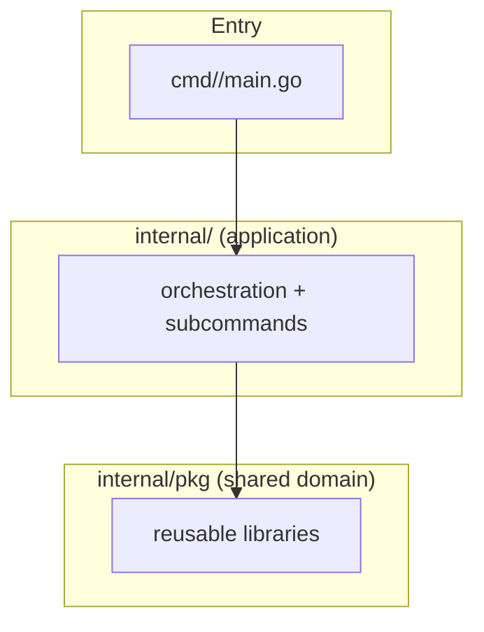

# AiT Project Structure

This document is the structure overview for the AiT repository: what lives where, why the layering exists, and how to extend it safely. It does **not** document tool-specific implementation details.

---

## 1. What is AiT

AiT is a Go CLI toolbox.  
Go module path: `github.com/os-artificer/AiT`.

Shipped tools:

- `aitssh`: SSH client with session persistence, optional experimental AI mode (off by default), transfer support, and shell/meta workflows.
- `aitimg`: Image metadata extractor (EXIF device/time/GPS + Nominatim reverse-geocoded address).

Shared capabilities (not separate binaries) live under `internal/pkg/` and are consumed by tools. AI REPL/agent UX is `internal/pkg/aimode` (engine: `internal/pkg/ai`); tools gate experimental AI via config/env/CLI before calling it.

---

## 2. Documentation map

| Document | Purpose |
| -------- | ------- |
| [architecture.md](architecture.md) | Toolbox structure and generic layering rules (this page) |
| [tools/aitssh.md](tools/aitssh.md) | `aitssh` user guide (CLI, prompts, behavior) |
| [tools/aitssh-internals.md](tools/aitssh-internals.md) | `aitssh` implementation (package layering, workflows, source map) |
| [tools/aitimg.md](tools/aitimg.md) | `aitimg` user guide |
| [tools/aitimg-internals.md](tools/aitimg-internals.md) | `aitimg` implementation (package layering) |
| [AGENTS.md](../AGENTS.md) | Agent-oriented build/test/layout orientation |
| [CONTRIBUTING.md](../CONTRIBUTING.md) | Contributor workflow and coding standards |
| [change-acceptance.mdc](../.cursor/rules/change-acceptance.mdc) | Merge gates and regression acceptance checklist |

---

## 3. Tools catalog

| Tool     | Status  | Entry binary | App package       | User guide                         | Internals                                              |
| -------- | ------- | ------------ | ----------------- | ---------------------------------- | ------------------------------------------------------ |
| `aitssh` | Shipped | `bin/aitssh` | `internal/aissh`  | [tools/aitssh.md](tools/aitssh.md) | [tools/aitssh-internals.md](tools/aitssh-internals.md) |
| `aitimg` | Shipped | `bin/aitimg` | `internal/aitimg` | [tools/aitimg.md](tools/aitimg.md) | [tools/aitimg-internals.md](tools/aitimg-internals.md) |

AiT is intentionally toolbox-first: each tool gets a thin `cmd/<tool>/main.go` entry, an app layer under `internal/<tool>/`, and shared primitives in `internal/pkg/*`.  
The toolbox currently ships `aitssh` and `aitimg`.

---

## 4. Repository layout

| Path              | Role                                                                 |
| ----------------- | -------------------------------------------------------------------- |
| `cmd/`            | Binary entrypoints; each tool has a minimal `main`                   |
| `internal/<app>/` | Application layer for one toolbox tool (orchestration + subcommands) |
| `internal/pkg/`   | Shared module-private libraries reused by app packages               |
| `pkg/`            | Public importable packages for external consumers                    |
| `configs/`        | Example configuration files                                          |
| `docs/`           | Architecture, tool docs, and project docs                            |
| `docs/tools/`     | Per-tool user guides and internals documents                         |

Practical split:

- `cmd` should stay tiny.
- `internal/<app>` owns that tool's user-facing behavior and command composition.
- `internal/pkg` owns reusable implementation details that are not tied to one subcommand package.
- `pkg` is for external reuse and should remain product-agnostic.

---

## 5. Toolbox layer diagram

Tool-specific layer diagrams and module names live in each tool's internals document (for `aitssh`, see [tools/aitssh-internals.md](tools/aitssh-internals.md)).

---

## 6. Layer rules

| Layer         | Paths                                      | Allowed imports                                              |
| ------------- | ------------------------------------------ | ------------------------------------------------------------ |
| Entry         | `cmd/<tool>`                               | Tool app package only                                        |
| Application   | `internal/<app>/`, `internal/<app>/<cmd>/` | `internal/pkg/*`, never the reverse direction                |
| Shared domain | `internal/pkg/*`                           | Other `internal/pkg/*`; must not import any `internal/<app>` |
| Public libs   | `pkg/*`                                    | Generic dependencies; avoid AiT product coupling             |

Hard constraints:

- Import direction flows downward (`cmd` → `internal/<app>` → `internal/pkg`).
- `internal/pkg` is never allowed to depend on application packages under `internal/<app>`.
- New top-level behavior should not require editing unrelated command packages.

---

## 7. Cross-cutting concerns

- **Keyring first:** SSH/API secrets should remain outside SQLite rows whenever possible.
- **Errhint formatting:** user-facing recoverable errors should use multi-line `errhint` style with stable `Try:` guidance.
- **Cross-platform gate:** run `make test-cross` for any change that can affect OS behavior (TTY, pathing, exec, platform tools).

---

## 8. Package layering (toolbox principles)

At the toolbox level:

1. Each tool documents its own package layering in `docs/tools/<tool>-internals.md`.
2. Application packages compose subcommands; shared logic belongs in `internal/pkg`.
3. `internal/pkg` must not import application packages.

For `aitssh` call chains, registry rules, entry surfaces, and the contributor checklist, see [tools/aitssh-internals.md#package-layering](tools/aitssh-internals.md#package-layering). Cursor rule summary: [package-layering.mdc](../.cursor/rules/package-layering.mdc).

---

## 9. Adding a new tool

For a future toolbox tool `<tool>`:

1. Add `cmd/<tool>/main.go` with minimal delegation.
2. Add `internal/<tool>/` as the application layer for that tool.
3. Add `docs/tools/<tool>.md` (user guide) and `docs/tools/<tool>-internals.md` (implementation reference).
4. Reuse `internal/pkg/*` only for genuinely shared logic.
5. Keep cross-tool boundaries explicit to avoid coupling.

---

## 10. Related documents

| Document | Focus |
| -------- | ----- |
| [tools/aitssh.md](tools/aitssh.md) | `aitssh` operator-facing CLI guide |
| [tools/aitssh-internals.md](tools/aitssh-internals.md) | `aitssh` code layout and workflows |
| [tools/aitimg.md](tools/aitimg.md) | `aitimg` operator-facing CLI guide |
| [tools/aitimg-internals.md](tools/aitimg-internals.md) | `aitimg` code layout |
| [AGENTS.md](../AGENTS.md) | Agent entry point and codebase orientation |
| [CONTRIBUTING.md](../CONTRIBUTING.md) | Contributor process and standards |
| [change-acceptance.mdc](../.cursor/rules/change-acceptance.mdc) | Acceptance and regression checklist |
| [go.mod](../go.mod) | Dependency and module version source |

