# aissh 实现说明

> 二进制 `aitssh`，插件 `ssh`，Go 包名 `aissh`。
>
> 代码布局、包规则与实现工作流。

## 目录

- [概述](#概述)
- [分层图](#分层图)
- [调用链与 argv 路由](#调用链与-argv-路由)
- [技术栈](#技术栈)
- [包分层](#包分层)
- [运行时 AppRoot 布局](#运行时-approot-布局)
- [工作流](#工作流)
- [数据模型（SQLite）](#数据模型sqlite)
- [包布局](#包布局)
- [模块交互矩阵](#模块交互矩阵)
- [从哪里开始读](#从哪里开始读)
- [相关文档](#相关文档)

---

## 概述

`aitssh`（包 `aissh`）实现参考：代码位置、argv 路由、包边界与端到端工作流。

| 文档 | 说明 |
|------|------|
| [`overview.md`](overview.md) | 工具箱结构 |
| [`../guide/aissh.md`](../guide/aissh.md) | CLI |
| [`../../AGENTS.md`](../../AGENTS.md) | 构建 / 测试 / 布局 |
| [`.cursor/rules/package-layering.mdc`](../../.cursor/rules/package-layering.mdc) | 分层规则摘要（与 [包分层](#包分层) 同步） |

---

## 分层图

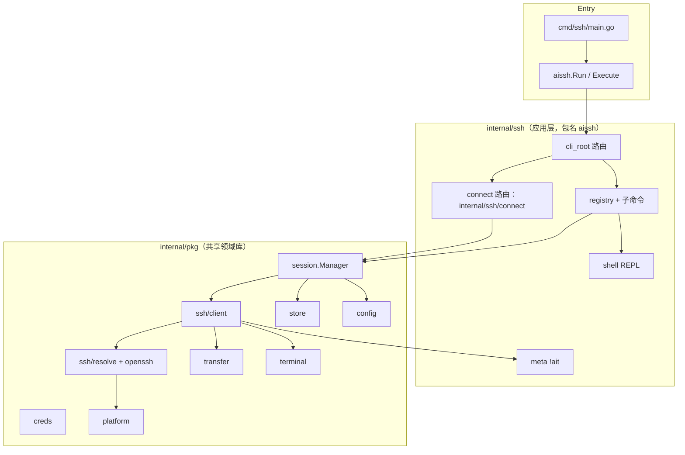

Agent Loop 与管理 CLI 位于 **`ait`**（`internal/ait/agent`）；见 [`ait.md`](ait.md)。`aitssh` 不导入 `agentcore` 或 `internal/ait/agent`。

---

## 调用链与 argv 路由

顶层 argv 流：

```text
cmd/ssh/main.go      -> 极简 main；委托 aissh.Run
internal/ssh            -> 包 aissh：Run、Execute、NewManager、根接线
internal/ssh/<cmd>    -> 每个顶层命令一个包（闭环）
internal/pkg/*          -> 模块私有共享库
pkg/*                   -> 仅供外部导入的库
```

路由表面：

| 输入 | 处理方 | 说明 |
|------|--------|------|
| 无参 `aitssh` | 经 `ExecuteWriters` 输出根帮助 | 不是隐式 SSH 连接 |
| `aitssh [flags] destination` | `internal/ssh/connect` 连接路由 | 不是已注册的 Cobra 子命令 |
| `aitssh <registered-cmd> …` | 经 `registry` 的 Cobra 树 | 子命令在 `init()` 中注册 |
| `aitssh shell` REPL 行 | `shell` 分发链 | 内置 → `AppRoot/bin` → Cobra → PATH → 连接路由 |

目录/包说明：

- 应用根位于 `internal/ssh/`，Go 包名为 `aissh`。
- 已注册命令包应与 Cobra 命令名一致（`shell`、`session`、`config` 等）。
- `internal/ssh/connect/` 是 SSH 连接路由包（不是已注册的 Cobra 顶层命令）。
- **没有** `internal/ssh/ai`；AI 管理位于 `internal/ait/agent`（以 `ait agent …` 调用）。

关键文件：[`../../internal/ssh/cli_root.go`](../../internal/ssh/cli_root.go)、[`../../internal/ssh/root.go`](../../internal/ssh/root.go)、[`../../internal/pkg/cliroute/route.go`](../../internal/pkg/cliroute/route.go)。

---

## 技术栈

版本与升级的单一事实来源：[`go.mod`](../../go.mod)。

| 主题 | 选择 | 原因 |
|------|------|------|
| CLI 框架 | `spf13/cobra` | 可预期的命令树与帮助集成 |
| SQLite 驱动 | `modernc.org/sqlite` | 纯 Go（无 CGO），便于跨平台构建 |
| SSH 栈 | `golang.org/x/crypto/ssh` | Go 标准 SSH 实现 |
| 本机 PTY | `creack/pty`（`localmode` / `!ait local`） | 本机交互 shell；远程会话用 SSH PTY |
| 密钥存储 | OS keyring + 回退 keyring 目录 | 避免在 SQLite 中存明文凭据 |
| Host key 策略 | 默认 `known_hosts` | 对齐 OpenSSH 信任模型 |

---

<a id="package-layering"></a>
## 包分层

本节定义 `aissh` 代码归属，以及如何在不破坏依赖方向的前提下开放扩展点。

### 调用链（摘要）

见上文 [调用链与 argv 路由](#调用链与-argv-路由)。

### 子命令闭环

每个已注册顶层子命令应在 `internal/ssh/<cmd>/` 下自包含。

| 关注点 | 典型文件 |
|--------|----------|
| 命令名常量 | `name.go` 或 `cmd.go` |
| 旗标 | `flags.go` |
| 解析 | `parse.go` |
| Cobra 接线 | `cmd.go` |
| 帮助正文 | `help.go` |
| 运行时执行 | `run.go` |
| 注册 | `register.go` |

不要在 `internal/pkg` 下为命令常量创建仅含名字的辅助包。

`session` 命令包的实际文件为 `cmd.go`、`action.go`、`help.go`、`register.go`（无独立的 `flags.go` / `run.go`）。

### `internal/ssh` 职责

`internal/ssh` 负责应用组合：

- 根命令创建与执行入口
- manager 引导（`NewManager`）
- registry 挂接（`AttachRoot`）
- shell/meta 集成的 init hooks
- 顶层路由决策（默认 SSH 连接 vs Cobra 命令树）

### `internal/pkg` 职责

`internal/pkg/*` 存放跨命令包复用的逻辑：

- 存储（`store`）、生命周期管理（`session`）、传输（`ssh/client`）
- 配置、凭据、终端、文件传输
- 不属于单一命令包的共享解析/机制

导入规则：

- `internal/pkg` 不得导入 `internal/ssh`。

### `pkg` 职责

`pkg/*` 供外部导入，保持通用。产品行为留在 `internal/*`。

### `helpdoc` 拆分

- 共享帮助构建位于 `internal/pkg/helpdoc`（代表性文件：`common.go`、`bind.go`）。
- 命令专属帮助文案/旗标留在各命令包的 `help.go`。
- 根与嵌套帮助列表应来自 registry/subregistry 条目集合。

### 包命名规则

- 包名与命令名一致（`shell`、`session`、`config`）。
- 例外：目录 `internal/ssh`，包名 `aissh`。
- 例外：`internal/ssh/connect` 为默认 SSH 路由。
- 避免 `*cmd` 包后缀。
- Agent Loop UX 位于 `internal/pkg/agentcore`（共享）；Ops AI 适配器是 `internal/ait/agent`，**不**在 `aissh` 下。交互 Loop 入口为无参 `ait` 或 `ait agent`。

### 嵌套子命令

嵌套命令树遵循同一闭环模式：

- `aitssh config` → `set`、`get`、`init`、`view`、`edit`、`validate`

子命令经父级 subregistry 包注册，不要手写追加冗长的 `AddCommand` 列表。

### 共享抽取指南

仅在行为确实跨命令时抽到共享包：

- OpenSSH argv 机制（`internal/pkg/ssh/openssh`）
- `ssh -G` 解析（`internal/pkg/ssh/resolve`）
- `get` 与 `put` 共用的传输解析
- 通用终端/错误/帮助原语

命令专属旗标与语义留在所属命令包内。

### 命令入口表面

`aitssh` 有三种不同入口表面：

| 表面 | 机制 | 扩展点 |
|------|------|--------|
| Cobra 命令树 | `registry` 与嵌套 `subregistry` | 增加命令包 + 注册 + blank import |
| Shell 内置（`aitssh shell`） | shell builtin registry | 增加 builtin 常量 + 处理函数 |
| SSH meta（`!ait`） | meta 执行器 | 在相关执行器中增加 meta 动词处理 |

特例：

- Agent 管理（`ait agent model list`、`ait agent connect`；Loop 经无参 `ait`）由 `internal/ait/agent` 拥有，见 [`ait.md`](ait.md)。

### `clihints` 作为共享 Try 行来源

可复用提示的 Try 行示例应集中在 `internal/pkg/clihints`，避免命令包与共享包漂移。

### 扩展命令（开闭原则）

增加顶层命令时：

1. 创建带闭环文件与 `register.go` 的 `internal/ssh/<cmd>/`。
2. 在 `init()` 中经 `registry.Register` 注册。
3. 在 registry 导入聚合器中接线 blank import。
4. 避免改动无关命令包。

嵌套命令在父命令树下遵循同一模式。

### 包分层检查清单

- [ ] 新建/更新的命令包自包含（`flags`、`parse`、`help`、`run`、`register`；`session` 以实际文件为准）
- [ ] 注册使用 registry/subregistry，而不是临时改根命令
- [ ] `internal/pkg` 只含共享逻辑，且不导入 `internal/ssh`
- [ ] `cmd/ssh/main.go` 保持极简
- [ ] 帮助内容拆分仍为 `helpdoc` 共享 + 每命令 `help.go`
- [ ] `clihints` Try 行保持单一事实来源
- [ ] 行为/回归门禁与 [`change-acceptance.mdc`](../../.cursor/rules/change-acceptance.mdc) 对齐

---

## 运行时 AppRoot 布局

全部运行时文件位于 `AppRoot`（`platform.AppRoot()`）。覆盖顺序：优先非空 `AIT_HOME`；否则非空 `AIT_DATA_DIR`；空字符串忽略，回退 OS 默认。

```text
<AppRoot>/
├── config.yaml       # YAML 配置
├── ait.db            # SQLite 数据存储
├── repl_history      # aitssh shell 输入历史（0600）
├── ait_repl_history  # ait shell 输入历史（与上不同文件）
├── scrollback/       # 会话 scrollback 侧车
├── keyring/          # 文件 keyring 回退
└── bin/              # 用户 shell 扩展
```

可选：`ai.providers.ollama.models_dir`（例如 `<AppRoot>/ollama/models`）；未配置不要求该目录存在。

默认路径：

- Linux：`~/.local/share/ait`
- macOS：`~/Library/Application Support/ait`
- Windows：`%LOCALAPPDATA%\ait`

配置说明：`aitssh config init` 补齐缺失的 `session.*`。文件尚不存在时，`ensureScopedDefaults` 在 Save 前仍调用 `normalizeAI`，因此写出的 YAML 可能含有默认 `ai:` 段。CLI 的 `set`/`get` 拒绝 `ai.*` 键；语义 AI 校验使用 `ait agent config validate`。

---

## 工作流

本节记录生产使用中最常见的端到端行为。

### 1）SSH 连接序列

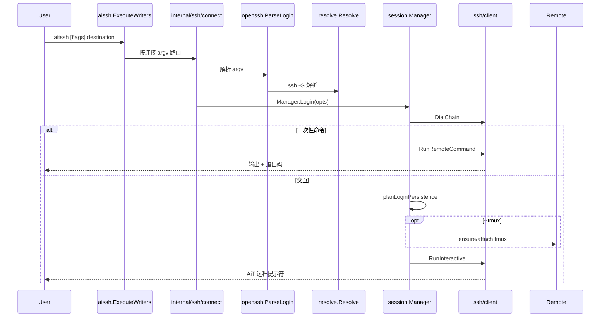

### 2）连接持久化流

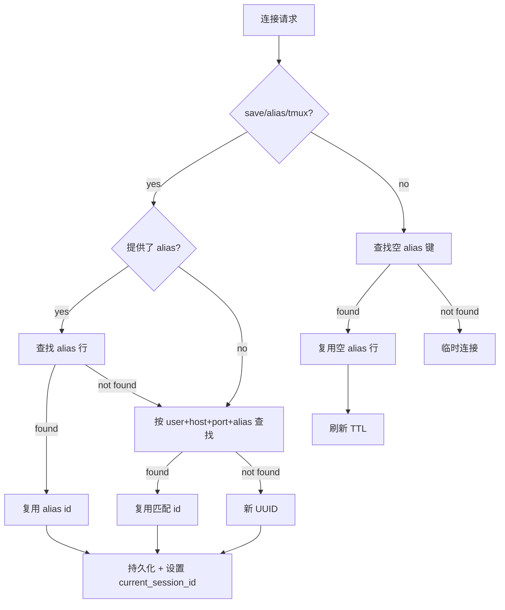

### 3）Shell REPL 分发（文字 + 流程）

`aitssh shell` 中的分发顺序：

1. 内置命令
2. `<AppRoot>/bin/<name>`
3. `aitssh` CLI 子命令
4. 系统 PATH 回退
5. 窄范围 SSH 连接路由
6. not-found 提示

`login` 从不会被当作连接路由首词。

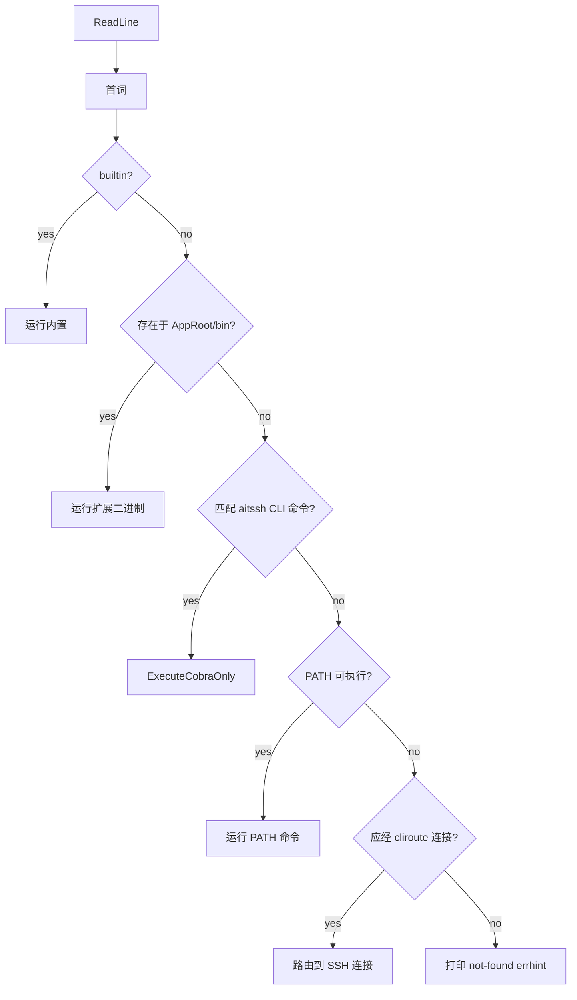

### 4）会话生命周期、TTL 与切换

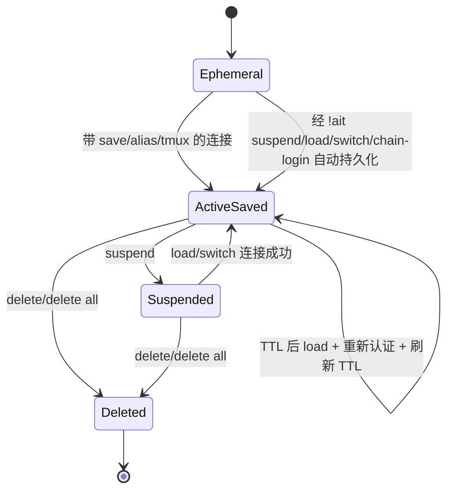

切换行为：

- 本机独立 `session --switch` 在当前会话为 active 时阻断，除非 `--force`
- 会话内 `!ait session --switch` 会在切换前自动持久化/挂起当前会话
- 无目标的 switch/load 使用交互选择器

### 5）本机模式流（`!ait local` / `!ait remote`）

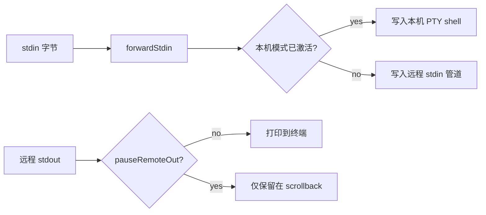

说明：

- 本机模式期间 SSH 隧道仍保持活动
- 提示符变为 `AiT Local>`
- 本机模式激活时，远程输出暂停显示

### 6）会话内 meta 协议（`!ait`）

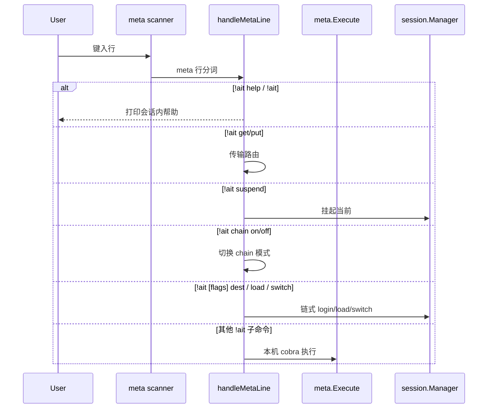

说明：

- `!!` 行不视为 AI meta；见 OA21（适用时 `!!` 转发到 PTY）。

### 7）get/put 传输工作流

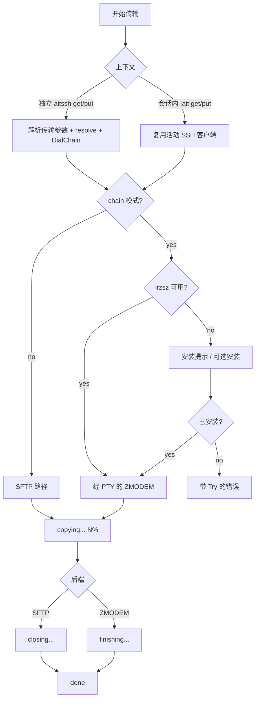

### 8）远程提示符管道

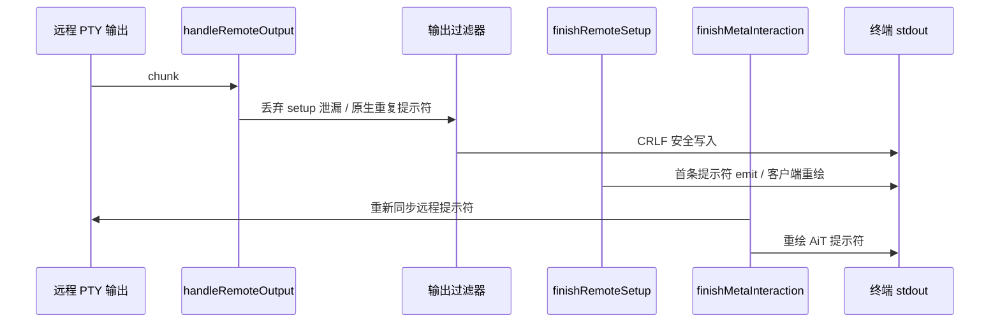

关键行为：

- setup 输出过滤防止 PS1 注入泄漏
- 首条提示符无需再按 Enter 即可显示
- meta 结束后的重绘路径在 AiT 托管提示符时不会回退到原生 shell 提示符

### 9）tmux 保活流（`--tmux`）

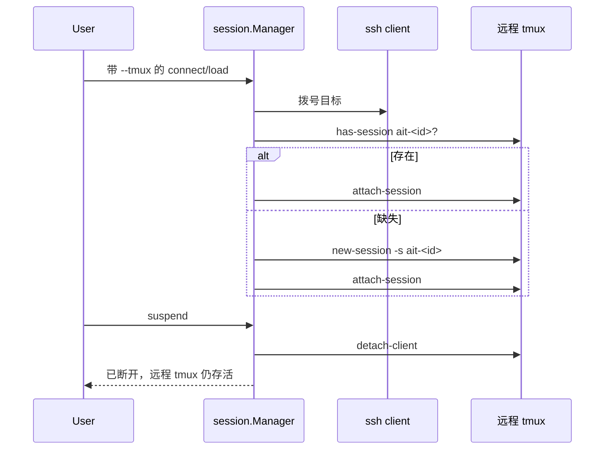

### 10）代理链模式工作流

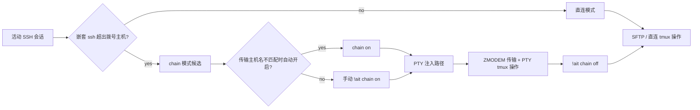

---

## 数据模型（SQLite）

数据库文件：`<AppRoot>/ait.db`。

```sql
CREATE TABLE sessions (
  id                TEXT PRIMARY KEY,
  alias             TEXT UNIQUE,
  host              TEXT NOT NULL,
  port              INTEGER NOT NULL DEFAULT 22,
  username          TEXT NOT NULL,
  identity_path     TEXT,
  auth_method       TEXT NOT NULL,       -- key | password | agent
  auth_expires_at   INTEGER NOT NULL,    -- unix 秒
  tmux_enabled      INTEGER NOT NULL DEFAULT 0,
  tmux_session      TEXT,
  login_destination TEXT,
  proxy_jump        TEXT,
  proxy_command     TEXT,
  created_at        INTEGER NOT NULL,
  updated_at        INTEGER NOT NULL,
  status            TEXT NOT NULL        -- active | suspended
);

CREATE UNIQUE INDEX IF NOT EXISTS idx_sessions_conn_key
  ON sessions(username, host, port, COALESCE(alias, ''));

CREATE TABLE session_state (
  session_id      TEXT PRIMARY KEY REFERENCES sessions(id) ON DELETE CASCADE,
  cols            INTEGER,
  rows            INTEGER,
  remote_cwd      TEXT,
  scrollback_path TEXT,
  suspended_at    INTEGER
);

CREATE TABLE app_meta (
  key   TEXT PRIMARY KEY,
  value TEXT NOT NULL
);
```

核心字段含义：

- `login_destination`：`sessions.login_destination`，重连时用于重新解析的原始 destination 形式
- `auth_expires_at`：免凭据重连窗口截止时间
- `tmux_enabled` + `tmux_session`：远程保活配置
- `status`：`active` / `suspended`
- `app_meta.current_session_id`：当前前台活动会话
- `idx_sessions_conn_key`：连接四元组唯一索引 `(username, host, port, COALESCE(alias, ''))`

---

## 包布局

| 路径 | 职责 | 代表性文件 |
|------|------|------------|
| [`../../internal/ssh/`](../../internal/ssh/) | CLI 入口与根路由 | `root.go`、`cli_root.go`、`manager.go`、`init_hooks.go` |
| [`../../internal/ssh/registry/`](../../internal/ssh/registry/) | 顶层命令注册表 | `registry.go`、`root_help.go`、`all/imports.go` |
| [`../../internal/pkg/helpdoc/`](../../internal/pkg/helpdoc/) | 共享 CLI 帮助版式 | `common.go`、`bind.go` |
| [`../../internal/ssh/connect/`](../../internal/ssh/connect/) | 默认连接路由适配器 | `run.go`、`help.go` |
| [`../../internal/ssh/shell/`](../../internal/ssh/shell/) | `aitssh shell` REPL 与分发 | `repl.go`、`exec.go`、`exec_dispatch.go` |
| [`../../internal/ssh/session/`](../../internal/ssh/session/) | session 命令表面 | `cmd.go`、`action.go`、`help.go`、`register.go` |
| [`../../internal/ssh/meta/`](../../internal/ssh/meta/) | 会话内本机 CLI 执行 | `exec.go` |
| [`../../internal/pkg/session/`](../../internal/pkg/session/) | connect/load/switch/suspend 编排 | `manager.go`、`manager_login.go`、`manager_helpers.go` |
| [`../../internal/pkg/store/`](../../internal/pkg/store/) | SQLite 存储与迁移 | `store.go`、`store_sessions.go`、`store_meta.go`、`open_helpers.go` |
| [`../../internal/pkg/ssh/openssh/`](../../internal/pkg/ssh/openssh/) | SSH argv 解析（`ParseLogin`） | `login_parse.go`、`transfer_parse.go`、`flags.go` |
| [`../../internal/pkg/ssh/resolve/`](../../internal/pkg/ssh/resolve/) | `ssh -G` 解析与 ProxyJump hop 展开 | `resolve.go`、`jump_expand.go` |
| [`../../internal/pkg/ssh/client/`](../../internal/pkg/ssh/client/) | 拨号、交互 PTY、meta、提示符、传输、注入 | `client.go`、`client_dial.go`、`dialchain.go`、`nested_prompt.go`、`prompt_mode.go`、`transfer_zmodem.go` |
| [`../../internal/pkg/ssh/client/meta/`](../../internal/pkg/ssh/client/meta/) | 字节级 meta 扫描器 | `scanner.go` |
| [`../../internal/pkg/ssh/client/localmode/`](../../internal/pkg/ssh/client/localmode/) | SSH 会话内本机 shell | `shell.go` |
| [`../../internal/pkg/ssh/client/prompt/`](../../internal/pkg/ssh/client/prompt/) | 提示符格式与 setup 脚本 | `prompt.go` |
| [`../../internal/pkg/terminal/`](../../internal/pkg/terminal/) | 行编辑、历史、CRLF、屏幕辅助 | `lineedit`、`history`、`crlf`、`screen`、`scrollback` |
| [`../../internal/pkg/tmux/`](../../internal/pkg/tmux/) | 远程 tmux 操作 | `remote.go`、`remote_pty.go` |
| [`../../internal/pkg/transfer/`](../../internal/pkg/transfer/) | 独立 SFTP 传输 | `transfer.go`、`parse.go`、`path_defaults.go` |
| [`../../internal/pkg/transfer/route/`](../../internal/pkg/transfer/route/) | 会话内传输后端路由 | route helpers |
| [`../../internal/pkg/transfer/zmodem/`](../../internal/pkg/transfer/zmodem/) | zmodem 协议引擎 | receive/send/session 文件 |
| [`../../internal/pkg/lrzsz/`](../../internal/pkg/lrzsz/) | 远程 lrzsz 探测/安装辅助 | probe/install 文件 |
| [`../../internal/pkg/config/`](../../internal/pkg/config/) | 配置 load/save/validate/init（含工具箱 AI 实验门禁 SSOT） | `config.go`、`ai_experimental.go`、`config_validate.go` |
| [`../../internal/pkg/platform/`](../../internal/pkg/platform/) | AppRoot 路径、编辑器与 OpenSSH 辅助 | `paths_appdir.go`、`editor.go`、`openssh.go` |
| [`../../internal/pkg/creds/`](../../internal/pkg/creds/) | keyring 抽象 | `keyring.go` |
| [`../../configs/ait.example.yaml`](../../configs/ait.example.yaml) | 示例配置模板 | YAML 样例 |

---

## 模块交互矩阵

| 调用方 | 被调用方 | 原因 |
|--------|----------|------|
| `internal/ssh/connect` | `internal/pkg/session` | 连接路由委托编排 |
| `internal/pkg/session` | `internal/pkg/ssh/openssh` | 解析 OpenSSH 兼容 argv（`ParseLogin`） |
| `internal/pkg/session` | `internal/pkg/ssh/resolve` | `ssh -G` 解析与 jump 展开 |
| `internal/pkg/session` | `internal/pkg/store` | 持久化会话生命周期状态 |
| `internal/pkg/session` | `internal/pkg/ssh/client` | 拨号与交互执行 |
| `internal/pkg/ssh/client` | `internal/ssh/meta` | 会话内本机 CLI 执行（回调） |
| `internal/ssh/shell` | `internal/ssh` 根 / cobra runner | 分发到本机 CLI 子命令 |
| `internal/pkg/ssh/client` | `internal/pkg/transfer` / transfer route | 传输路径选择与执行 |
| `internal/pkg/ssh/client` | `internal/pkg/tmux` | 保活 tmux 集成 |

---

## 从哪里开始读

| 任务 | 从这里开始 |
|------|------------|
| 增加顶层命令 | `../../internal/ssh/<cmd>/register.go` 与 `../../internal/ssh/registry/all/imports.go` |
| 改连接旗标行为 | `../../internal/pkg/ssh/openssh/login_parse.go` 与 `../../internal/ssh/connect/help.go` |
| 调整持久化逻辑 | `../../internal/pkg/session/manager_login_persist_helpers.go` |
| 理解交互 SSH 循环 | `../../internal/pkg/ssh/client/client.go`（`RunInteractive`） |
| 追踪会话内 meta 处理 | `../../internal/pkg/ssh/client/client_interactive_helpers.go` |
| 修改 shell 分发优先级 | `../../internal/ssh/shell/exec_dispatch.go` |
| 调整根 argv 路由 | `../../internal/ssh/cli_root.go` 与 `../../internal/pkg/cliroute/route.go` |
| Agent / agentcore | [`ait.md`](ait.md)；`../../internal/ait/agent/`；`../../internal/pkg/agentcore/` |
| AI 实验配置（遗留 SSOT） | `../../internal/pkg/config/ai_experimental.go`（可选；Agent 默认经 `ait` 开启） |
| 理解传输后端决策 | `../../internal/pkg/ssh/client/transfer_route.go` |
| 理解提示符 setup 与重绘 | `../../internal/pkg/ssh/client/client_init_helpers.go` 与 prompt helpers |

---

## 相关文档

| 文档 | 说明 |
|------|------|
| [`overview.md`](overview.md) | AiT 工具箱项目结构 |
| [`../guide/aissh.md`](../guide/aissh.md) | CLI |
| [`../guide/ait.md`](../guide/ait.md) / [`ait.md`](ait.md) | Agent Loop 与 `ait agent` |
| [`../../AGENTS.md`](../../AGENTS.md) | 代码库导向与包职责 |
| [`../../CONTRIBUTING.md`](../../CONTRIBUTING.md) | 开发流程与编码规范 |
| [`../../README.md`](../../README.md) | 项目概览与安装 |
| [`../../go.mod`](../../go.mod) | 依赖与模块版本来源 |
