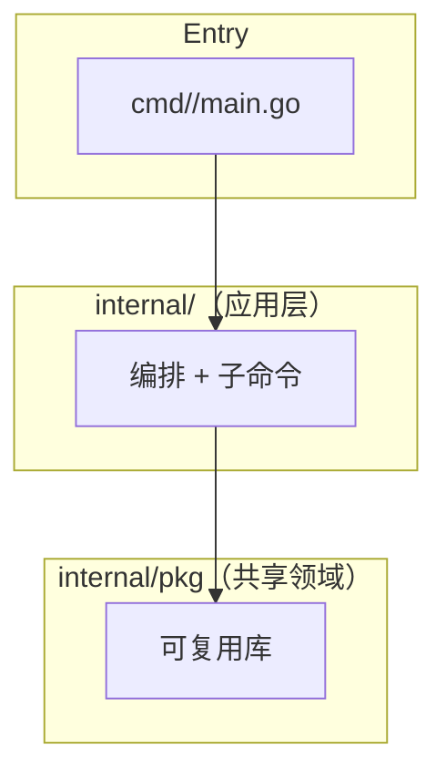

# AiT 项目结构

仓库布局与分层。各工具细节见同目录对应文档。

---

## 1. AiT 是什么

Go 命令行工具箱，模块路径 `github.com/os-artificer/AiT`。

已发布工具（二进制 / 插件；文档里常用 aissh 等产品标题）：

- `ait`：Agent 入口。无参 `ait` / `ait agent` 进 Loop；`ait shell` 为工具箱 REPL；顶层分发插件（`ait ssh`、`ait log`、`ait img`、`ait host`、`ait keep`）。
- `aitssh`（`ssh`）：SSH 客户端，会话持久化、传输、shell / meta（无 AI 子树）；包名 `aissh`。
- `aitimg`（`img`）：图像 EXIF / GPS / Nominatim 逆地理。
- `aitlog`（`log`）：系统日志查看与搜索（Linux / macOS / Windows），优先系统工具，有内置回退。
- `aithost`（`host`）：CPU / 内存 / 磁盘 / 网络 / 协议 / 进程监视（Bubble Tea）。
- `aitkeep`（`keep`）：进程监管；`GET /ping`；CPU / 内存 / 磁盘限制。

共享库在 `internal/pkg/`。Agent Loop 内核：`agentcore`（引擎 `ai`；运维 `agentops` + `tooldispatch`；接线 `agentwire`；界面 `agentui`）。管理 CLI 与 connect：`internal/ait/agent`；路由：`internal/ait/router`。

---

## 2. 文档索引

| 文档 | 用途 |
|------|------|
| [overview.md](overview.md) | 工具箱结构与分层（本文） |
| [../guide/ait.md](../guide/ait.md) | `ait` CLI |
| [ait.md](ait.md) | `ait` 实现 |
| [../guide/aissh.md](../guide/aissh.md) | `aissh` CLI |
| [aissh.md](aissh.md) | `aissh` 实现 |
| [../guide/aiimg.md](../guide/aiimg.md) | `aiimg` CLI |
| [aiimg.md](aiimg.md) | `aiimg` 实现 |
| [../guide/ailog.md](../guide/ailog.md) | `ailog` CLI |
| [ailog.md](ailog.md) | `ailog` 实现 |
| [../guide/aihost.md](../guide/aihost.md) | `aihost` CLI |
| [aihost.md](aihost.md) | `aihost` 实现 |
| [../guide/aitkeep.md](../guide/aitkeep.md) | `aitkeep` CLI |
| [aitkeep.md](aitkeep.md) | `aitkeep` 实现 |
| [AGENTS.md](../../AGENTS.md) | Agent 构建 / 测试 / 布局 |
| [CONTRIBUTING.md](../../CONTRIBUTING.md) | 贡献流程 |
| [change-acceptance.mdc](../../.cursor/rules/change-acceptance.mdc) | 合并门禁与回归 |
| [testenv-mock.md](testenv-mock.md) | 回环 SSH + HTTP mock |

---

## 3. 工具一览

| 工具 | 状态 | 入口二进制 | 插件 | 应用包 | CLI | 实现 |
|------|------|------------|------|--------|-----|------|
| `ait` | 已发布 | `bin/ait` | — | `internal/ait`（含 `agent`） | [../guide/ait.md](../guide/ait.md) | [ait.md](ait.md) |
| `aissh` | 已发布 | `bin/aitssh` | `ssh` | `internal/ssh`（包 `aissh`） | [../guide/aissh.md](../guide/aissh.md) | [aissh.md](aissh.md) |
| `aiimg` | 已发布 | `bin/aitimg` | `img` | `internal/img` | [../guide/aiimg.md](../guide/aiimg.md) | [aiimg.md](aiimg.md) |
| `ailog` | 已发布 | `bin/aitlog` | `log` | `internal/log` | [../guide/ailog.md](../guide/ailog.md) | [ailog.md](ailog.md) |
| `aihost` | 已发布 | `bin/aithost` | `host` | `internal/host` | [../guide/aihost.md](../guide/aihost.md) | [aihost.md](aihost.md) |
| `aitkeep` | 已发布 | `bin/aitkeep` | `keep` | `internal/pkg/keepalive` | [../guide/aitkeep.md](../guide/aitkeep.md) | [aitkeep.md](aitkeep.md) |

薄 `cmd/<dir>/main.go` → `internal/<app>/`（aitkeep 在 `keepalive`）→ `internal/pkg/*`。Agent 管理在 `internal/ait/agent`。发布二进制：`ait`、`aitssh`、`aitimg`、`aitlog`、`aithost`、`aitkeep`。`cmd/keep` 只调 `keepalive.Run`。

---

## 4. 仓库布局

| 路径 | 作用 |
|------|------|
| `cmd/` | 薄 `main` |
| `internal/<app>/` | 单工具应用层 |
| `internal/pkg/` | 共享库 |
| `pkg/` | 可对外导入 |
| `mock/` | 回环 mock（SSH / HTTP / Releases） |
| `mock/testssh/` | mock sshd + SFTP |
| `mock/testhttp/` | mock OpenAI / Ollama / Nominatim |
| `mock/testrelease/` | GitHub Releases 夹具 |
| `mock/testenv-mock/` | SSH + HTTP 守护进程 |
| `configs/` | 示例配置 |
| `docs/` | 手册 / 变更 / 架构（[README](../README.md)） |
| `docs/guide/` | 用户手册 |
| `docs/changelog/` | 变更条目 |
| `docs/architecture/` | 架构与实现 |

分工：`cmd` 薄；`internal/<app>` 管该工具 CLI 与编排；`internal/pkg` 可复用、不绑死某子命令包；`pkg` 与产品解耦。

---

## 5. 工具箱分层图

各工具分层见对应实现文档（`aissh`：[aissh.md](aissh.md)）。

---

## 6. 分层规则

| 层 | 路径 | 允许的导入 |
|----|------|------------|
| 入口 | `cmd/<tool>` | 仅该工具应用包 |
| 应用 | `internal/<app>/` | `internal/pkg/*`，不可反向 |
| 共享 | `internal/pkg/*` | 其他 `internal/pkg/*`；不得导入 `internal/<app>` |
| 公共 | `pkg/*` | 通用依赖；避免耦合 AiT 产品 |

- 导入向下：`cmd` → `internal/<app>` → `internal/pkg`。
- `internal/pkg` 不得依赖应用包。
- 新增顶层行为时，不改无关命令包。

---

## 7. 横切关注点

- **密钥：** SSH / API 密钥尽量不进 SQLite 行。
- **errhint：** 可恢复错误用多行 `errhint` + 稳定 `Try:`。
- **跨平台：** 涉及 TTY / 路径 / exec / 平台工具时跑 `make test-cross`。

---

## 8. 包分层（工具箱原则）

1. 每个工具在 `docs/architecture/<tool>.md` 写明分层。
2. 应用包组合子命令；共享逻辑进 `internal/pkg`。
3. `internal/pkg` 不得导入应用包。

`aissh` 细节：[aissh.md#package-layering](aissh.md#package-layering)。Cursor 摘要：[package-layering.mdc](../../.cursor/rules/package-layering.mdc)。

---

## 9. 增加新工具

1. `cmd/<tool>/main.go`：最小委托。
2. 应用层通常为 `internal/<tool>/`。**例外：** `aitkeep` 无独立应用包，CLI 与守护进程共用 `internal/pkg/keepalive`，`cmd/keep` 只调 `keepalive.Run`。
3. `docs/guide/<tool>.md` + `docs/architecture/<tool>.md`。
4. 真正共享的才进 `internal/pkg/*`。
5. 保持跨工具边界。

---

## 10. 相关文档

| 文档 | 重点 |
|------|------|
| [../guide/aissh.md](../guide/aissh.md) | `aissh` CLI |
| [aissh.md](aissh.md) | `aissh` 布局与工作流 |
| [../guide/ait.md](../guide/ait.md) | `ait` CLI |
| [ait.md](ait.md) | `ait` 布局 |
| [../guide/aiimg.md](../guide/aiimg.md) | `aiimg` CLI |
| [aiimg.md](aiimg.md) | `aiimg` 布局 |
| [../guide/ailog.md](../guide/ailog.md) | `ailog` CLI |
| [ailog.md](ailog.md) | `ailog` 布局 |
| [../guide/aihost.md](../guide/aihost.md) | `aihost` CLI |
| [aihost.md](aihost.md) | `aihost` 布局 |
| [../guide/aitkeep.md](../guide/aitkeep.md) | `aitkeep` CLI |
| [aitkeep.md](aitkeep.md) | `aitkeep` 布局 |
| [AGENTS.md](../../AGENTS.md) | 代码库导读 |
| [CONTRIBUTING.md](../../CONTRIBUTING.md) | 贡献流程 |
| [change-acceptance.mdc](../../.cursor/rules/change-acceptance.mdc) | 验收清单 |
| [testenv-mock.md](testenv-mock.md) | CI 回环 mock |
| [go.mod](../../go.mod) | 依赖版本 |
