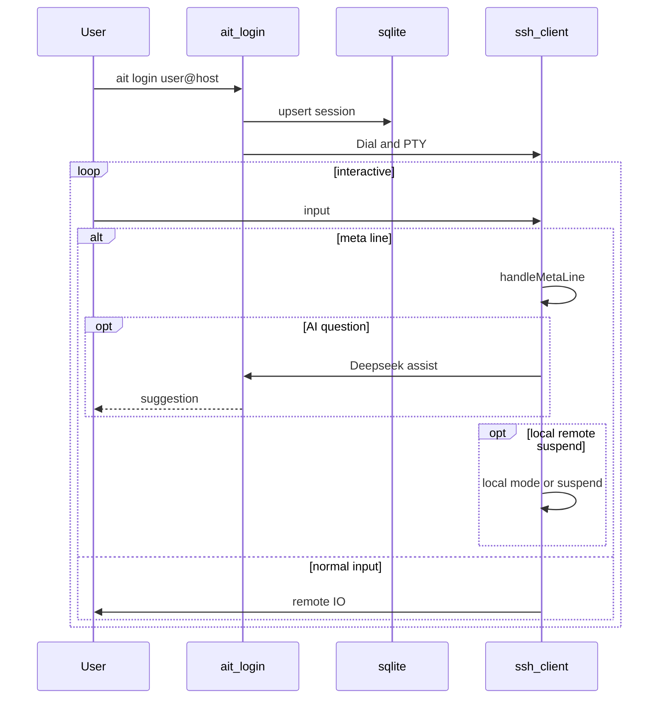
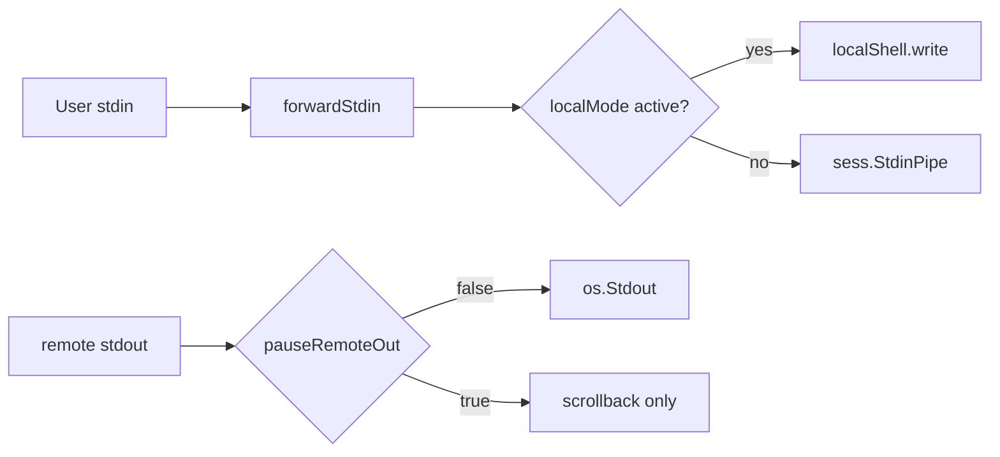
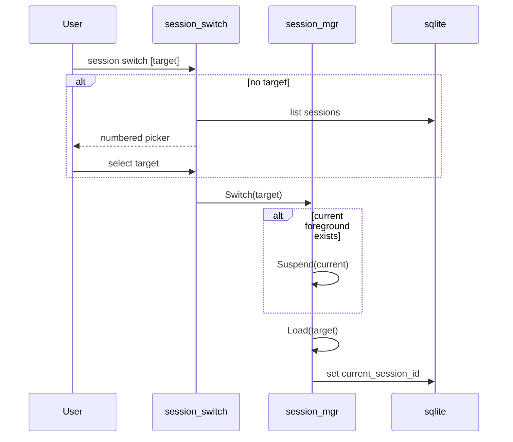
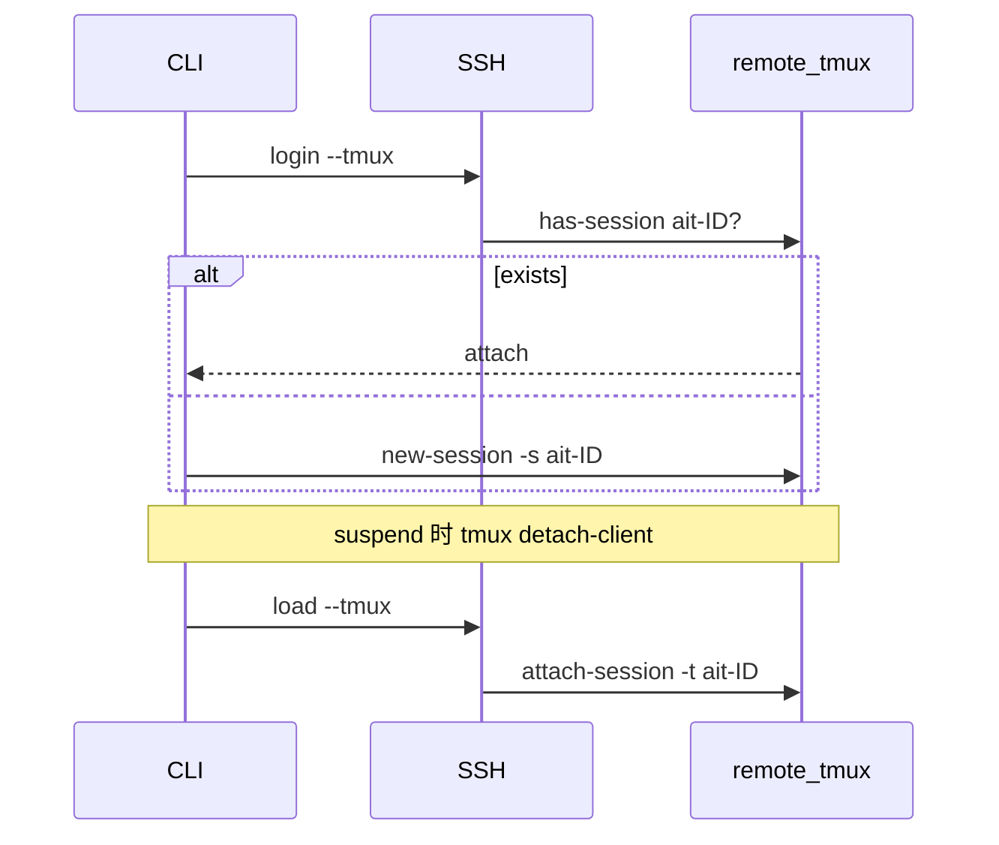

# AiT: Architecture and Behavior

**Languages:** English (this page) · [简体中文](design.zh-CN.md)

This document describes behavior and package layout implemented on the **current main branch** (not a backlog). For users, see [`README.md`](../README.md), [`docs/user-manual.md`](user-manual.md); for agent orientation and code layout, see [`AGENTS.md`](../AGENTS.md).

CLI entry point: [`internal/ait/root.go`](../internal/ait/root.go) (`Run` plus cobra root). Dependencies are listed in [`go.mod`](../go.mod). Layout: thin `cmd/ait` entry → `internal/ait` plus `internal/pkg`.

## CLI surface

```text
ait shell                                    # AiT> REPL (login/list/load, etc.)
ait login [ssh-options] destination [command ...] [--alias NAME] [--password] [--tmux]
        # OpenSSH-compatible: -p -l -i -F -J -o, etc.; destination is [user@]host or a config Host alias
        # Requires local OpenSSH client (ssh -G) for config resolution; data plane is Go x/crypto/ssh (Windows/macOS/Linux)
        # With command: one-shot execution (similar to ssh host cmd); by default does not persist to SQLite
        # Legacy --host/--user remain supported for backward compatibility
ait list
ait load <id|alias> [--tmux]  # Credential-free reconnect within auth TTL; after expiry, prompts for SSH password or key passphrase
ait suspend                   # Suspend interactively; with --tmux, detach remote tmux
ait session switch [id|alias] # Switch to another session; interactive picker when omitted
ait session delete all        # Delete all saved sessions and local sidecars
ait session delete <id|alias> # Delete one session
ait get [ssh-flags] <paths...>   # OpenSSH flags; paths/order like login (see get/put section)
ait put [ssh-flags] <paths...>
ait config set|get ...        # Includes session.auth_ttl (default 168h = 7 days)
```

Inside interactive SSH: invoke Deepseek with **`!ait ai <question>`** (recommended) or **`!! <question>`** (backward-compatible alias); use **`!ait local` / `!ait remote`** to toggle local versus remote input while the SSH session stays connected; use **`!ait suspend`** to suspend. When no API key is configured, leading `!!` / `!ait` lines fail closed locally and do not reach the remote shell. See [In-session meta protocol (!ait / !!)](#in-session-meta-protocol-ait) and [Local mode (!ait local / remote)](#local-mode-ait-local-remote).

### Two recovery modes (default versus `--tmux`)

| Mode | Trigger | `load` behavior | Remote processes |
|------|---------|-----------------|------------------|
| **Default (bookmark)** | No `--tmux` | Reconnect with stored connection info; optionally replay scrollback saved at last suspend | No keep-alive guarantee |
| **tmux keep-alive** | `login`/`load` with `--tmux` | After SSH: `tmux attach -t ait-<session_id>` (or `new -s` if missing) | Shell/process survives disconnect |

**By default only login metadata is persisted** (host/port/user/identity/alias and authentication expiry); scrollback/`remote_cwd` are optional enhancements written on suspend and do **not** constitute a promise of true session keep-alive. Explicit `--tmux` is required for real keep-alive.

## Architecture overview


## Core design decisions

| Topic | Choice | Notes |
|-------|--------|-------|
| CLI framework | [spf13/cobra](https://github.com/spf13/cobra) | Clear subcommands; integrates with `Run(args)` |
| SQLite | [modernc.org/sqlite](https://pkg.go.dev/modernc.org/sqlite) | Pure Go, no CGO; simplifies Windows cross-compilation |
| SSH | `golang.org/x/crypto/ssh` plus `RequestPty` | Standard ecosystem; cross-platform |
| Local PTY | Unix: `github.com/creack/pty`; Windows: ConPTY (`golang.org/x/sys/windows` or a mature wrapper) | Split files `pty_unix.go` / `pty_windows.go` |
| Deepseek | OpenAI-compatible HTTP (`https://api.deepseek.com`) | Lightweight `net/http` or `github.com/sashabaranov/go-openai` with `BaseURL` |
| Secrets / passwords | Private key paths in SQLite; SSH passwords and key passphrases cached in keyring; **auth TTL defaults to 7 days** | After expiry, `load` must prompt again |
| SSH host keys | Default `~/.ssh/known_hosts`; unknown hosts error with `ssh-keyscan` hint | `AIT_SSH_INSECURE=1` for development only |
| System commands | `exec.LookPath` plus `runtime.GOOS` | Missing tools trigger Deepseek install hints |
| Remote keep-alive | Enabled only with `--tmux` | Invokes system `tmux` (must exist on remote; AI suggests install when absent) |

### Session semantics and 7-day authentication TTL

**`login` / `load` and authentication TTL:**

- **Successful `login`**: writes `auth_expires_at = now + session.auth_ttl` (default **168h / 7 days**)
- **`load` / `switch` credential-free reconnect**: within TTL uses keyring cache and **does not refresh** `auth_expires_at`
- **After password re-entry** (`--password` or interactive prompt, and dial succeeds): refreshes `auth_expires_at`
- **Beyond TTL**: `load` / `switch` must prompt for SSH password again; TTL refreshes after successful verification

**Persistence on suspend:**

- **Always**: connection profile plus `auth_expires_at` plus `status`
- **Optional (on suspend)**: local `cols`/`rows`, scrollback sidecar, `remote_cwd` (improves default-mode UX; not tmux keep-alive)
- **Additional with `--tmux`**: `tmux_session_name` (fixed `ait-<session_id>`), `tmux_enabled` flag

**Default `load` (no `--tmux`):**

1. Check TTL → if expired, require password or passphrase
2. SSH reconnect
3. If `session_state` exists: replay scrollback and `cd` to `remote_cwd` when present
4. Enter interactive session

**`load --tmux`:**

1. Same TTL checks as above
2. SSH connection → probe remote `tmux has-session -t ait-<id>` → attach, else `tmux new-session -s ait-<id>`
3. Enter tmux foreground (on suspend, `detach` existing session)

**Limitations:** Without `--tmux`, suspend still tears down SSH and **does not guarantee** remote processes keep running; true session persistence requires `--tmux` with tmux available on the remote host.

### Session switching (`session switch`)

Switch among multiple saved sessions without manually `suspend` then `load`.

| Scenario | Behavior |
|----------|----------|
| No foreground SSH locally | Equivalent to `load <target>` (same TTL/password rules) |
| Foreground SSH exists locally | **Suspend current** first (writes `session_state`, tmux detach) → **load target**; `--force` marks current suspended **without** saving scrollback/cwd |
| Target omitted | `list`-style numbered menu; user selects id/alias (`--tmux` follows current connection mode or target `tmux_enabled` in DB) |

```text
ait session switch              # Interactive picker
ait session switch prod         # Switch by alias/id
ait session switch prod --tmux  # Switch and attach target in tmux mode
```

**Inside interactive SSH:** prefer CLI `ait session switch`; use `!ait suspend` for suspend.

**Compared with `load`:** `load` connects only to the target; `switch` ensures the current session suspends first so scrollback/cwd are not dropped, and updates `app_meta.current_session_id`.

**Tmux mode switching:** detach current session → SSH to target → `tmux attach -t ait-<target_id>`; tmux sessions on different hosts do not interfere.

## Data model (SQLite)

Locations ([`internal/pkg/platform`](../internal/pkg/platform)):

- Linux: `~/.local/share/ait/ait.db`
- macOS: `~/Library/Application Support/ait/ait.db`
- Windows: `%LOCALAPPDATA%\ait\ait.db`

```sql
CREATE TABLE sessions (
  id              TEXT PRIMARY KEY,
  alias           TEXT UNIQUE,
  host            TEXT NOT NULL,
  port            INTEGER NOT NULL DEFAULT 22,
  username        TEXT NOT NULL,
  identity_path   TEXT,
  auth_method     TEXT NOT NULL,  -- key | password | agent
  auth_expires_at INTEGER NOT NULL,  -- Unix 秒；load 免密截止
  tmux_enabled    INTEGER NOT NULL DEFAULT 0,
  tmux_session    TEXT,           -- 默认 ait-<id>
  created_at      INTEGER NOT NULL,
  updated_at      INTEGER NOT NULL,
  status          TEXT NOT NULL   -- active | suspended
);

CREATE TABLE session_state (
  session_id        TEXT PRIMARY KEY REFERENCES sessions(id) ON DELETE CASCADE,
  cols              INTEGER,
  rows              INTEGER,
  remote_cwd        TEXT,
  scrollback_path   TEXT,
  suspended_at      INTEGER
);

CREATE TABLE app_meta (
  key   TEXT PRIMARY KEY,
  value TEXT NOT NULL
);
-- 键 current_session_id：当前/上次前台会话 UUID（switch/load/login 后更新）
```

- Successful `login` → upsert `sessions`, set `auth_expires_at`; if `--tmux`, set `tmux_enabled=1` and initialize remote tmux; write `app_meta.current_session_id`
- `suspend` → write `session_state`, `status=suspended`; in tmux mode `tmux detach` before closing SSH
- `session delete <id>` / `session delete all` → delete DB rows plus scrollback sidecars; tmux mode optional `--kill-tmux` kills remote sessions (`delete all` defaults to not killing remote tmux to avoid accidents; documented)

**Credential storage:** SSH passwords are not stored in plaintext SQLite; within the 7-day window, secrets cache in the **OS keyring** (key `ait/session/<id>/unlock`), expiring entries force re-entry. Private keys remain paths only.

## Package layout (current)

| Path | Role | Representative files |
|------|------|----------------------|
| [`internal/ait/`](../internal/ait/) | CLI entry | `root.go` |
| [`internal/ait/cli/`](../internal/ait/cli/) | Cobra subcommands | `root.go`, `login.go`, `shell.go`, … |
| [`internal/ait/app/`](../internal/ait/app/) | Manager bootstrap | `manager.go`, `context.go` |
| [`internal/ait/login/`](../internal/ait/login/) | Login parsing and help | `run.go`, `help.go` |
| [`internal/ait/shell/`](../internal/ait/shell/) | `ait shell` REPL | `repl.go`, `exec.go`, `parse.go` |
| [`internal/ait/meta/`](../internal/ait/meta/) | In-session `!ait` | `exec.go` |
| [`internal/pkg/ssh/args/`](../internal/pkg/ssh/args/) | OpenSSH argv, `ssh -G`, mapped options | `parse.go`, `resolve.go`, `*_helpers.go` |
| [`internal/pkg/session/`](../internal/pkg/session/) | Session lifecycle | `manager.go`, `manager_helpers.go` |
| [`internal/pkg/store/`](../internal/pkg/store/) | SQLite | `store.go`, `store_scan.go`, `session_helpers.go`, `open_helpers.go` |
| [`internal/pkg/ssh/client/`](../internal/pkg/ssh/client/) | Dial, PTY, `!ait` meta, local mode | `client.go`, `client_dial.go`, `dialchain.go`, `metascanner.go`, `localmode.go`, `hostkeys.go`, `prompt.go` |
| [`internal/pkg/terminal/`](../internal/pkg/terminal/) | Scrollback, replay, paths | `scrollback.go`, `scrollback_io.go`, `path.go` |
| [`internal/pkg/tmux/`](../internal/pkg/tmux/) | Remote tmux | `remote.go` |
| [`internal/pkg/ai/`](../internal/pkg/ai/) | Deepseek | `client.go`, `client_helpers.go` |
| [`internal/pkg/transfer/`](../internal/pkg/transfer/) | SFTP get/put (single file) | `transfer.go`, `parse.go` |
| [`internal/pkg/platform/`](../internal/pkg/platform/) | Data dirs, OpenSSH, `LookPath` | `paths.go`, `openssh.go`, `exec.go` |
| [`internal/pkg/config/`](../internal/pkg/config/) | YAML config | `config.go`, `config_load.go` |
| [`internal/pkg/creds/`](../internal/pkg/creds/) | OS keyring | `keyring.go` |
| [`internal/pkg/pathsafe/`](../internal/pkg/pathsafe/) | Session/path validation | `path.go` |
| [`configs/ait.example.yaml`](../configs/ait.example.yaml) | Config template (secrets via keyring) | — |

`pkg/` holds no public API yet. Package-level helpers live in `*_helpers.go`; structs with methods use one file each (see [`go-structure.mdc`](../.cursor/rules/go-structure.mdc)).

## Key flows

### Prompts (`AiT>` / `AiT Local>` / `AiT user@host>`)

| Scenario | Prompt | How it is set |
|----------|--------|----------------|
| `ait shell` (no remote yet) | `AiT> ` | REPL prints [`BasePrompt`](../internal/pkg/ssh/client/prompt.go) |
| SSH remote | `AiT <user>@<host> ` | [`RemotePromptInitialCommands`](../internal/pkg/ssh/client/prompt.go) single-line inject after `load`/`login`; setup does not printf the prompt remotely—local writes it once and `copyOut` drops a duplicate precmd line (no extra Enter); filter hides setup echo (independent of standalone `ait get`/`put` SFTP) |
| SSH local mode | `AiT Local> ` | Silent rc/env ([`localmode.go`](../internal/pkg/ssh/client/localmode.go)) |

**`ait shell`**: line-oriented REPL; type `login`, `load`, `list`, `help`, etc. directly (no `!ait` prefix). After `login` inside shell, return to `AiT>`; after `ait login` from the system shell, return to the OS shell.

### In-session meta protocol (!ait / !!)

Implementation: [`internal/pkg/ssh/client/metascanner.go`](../internal/pkg/ssh/client/metascanner.go) and `forwardStdin` / `handleMetaLine` in [`client.go`](../internal/pkg/ssh/client/client.go). The `\ait` prefix is deprecated.

| Command | Behavior |
|---------|----------|
| `!ait help` / `!ait` | Print in-session commands and locally runnable CLI notes |
| `!ait <subcommand> …` | Run matching `ait` CLI locally (for example `!ait list`); use `ait shell` for `login`/`load` |
| `!ait ai <question>` | Call Deepseek; output prints locally, not forwarded remote |
| `!! <question>` | Alias above (`!!` must be followed by space) |
| `!ait local` | Enter local mode (below) |
| `!ait remote` | Leave local mode; restore remote stdin |
| `!ait suspend` | Suspend session (same as CLI `suspend`) |
| `!ait get <remote> <local>` | Download one file via SFTP on the **current** SSH connection (no re-auth) |
| `!ait put <local> <remote>` | Upload one file via SFTP on the **current** SSH connection (no re-auth) |

**Detection rules:**

- Byte-oriented `metaScanner`: strict opener match (`!ait ai `, `!ait local`, `!! `, etc.); inline `!` still enters holding so remote zsh without a newline on the prompt cannot swallow `!ait`.
- When `aiAvailable == false` (no API key), fail closed: leading `!!…` / `!ait…` never goes remote; **non-empty** AI questions stderr a configure-key hint; empty questions print usage only.
- Meta lines echo locally and never enter remote PTY; user-visible messages use `termPrintln` / `aitModeNotice` with `termEOL` (`\r\n`) for raw TTY.

### login



- **Config resolution**: `internal/pkg/ssh/args` invokes local `ssh -G` (`platform.OpenSSHPath`: Linux/macOS on PATH; Windows also tries `System32\OpenSSH\ssh.exe`)
- **Dial**: `client.DialChain` supports `ProxyJump` / `ProxyCommand` (Unix `sh -c`, Windows `cmd /c`)
- **One-shot command**: `ait login host cmd` → `RunRemoteCommand`, exit code forwarded; by default does not write SQLite (`--alias` still upserts)
- Auth order: `-i` / config `IdentityFile` → SSH agent → `~/.ssh/id_ed25519` / `id_rsa`
- Interactive successful login writes or updates the session row

### Local mode (!ait local / remote)

The SSH connection and subshell **stay open**; stdin switches between local PTY and remote `stdin`; remote stdout pauses display in local mode (still appended to scrollback).



| Topic | Notes |
|-------|-------|
| Child process | [`localmode.go`](../internal/pkg/ssh/client/localmode.go): `creack/pty` launches `$SHELL` (Windows uses `ComSpec`) |
| Prompt | Constant `AiT Local> `; bash `PS1` uses `\[\]…\[\]`; env `AIT_LOCAL_MODE=1`, `PS1`, `PROMPT` (Windows cmd sets `PROMPT`) |
| Silent setup | **Do not print** `export PS1=…` setup lines to the terminal: bash uses `--rcfile` temporary rc; zsh uses minimal `ZDOTDIR` `.zshrc` (sources user rc then `export PROMPT` again); temp dirs removed in `stop()` |
| Lifecycle | `enterLocalMode` / `exitLocalMode` / `onLocalShellExit`; `closing` suppresses expected ptmx close errors |
| Size | [`resize.go`](../internal/pkg/ssh/client/resize.go): SIGWINCH keeps local PTY and remote `WindowChange` aligned |
| Advanced | Users may detect `AIT_LOCAL_MODE=1` in `.zshrc` to theme prompts (may override `PROMPT`) |

### suspend / list / load

- **suspend**: `!ait suspend`; tmux mode detaches first; write `session_state` (optional scrollback/cwd) → close SSH
- **list**: prints `id`, `alias`, `host`, `user`, `status`, `tmux`, `auth_expires_at` (days remaining)
- **load**: TTL check → (prompt password if expired) → reconnect → default replay plus cwd or `--tmux` attach → update `current_session_id`
- **switch**: when `current_session_id` differs from target → `Suspend(current)` → `Load(target)`; same target is no-op with notice

### Session switch flow



### Session cleanup

```text
ait session delete all         # Delete all sessions + session_state + sidecars + keyring entries
ait session delete <id|alias>  # Delete one; confirmation when present (--force skips)
```

Cobra layout: `ait session delete` is the parent; `all` and `<id|alias>` are mutually exclusive targets (`all` is a fixed sub-arg/subcommand with secondary confirmation or `--force`).

- `delete all`: transaction clears both tables; walks data dir deleting scrollback files; bulk clears keyring `ait/session/*`
- `delete <id|alias>`: `ON DELETE CASCADE` removes `session_state`; deletes matching sidecar and keyring entries

### tmux integration (`--tmux`)



- Remote lacks `tmux`: `LookPath` fails → `ai.SuggestInstall` (apt/brew, etc.)
- Deterministic session name `ait-<session_id>` avoids colliding with manual tmux sessions
- Windows clients may still `load --tmux`; remote hosts are typically Linux/macOS

### get / put

Implementation: [`internal/pkg/transfer/`](../internal/pkg/transfer/) (SFTP over `golang.org/x/crypto/ssh`). **Single regular files only**; directories return a clear error. **`Put`** calls SFTP `MkdirAll` on the remote parent directory before `Create`. Errors are wrapped with `local file` / `remote file` prefixes; remote `IsNotExist` includes a hint to check the remote path and parent directory (SFTP servers often report `file does not exist` when a parent path is missing).

| Mode | Command | Authentication |
|------|---------|----------------|
| Standalone CLI | `ait get [flags] <paths…>` / `ait put [flags] <paths…>` | [`args.ParseTransfer`](../internal/pkg/ssh/args/transfer_parse.go) + [`args.Resolve`](../internal/pkg/ssh/args/resolve.go) + [`DialChain`](../internal/pkg/ssh/client/dialchain.go) (same auth path as login, including password prompt) |
| In SSH session | `!ait get …` / `!ait put …` | Reuses the live connection from [`handleMetaLine`](../internal/pkg/ssh/client/client.go) / [`client_transfer.go`](../internal/pkg/ssh/client/client_transfer.go); **no second dial** |

**Standalone flags and paths** (flags and paths may appear in **any order**; glued forms such as `-p22`, `-i~/.ssh/id` are supported):

- OpenSSH-compatible: `-p`, `-l`, `-i`, `-F`, `-J`, `-o`, legacy `--host`/`--user`/`--port`/`--identity`, plus `--password`
- AiT: `--session <id|alias>` (saved session; remote path may be bare `/path` on that host)
- **Two paths**: `user@host:/remote/file` + local path, in either order
- **Three paths**: `destination` + remote file path + local path (any order), e.g. `ait get deploy@10.0.0.5 /var/log/app.log ./app.log -F ~/.ssh/config`
- **Two paths + `--session`**: local and remote server paths (order-independent; local path detected via `./` prefix or existing local file)

**In-session** (`!ait get` / `!ait put`): two server-relative paths only; no SSH flags.

### AI assistant (in-session)

Aligned with [In-session meta protocol (!ait / !!)](#in-session-meta-protocol-ait); implementation details:

- Context: recent N scrollback lines (redacted), `GOOS`, current `remote_cwd`, user question
- Output prints locally (no automatic execution to prevent accidents)
- **Install hints**: when `platform.LookPath(cmd)==err`, prompts include OS/version probing → brew/apt/choco/winget suggestions

## Cross-platform notes

| Platform | PTY / terminal | Data dir | Common missing commands |
|----------|----------------|----------|-------------------------|
| Linux | creack/pty plus raw mode | XDG data home | `tmux` on remote when using `--tmux` |
| macOS | Same | Application Support | `brew install tmux` (remote) |
| Windows | ConPTY; OpenSSH bundled | LocalAppData | `winget` / OpenSSH optional feature |

Build tags: `//go:build linux || darwin` versus `windows` split PTY implementations; `make test` runs full suite on Linux CI; Windows targets must at least pass `go build`.

## Dependencies (current go.mod)

Direct dependencies:

- `github.com/spf13/cobra` — CLI
- `modernc.org/sqlite` — session store (pure Go)
- `golang.org/x/crypto/ssh`, `golang.org/x/term` — SSH and terminal
- `github.com/99designs/keyring` — secret/password cache
- `github.com/google/uuid` — session IDs
- `github.com/pkg/sftp` — file transfer (get/put)
- `github.com/sashabaranov/go-openai` — Deepseek (OpenAI-compatible)
- `gopkg.in/yaml.v3` — configuration

Indirect: `github.com/creack/pty` (Unix local mode `!ait local`).

Prefer stdlib plus `x/` extensions when adding dependencies; follow project rules.

## Testing strategy (current)

| Package | Focus |
|---------|-------|
| `store` | CRUD, `:memory:` SQLite |
| `ssh/client` | Meta lines, host keys, prompts, local mode, auth |
| `ssh/args` | parse/resolve, `ssh -G` (skip when local `ssh` unavailable) |
| `session` | TTL/password prompt logic |
| `ait` | REPL, shell line parsing, login help |
| `terminal`, `ai`, `config`, `transfer`, `platform`, `pathsafe` | Unit tests |

Gates: `make test`, `make vet`; `make test-cross` runs windows/darwin `go build`.

## Implementation status

Capabilities implemented in the current tree:

- [x] Cobra CLI, `ait shell` REPL, config/keyring, `session.auth_ttl`
- [x] `login` / interactive SSH, `ssh/args` plus `ssh/client` (including ProxyJump/Command)
- [x] `suspend` / `list` / `load` / `session switch` / `session delete`
- [x] `--tmux` remote keep-alive
- [x] `get` / `put` (SFTP, single file) and in-session AI (`!ait ai` / `!!`)
- [x] Cross-platform builds (including Windows OpenSSH probing, split proxy/resize files)

## Risks and mitigations

- **Windows PTY complexity**: phase one may settle for “connected plus non-full-screen interactive”; refine ConPTY sizing/signals later; Windows `go build` remains a gate
- **Large scrollback**: beyond threshold (for example 512KB) persist to sidecar file; DB stores path only
- **Security**: do not log API keys/passwords; redact `!!` context; clear keyring entries on `delete`/`delete all`
- **TTL edge cases**: document monotonic comparisons for clock skew; `auth_expires_at` configurable (minimum 1h, maximum 30d guardrails)

## Deliverables

- Runnable `bin/ait` (`make build`)
- [`configs/ait.example.yaml`](../configs/ait.example.yaml) configuration template
- User docs: [`README.md`](../README.md), [`docs/user-manual.md`](user-manual.md); code orientation: [`AGENTS.md`](../AGENTS.md)
- `make test` / `make vet` / `make test-cross` passing
