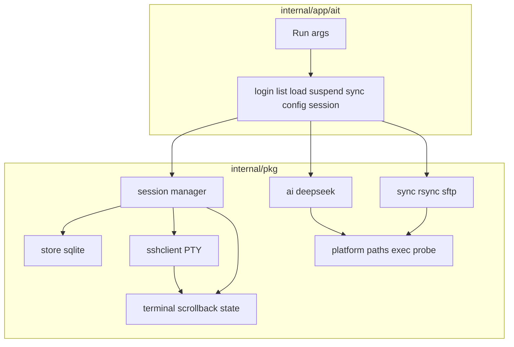
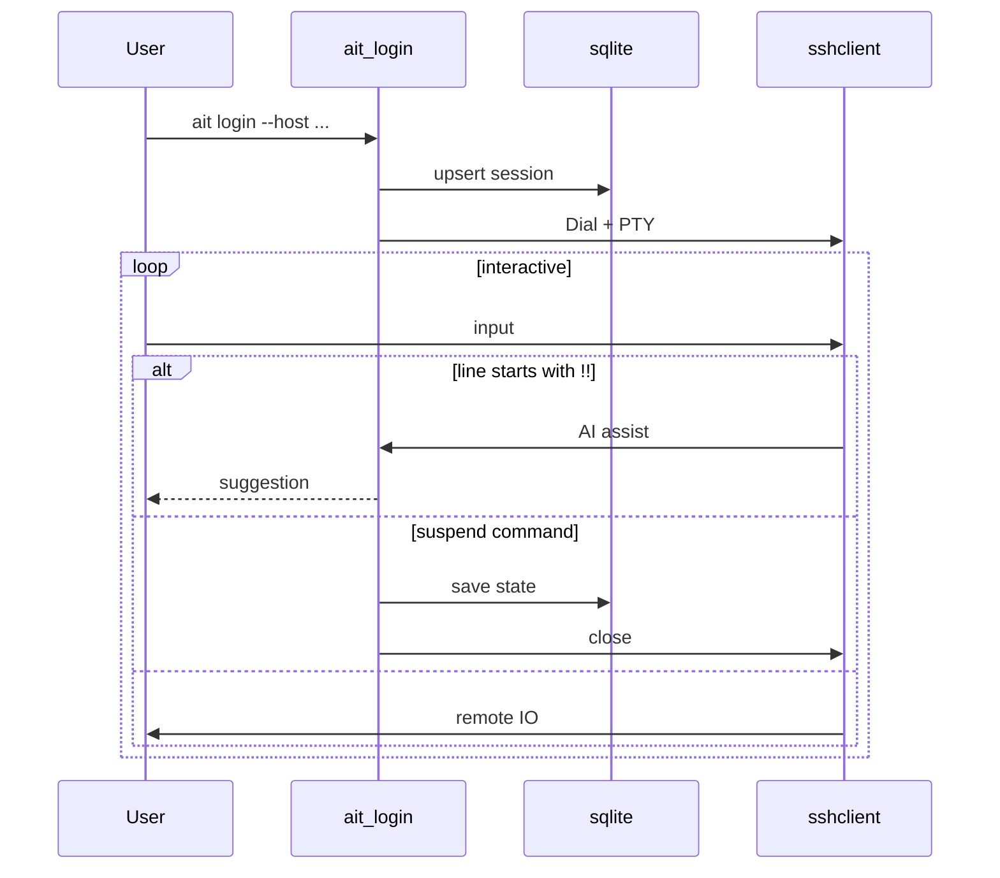
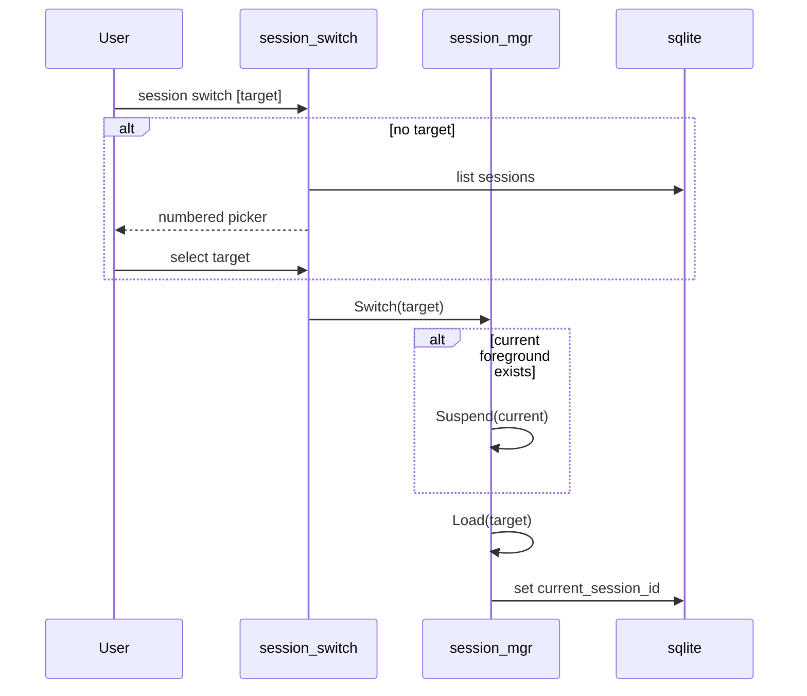
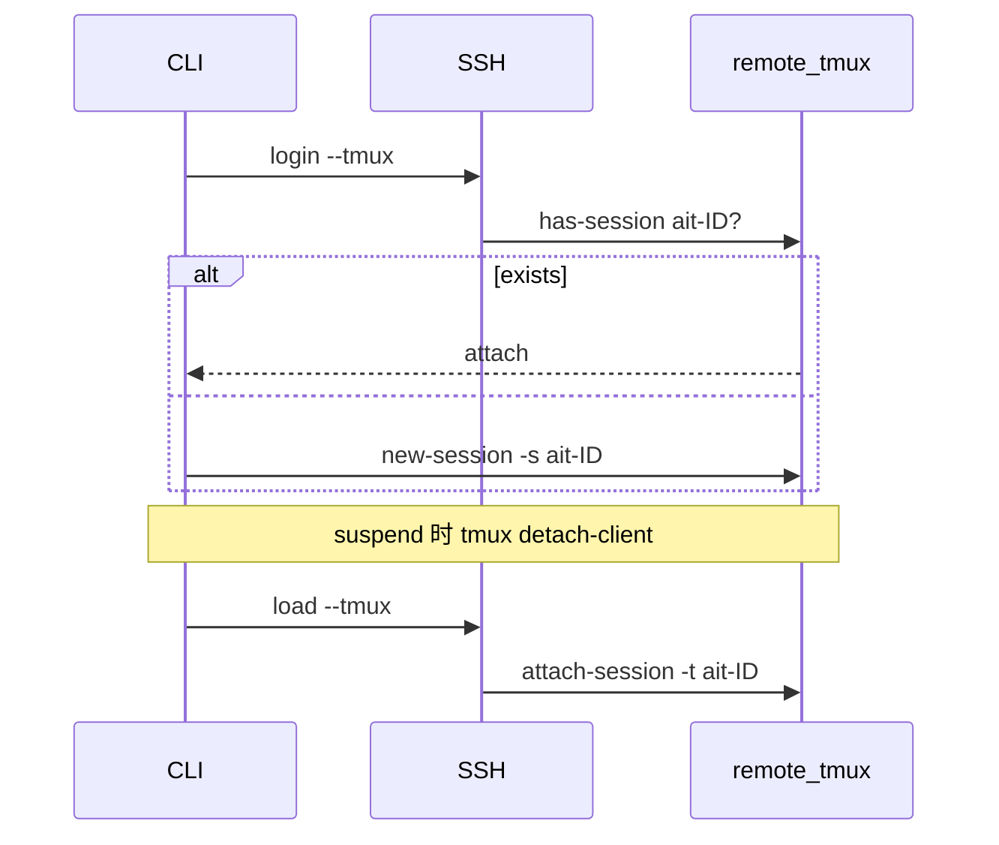

# AiT：AI 增强 SSH 客户端实现计划

## 现状

项目仅有占位实现：[`internal/app/ait/app.go`](internal/app/ait/app.go) 打印 banner，[`go.mod`](go.mod) 无第三方依赖。所有功能需从零搭建，但目录约定已明确（`cmd/ait` 薄入口 → `internal/app/ait` + `internal/pkg`）。

## 目标 CLI 形态

```text
ait login [--alias NAME] --host H [--user U] [--port 22] [--identity PATH] [--password]
        [--tmux]              # 可选：远程 tmux 保活（默认关闭）
ait list
ait load <id|alias> [--tmux]  # 7 天内免密恢复；过期后提示输入 SSH 密码/密钥口令
ait suspend                   # 交互中挂起；--tmux 时 detach 远程 tmux
ait session switch [id|alias] # 切换到另一会话；无参数时交互选择
ait session delete all        # 删除全部已保存会话及本地 sidecar
ait session delete <id|alias> # 删除指定会话
ait sync <src> <dst> [--session ID]
ait config set|get ...        # 含 session.auth_ttl（默认 168h = 7 天）
```

交互 SSH 内：以 **`!!` 行前缀** 唤起 Deepseek 助手；非 `!!` 行照常发往远程。

### 两种恢复模式（默认 vs `--tmux`）

| 模式 | 触发 | load 行为 | 远程进程 |
|------|------|-----------|----------|
| **默认（书签）** | 无 `--tmux` | 用已存连接信息重连；可选回放上次 suspend 的本地 scrollback | 不保证保活 |
| **tmux 保活** | `login`/`load` 加 `--tmux` | SSH 后 `tmux attach -t ait-<session_id>`（不存在则 `new -s`） | 断开连接后 shell/进程仍在 |

**默认仅持久化登录信息**（host/port/user/identity/alias、认证过期时间）；scrollback/`remote_cwd` 仅在 suspend 时作为增强项写入，不作为「真正保活」承诺。真正保活必须显式 `--tmux`。

## 架构总览



## 核心设计决策

| 主题 | 方案 | 说明 |
|------|------|------|
| CLI 框架 | [spf13/cobra](https://github.com/spf13/cobra) | 子命令清晰，与 `Run(args)` 对接 |
| SQLite | [modernc.org/sqlite](https://pkg.go.dev/modernc.org/sqlite) | 纯 Go、无 CGO，利于 Windows 交叉编译 |
| SSH | `golang.org/x/crypto/ssh` + `RequestPty` | 标准库生态，跨平台 |
| 本地 PTY | Unix: `github.com/creack/pty`；Windows: ConPTY（`golang.org/x/sys/windows` 或成熟封装） | 分文件 `pty_unix.go` / `pty_windows.go` |
| Deepseek | OpenAI 兼容 HTTP（`https://api.deepseek.com`） | 可用轻量 `net/http` 或 `github.com/sashabaranov/go-openai` 设 `BaseURL` |
| 密钥/密码 | 私钥路径入 SQLite；SSH 密码/密钥口令经 keyring 缓存；**认证 TTL 默认 7 天** | 过期后 `load` 必须重新输入 |
| SSH 主机密钥 | 默认 `~/.ssh/known_hosts`；未知主机报错并提示 `ssh-keyscan` | `AIT_SSH_INSECURE=1` 仅开发用 |
| 系统命令 | `exec.LookPath` + `runtime.GOOS` | 缺失时 Deepseek 安装建议 |
| 远程保活 | 仅 `--tmux` 时启用 | 调用系统 `tmux`（远程需已安装，缺失则 AI 建议安装） |

### 会话语义与 7 天认证 TTL

**`login` / `load` 与认证 TTL：**

- **`login` 成功**：写入 `auth_expires_at = now + session.auth_ttl`（默认 **168h / 7 天**）
- **`load` / `switch` 免密重连**：在 TTL 内使用 keyring 缓存，**不刷新** `auth_expires_at`
- **重新输入密码后**（`--password` 或交互提示，且 dial 成功）：刷新 `auth_expires_at`
- **超过 TTL**：`load` / `switch` 前必须重新输入 SSH 密码；验证成功后刷新 TTL

**挂起时持久化：**

- **必有**：连接配置 + `auth_expires_at` + `status`
- **可选（suspend 时）**：本地 `cols`/`rows`、scrollback sidecar、`remote_cwd`（便于默认模式下的体验，非 tmux 保活）
- **`--tmux` 时额外**：`tmux_session_name`（固定 `ait-<session_id>`）、`tmux_enabled` 标志

**默认 `load`（无 `--tmux`）：**

1. 检查 TTL → 过期则要求密码/口令
2. SSH 重连
3. 若有 `session_state`：回放 scrollback、`cd` 到 `remote_cwd`（有则执行）
4. 进入交互

**`load --tmux`：**

1. TTL 检查同上
2. SSH 连接 → 检测远程 `tmux has-session -t ait-<id>` → attach，否则 `tmux new-session -s ait-<id>`
3. 进入 tmux 前台（suspend 时对已存在会话执行 `detach`）

**限制说明：** 未加 `--tmux` 时，挂起仍断开 SSH，**不保证**远程进程继续运行；加 `--tmux` 且远程有 tmux 时，才实现真正会话保持。

### 会话切换（`session switch`）

在多个已保存会话之间切换，无需手动 `suspend` 再 `load`。

| 场景 | 行为 |
|------|------|
| 本地无前台 SSH | 等同 `load <target>`（TTL/密码规则相同） |
| 本地有前台 SSH | 先 **suspend 当前**（写 `session_state`、tmux detach）→ 再 **load 目标**；`--force` 仅标记当前为 suspended，**不**保存 scrollback/cwd |
| 未指定目标 | `list` 展示编号菜单，用户选择 id/alias（支持 `--tmux` 继承当前连接模式或按目标会话 DB 中 `tmux_enabled`） |

```text
ait session switch              # 交互式选择
ait session switch prod         # 按 alias/id 切换
ait session switch prod --tmux  # 切换并以 tmux 模式 attach 目标
```

**交互 SSH 内：** `\ait switch [alias]` 或 `Ctrl+]` 后 `w`，效果与同一会话管理器调用。

**与 `load` 区别：** `load` 仅连接目标；`switch` 保证当前会话先挂起保存，避免丢失当前 scrollback/cwd，并更新 `app_meta.current_session_id`。

**tmux 模式切换：** 当前会话 `detach` → 目标会话 SSH → `tmux attach -t ait-<target_id>`；两台主机上的 tmux 会话互不影响。

## 数据模型（SQLite）

文件位置（[`internal/pkg/platform`](internal/pkg/platform)）：

- Linux: `~/.local/share/ait/ait.db`
- macOS: `~/Library/Application Support/ait/ait.db`
- Windows: `%LOCALAPPDATA%\ait\ait.db`

```sql
CREATE TABLE sessions (
  id              TEXT PRIMARY KEY,
  alias           TEXT UNIQUE,
  host            TEXT NOT NULL,
  port            INTEGER NOT NULL DEFAULT 22,
  username        TEXT NOT NULL,
  identity_path   TEXT,
  auth_method     TEXT NOT NULL,  -- key | password | agent
  auth_expires_at INTEGER NOT NULL,  -- Unix 秒；load 免密截止
  tmux_enabled    INTEGER NOT NULL DEFAULT 0,
  tmux_session    TEXT,           -- 默认 ait-<id>
  created_at      INTEGER NOT NULL,
  updated_at      INTEGER NOT NULL,
  status          TEXT NOT NULL   -- active | suspended
);

CREATE TABLE session_state (
  session_id        TEXT PRIMARY KEY REFERENCES sessions(id) ON DELETE CASCADE,
  cols              INTEGER,
  rows              INTEGER,
  remote_cwd        TEXT,
  scrollback_path   TEXT,
  suspended_at      INTEGER
);

CREATE TABLE app_meta (
  key   TEXT PRIMARY KEY,
  value TEXT NOT NULL
);
-- 键 current_session_id：当前/上次前台会话 UUID（switch/load/login 后更新）
```

- `login` 成功 → upsert `sessions`，设置 `auth_expires_at`；若 `--tmux` 则 `tmux_enabled=1` 并初始化远程 tmux；写 `app_meta.current_session_id`
- `suspend` → 写 `session_state`，`status=suspended`；tmux 模式先 `tmux detach` 再断 SSH
- `session delete <id>` / `session delete all` → 删 DB 行 + 删除 scrollback sidecar；tmux 模式可选 `--kill-tmux` 远程杀会话（`delete all` 默认不杀远程 tmux，避免误删；文档说明）

**凭证存储：** SSH 密码不落明文 SQLite；7 天内有期缓存放 **OS keyring**（key: `ait/session/<id>/unlock`），过期自动要求重输。私钥仍只存路径。

## 包布局（新增）

| 路径 | 职责 |
|------|------|
| [`internal/app/ait/`](internal/app/ait/) | `Run` → cobra root；注册子命令 |
| `internal/app/ait/cmd_*.go` | `login`, `list`, `load`, `suspend`, `sync`, `config`, `session` 命令 |
| `internal/pkg/tmux/` | 远程 tmux 探测、`new-session` / `attach` / `detach` / `has-session` 封装 |
| `internal/pkg/store/` | SQLite 打开、迁移、CRUD |
| `internal/pkg/session/` | 会话生命周期：创建、挂起、加载、**切换**、列表 |
| `internal/pkg/sshclient/` | 拨号、认证、PTY 会话、交互循环 |
| `internal/pkg/terminal/` | scrollback 缓冲、尺寸、回放、原始模式 stdin |
| `internal/pkg/ai/` | Deepseek 客户端、`SuggestInstall(os, cmd)`、`Assist(ctx, prompt)` |
| `internal/pkg/sync/` | `rsync`/`scp` 包装；无则 SFTP 回退 |
| `internal/pkg/platform/` | 数据目录、`LookPath`、OS 描述字符串 |
| `configs/ait.example.yaml` | 可选：默认模型、`deepseek_base_url`（密钥仍走 keyring） |

`pkg/` 暂不放公开 API，除非后续需要被其他项目导入。

## 关键流程

### login



- 认证顺序：`--identity` → SSH agent → `~/.ssh/id_ed25519` / `id_rsa`
- 连接成功即写入/更新会话记录（满足「自动保存会话」）

### suspend / list / load

- **suspend**：`\ait suspend` 或约定快捷键；tmux 模式先 detach；写 `session_state`（可选 scrollback/cwd）→ 关 SSH
- **list**：输出 `id`, `alias`, `host`, `user`, `status`, `tmux`, `auth_expires_at`（剩余天数）
- **load**：TTL 校验 →（过期则读密码）→ 重连 → 默认回放+cwd 或 `--tmux` attach → 更新 `current_session_id`
- **switch**：若 `current_session_id` 存在且与目标不同 → `Suspend(current)` → `Load(target)`；目标与当前相同则 no-op 并提示

### session switch 流程



### session 清理

```text
ait session delete all         # 删除全部 sessions + session_state + sidecar + keyring 条目
ait session delete <id|alias>  # 删除单条；存在则确认提示（--force 跳过）
```

cobra 结构：`ait session delete` 为父命令，`all` 与 `<id|alias>` 为互斥目标（`all` 为固定子参数/子命令，需二次确认或 `--force`）。

- `delete all`：事务内清空两表；遍历数据目录删除 scrollback 文件；批量清除 keyring `ait/session/*`
- `delete <id|alias>`：`ON DELETE CASCADE` 清理 `session_state`；删对应 sidecar 与 keyring 项

### tmux 集成（`--tmux`）



- 远程无 `tmux`：`LookPath` 失败 → `ai.SuggestInstall`（apt/brew 等）
- 会话名确定性：`ait-<session_id>`，避免与用户手工 tmux 冲突
- Windows 本地客户端仍可 `load --tmux`，但远程主机通常为 Linux/macOS

### sync

1. `LookPath("rsync")` → 存在则构造 `rsync -e ssh ...`（会话的 host/user/identity 注入 `-e`）
2. 否则 `scp`；再否则 **内置 SFTP**（`ssh.NewSFTPClient` 或 `pkg/sftp`）
3. 三者皆不可用或执行失败且原因为「命令不存在」→ 调 `ai.SuggestInstall`

路径语义：`user@host:/path` 与本地路径，与 `scp` 一致；`--session` 复用已保存会话的连接参数。

### AI 助手（会话内）

- 检测到行首 `!!`（去除前缀后 trim）→ 不调远程，而是：
  - 上下文：最近 N 行 scrollback（脱敏）、`GOOS`、当前 `remote_cwd`、用户问题
  - 调用 Deepseek chat completions
  - 结果打印到本地终端（不自动执行，避免误操作；可提供 `!!run` 后续扩展）
- **安装建议**：`platform.LookPath(cmd)==err` 时，prompt 包含 OS 版本探测（`runtime.GOOS` + 读 `/etc/os-release` 或 `sw_vers` / `ver`）→ 返回 brew/apt/choco/winget 等建议

## 跨平台要点

| 平台 | PTY / 终端 | 数据目录 | 常见缺失命令 |
|------|------------|----------|----------------|
| Linux | creack/pty + raw mode | XDG data home | rsync 包名 `rsync` |
| macOS | 同上 | Application Support | `brew install rsync` |
| Windows | ConPTY；OpenSSH 内置 | LocalAppData | `winget` / OpenSSH 功能 |

构建标签：`//go:build linux || darwin` 与 `windows` 分离 PTY 实现；`make test` 在 Linux CI 全量，Windows 目标至少 `go build` 通过。

## 依赖（拟加入 go.mod）

- `github.com/spf13/cobra`
- `modernc.org/sqlite`
- `golang.org/x/crypto/ssh`
- `golang.org/x/term`
- `github.com/creack/pty`（unix）
- `github.com/99designs/keyring`
- `github.com/google/uuid`
- （可选）`github.com/pkg/sftp` — SFTP 回退
- （可选）`github.com/sashabaranov/go-openai` — Deepseek 兼容

遵循项目规则：**仅在需要时引入**，优先 stdlib + `x/` 扩展。

## 测试策略

- **单元测试**：`store` CRUD（`:memory:` SQLite）、`terminal` scrollback 截断/回放、`ai` mock HTTP
- **集成测试**：`sshclient` 用 `httptest` 或跳过标签；`//go:build integration` + docker testcontainers 可选后续
- 保持 [`internal/app/ait/app_test.go`](internal/app/ait/app_test.go)  smoke test 更新为 `Run([]string{"--help"})`

## 实施阶段（建议顺序）

1. **基础 CLI + 配置**：cobra、`platform`、`store` 迁移（含 `auth_expires_at`）、keyring、`session.auth_ttl` 默认 7d
2. **login + 交互 SSH**：sshclient；login 写 sessions + 刷新 TTL
3. **suspend / list / load / switch**：默认书签恢复 + TTL；`switch` = suspend 当前 + load 目标 + 交互选择器
4. **session delete**：`delete all` 与 `delete <id|alias>` 清理 DB、sidecar、keyring
5. **`--tmux` 集成**：`internal/pkg/tmux` + login/load/suspend 分支
6. **sync + AI 助手 + Windows**：rsync/sync、`!!` 助手、ConPTY、README 说明两种模式与 TTL

## 风险与缓解

- **Windows PTY 复杂度高**：第一期可先保证「连接 + 非全屏交互」可用，再完善 ConPTY 尺寸/信号；`go build` Windows 为门禁
- **scrollback 过大**：超过阈值（如 512KB）写入 sidecar 文件，DB 只存 path
- **安全**：不在日志打印 API Key/密码；`!!` 上下文脱敏；keyring 条目随 `delete`/`delete all` 清除
- **TTL 边界**：时钟回拨用单调比较 + 文档说明；`auth_expires_at` 可在 `config` 中覆盖（最小 1h，最大 30d 防误配）

## 交付物

- 可执行 `bin/ait` 支持上述子命令
- [`configs/ait.example.yaml`](configs/ait.example.yaml) 配置模板
- `make test` / `make vet` 通过
- 简短用户说明（可写在根 [`README.md`](README.md) 的「用法」一节，仅在你确认后添加）
