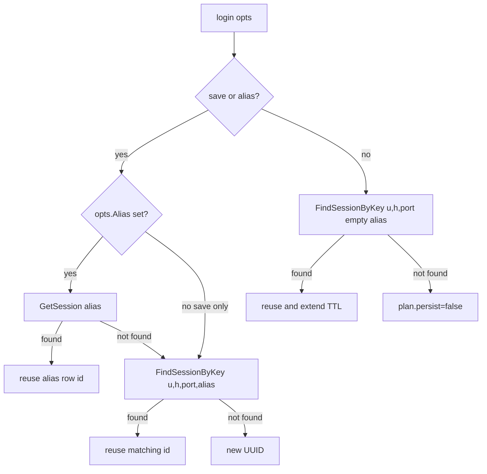
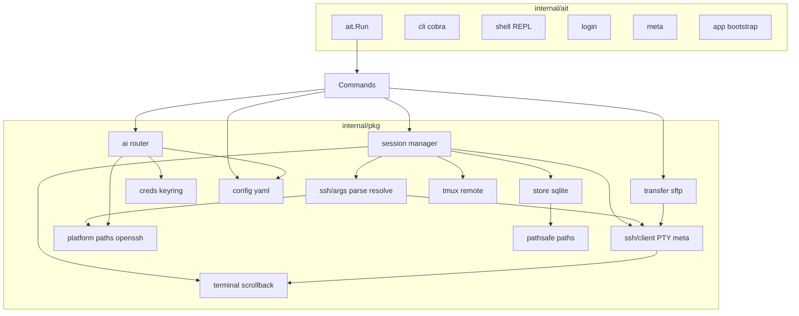
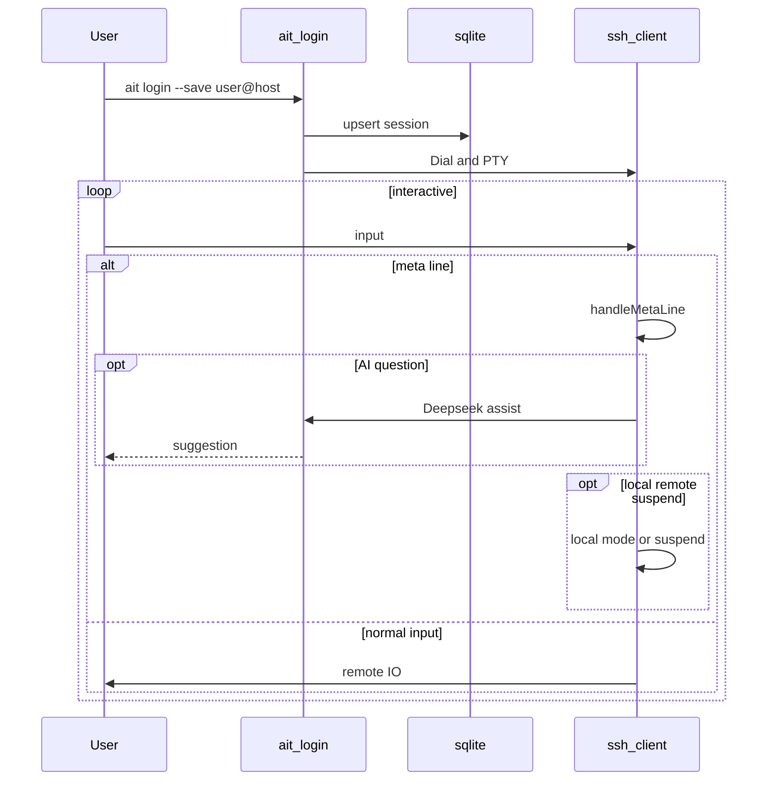
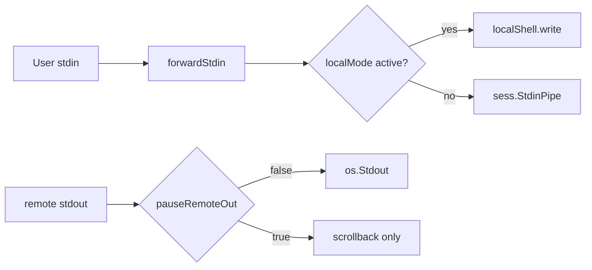
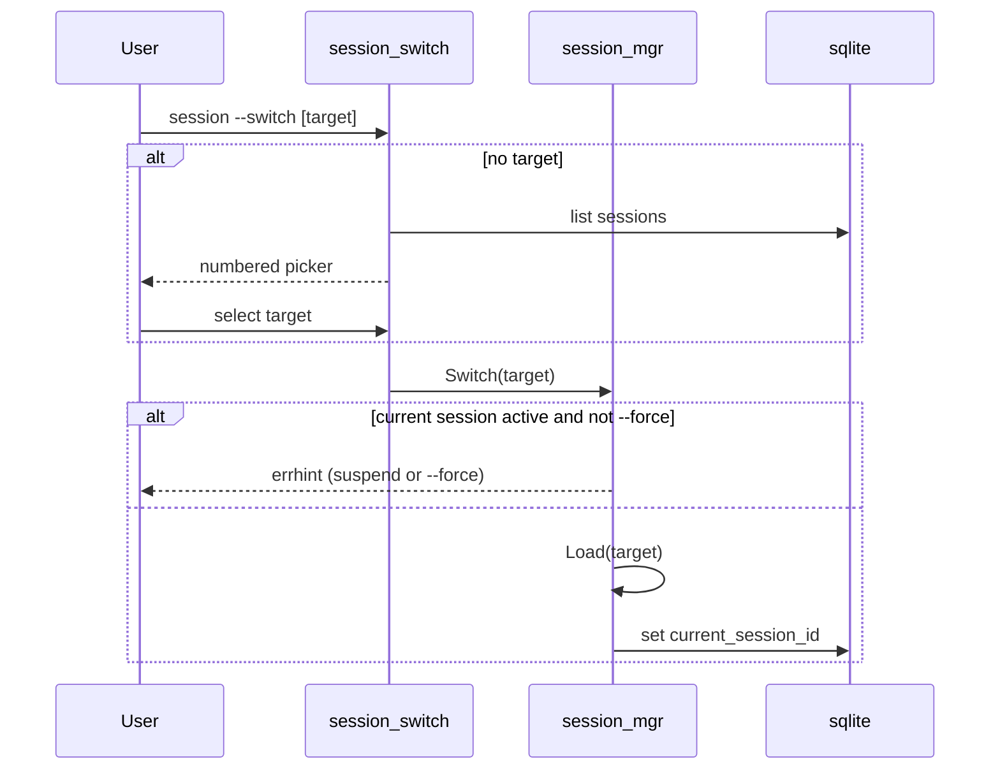
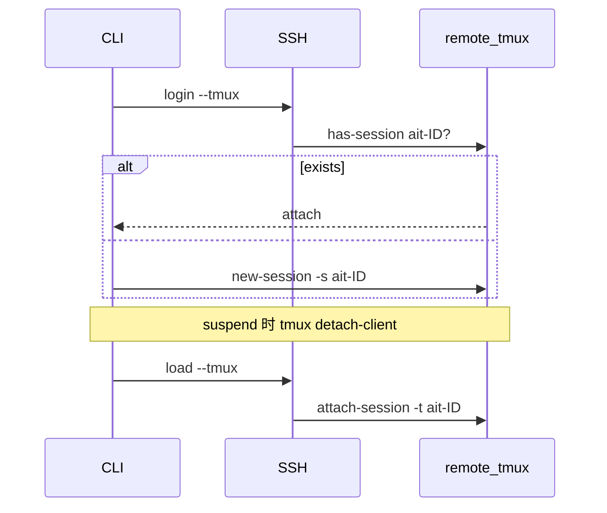
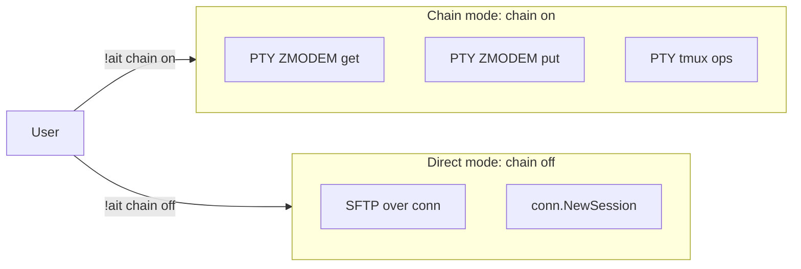

# AiT: Architecture and Behavior

**Languages:** English (this page) · [简体中文](design.zh-CN.md)

This document describes behavior and package layout implemented on the **current main branch** (not a backlog). For users, see [`README.md`](../README.md), [`docs/user-manual.md`](user-manual.md); for agent orientation and code layout, see [`AGENTS.md`](../AGENTS.md).

CLI entry point: [`internal/ait/root.go`](../internal/ait/root.go) (`Run` plus cobra root). Dependencies are listed in [`go.mod`](../go.mod). Layout: thin `cmd/ait` entry → `internal/ait` plus `internal/pkg`.

## CLI surface

```text
ait shell                                    # AiT> REPL (login/list/load, etc.)
ait ai                                       # Local AI mode (AiT AI(Agent)>); also "ai" inside ait shell
ait ai model list                            # List configured AI providers (ENABLED column)
ait ai ask [message...]                      # One-shot AI question (stdin if no args); SSH: !ait ai ask / !! ask
ait ai agent [message...]                    # One-shot agent with tool execution
ait ai provider enable|disable <provider>    # Enable/disable routing to a provider
ait ai ollama status|setup|start|stop|disable  # Local Ollama (setup: models_dir + install [y/N])
ait login [ssh-options] destination [command ...] [--save] [--alias NAME] [--password] [--tmux]
        # OpenSSH-compatible: -p -l -i -F -J -o, etc.; destination is [user@]host or a config Host alias
        # Requires local OpenSSH client (ssh -G) for config resolution; data plane is Go x/crypto/ssh (Windows/macOS/Linux)
        # Persists to SQLite with --save (bookmark by id) or --alias (named save; implies --save)
        # Also updates an existing empty-alias row when the connection key matches (refreshes auth TTL)
        # With command: one-shot execution (similar to ssh host cmd); new hosts need --save or --alias
        # Legacy --host/--user remain supported for backward compatibility
ait session --list [-v]   # # column for pick-by-number; -v adds FULL_ID (complete UUID)
ait session --load [<id|alias>] [--tmux] [--password]   # Omit id to pick; id must be alias or full UUID (not list ID column)
ait session --suspend         # Local CLI only; inside SSH use !ait suspend
ait session --switch [id|alias] [--tmux] [--password] [--force]  # Switch session; omit id to pick
ait session --delete <id|alias|all> [--force]         # Delete one or all saved sessions
ait get [ssh-flags] <paths...>   # OpenSSH flags; paths/order like login (see get/put section)
ait put [ssh-flags] <paths...>
ait config init|view|edit|validate|set|get ...   # YAML config; edit uses $VISUAL/$EDITOR (vi / Notepad)
```

**AI mode** (multi-provider: Deepseek + MiniMax + optional local Ollama; cloud requires `ai.<provider>.api_key` in keyring, aliases `deepseek.api_key` / `minimax.api_key`): **`ait ai [--model <cloud-provider>]`** or **`ai` inside `ait shell`** runs a local AI REPL (`AiT AI(Agent)>`); commands run on this machine only after you confirm (`run`, optional `ait` subcommands). Inside an active SSH session use **`!ait ai`** or **`!!`** for remote-scoped AI (`AiT AI(Agent) user@host>`); `run` sends the command to the remote shell via PTY stdin after confirmation. **`!ait ai` as a meta subcommand is blocked** (same as `login`/`load`). When no cloud API key is configured and tiered Ollama is off, `!!` / `!ait ai` fail closed locally. With **`ai.tiered.enabled`**, short first-turn prompts route to local Ollama (no keyring key); longer or complex prompts and `--model` / REPL `model <cloud>` use cloud default and failover (`ai.default` / `ai.fallback`). See [AI mode (dual scope)](#ai-mode-dual-scope) and [In-session meta protocol (!ait / !!)](#in-session-meta-protocol-ait).

Use **`!ait local` / `!ait remote`** to toggle local versus remote input while SSH stays connected; **`!ait suspend`** to suspend; **`!ait chain [on|off]`** to toggle chain mode (PTY-pipe injection for file transfer and tmux over multiple SSH hops).

### Two recovery modes (default versus `--tmux`)

| Mode | Trigger | `load` behavior | Remote processes |
|------|---------|-----------------|------------------|
| **Default (bookmark)** | No `--tmux` | Reconnect with stored connection info; optionally **seed** saved scrollback into in-memory buffer (not displayed on the terminal) | No keep-alive guarantee |
| **tmux keep-alive** | `login`/`load` with `--tmux` | After SSH: `tmux attach -t ait-<session_id>` (or `new -s` if missing) | Shell/process survives disconnect |

**Login metadata is persisted with `--save`, `--alias`, or `--tmux` for new connections** (`--tmux` implies `--save`). Each saved row is keyed by **`username` + `host` + `port` + `alias`** (empty alias when `--alias` is omitted; distinct from named aliases). `login_destination` stores the ssh config Host name (e.g. `devhost`) for `ssh -G` re-resolve on `load`/`switch`. Plain `ait login user@host` updates an existing row and refreshes auth TTL **only** when a matching **empty-alias** row exists; if only named-alias rows exist or there is no match, login stays ephemeral. Scrollback/`remote_cwd` are optional enhancements written on suspend and do **not** constitute a promise of true session keep-alive. Explicit `--tmux` is required for real keep-alive.

### Login persistence decision (connection key includes alias)



The same `user@host:port` may have both an empty-alias row (`ait login --save user@host`) and named rows (`ait login --alias prod user@host`) as separate records with distinct UUIDs and tmux names `ait-<id>`. SQLite enforces `UNIQUE(username, host, port, COALESCE(alias,''))`; migration dedupes legacy duplicate keys keeping the newest `updated_at`.

## Architecture overview



## Core design decisions

| Topic | Choice | Notes |
|-------|--------|-------|
| CLI framework | [spf13/cobra](https://github.com/spf13/cobra) | Clear subcommands; integrates with `Run(args)` |
| SQLite | [modernc.org/sqlite](https://pkg.go.dev/modernc.org/sqlite) | Pure Go, no CGO; simplifies Windows cross-compilation |
| SSH | `golang.org/x/crypto/ssh` plus `RequestPty` | Standard ecosystem; cross-platform |
| Local PTY | Unix: `github.com/creack/pty`; Windows: ConPTY (`golang.org/x/sys/windows` or a mature wrapper) | Split files `pty_unix.go` / `pty_windows.go` |
| AI providers | Deepseek + MiniMax (cloud); optional Ollama (local, OpenAI-compatible); `api_style` per provider | Router in `internal/pkg/ai`: tiered heuristic → Ollama, else cloud default-first failover (`ai.fallback` or auto `deepseek` → `minimax`); Ollama failure fails up to cloud |
| Secrets / passwords | Private key paths in SQLite; SSH passwords and key passphrases cached in keyring; **auth TTL defaults to 7 days** | After expiry, `load` must prompt again |
| SSH host keys | Default `~/.ssh/known_hosts`; unknown hosts error with `ssh-keyscan` hint | `AIT_SSH_INSECURE=1` for development only |
| System commands | `exec.LookPath` plus `runtime.GOOS` | Missing tools trigger Deepseek install hints |
| Remote keep-alive | Enabled only with `--tmux` | Invokes system `tmux` (must exist on remote; AI suggests install when absent) |

### Session semantics and 7-day authentication TTL

**`login` / `load` and authentication TTL:**

- **Successful `login`**: writes `auth_expires_at = now + session.auth_ttl` (default **168h / 7 days**)
- **`load` / `switch` credential-free reconnect**: within TTL uses keyring cache and **does not refresh** `auth_expires_at`
- **After password re-entry** (`--password` or interactive prompt, and dial succeeds): refreshes `auth_expires_at`
- **Beyond TTL**: `load` / `switch` must prompt for SSH password again; TTL refreshes after successful verification

**Persistence on suspend:**

- **Always**: connection profile plus `auth_expires_at` plus `status`
- **Optional (on suspend)**: local `cols`/`rows`, scrollback sidecar, `remote_cwd` (improves default-mode UX; not tmux keep-alive)
- **Additional with `--tmux`**: `tmux_session_name` (fixed `ait-<session_id>`), `tmux_enabled` flag

**Default `load` (no `--tmux`):**

1. Check TTL → if expired, require password or passphrase
2. SSH reconnect
3. If `session_state` exists: **seed** sanitized scrollback into the in-memory buffer (not replayed to the terminal) and `cd` to `remote_cwd` when present
4. Enter interactive session

**`load --tmux`:**

1. Same TTL checks as above
2. SSH connection → probe remote `tmux has-session -t ait-<id>` → attach, else `tmux new-session -s ait-<id>`
3. Enter tmux foreground (on suspend, `detach` existing session)

**Limitations:** Without `--tmux`, suspend still tears down SSH and **does not guarantee** remote processes keep running; true session persistence requires `--tmux` with tmux available on the remote host.

### Session switching (`session --switch`)

Switch among saved sessions. When no local foreground SSH is active, behavior matches `load <target>`.

| Scenario | Behavior |
|----------|----------|
| No foreground SSH locally | Equivalent to `load <target>` (same TTL/password rules) |
| Current session still `active` in DB | **Blocked** with errhint: run `!ait suspend` inside SSH first, or `session --switch --force` (marks current suspended **without** saving scrollback/cwd) → then **load target**. In-session `!ait session --switch` auto-suspends first. |
| Target omitted | `list`-style numbered menu; user selects id/alias (`--tmux` follows current connection mode or target `tmux_enabled` in DB) |

```text
ait session --switch              # Interactive picker
ait session --switch prod         # Switch by alias/id
ait session --switch prod --tmux  # Switch and attach target in tmux mode
```

**Inside interactive SSH:** use `!ait login`, `!ait load`, or `!ait session --switch` to chain sessions; `!ait suspend` to suspend only.

**Compared with `load`:** `load` connects only to the target; `switch` additionally checks whether the current session is still `active` and blocks until you suspend (or `--force`), then loads the target and updates `app_meta.current_session_id`.

**Tmux mode switching:** detach current session → SSH to target → `tmux attach -t ait-<target_id>`; tmux sessions on different hosts do not interfere.

## Data model (SQLite)

Database file: `<AppRoot>/ait.db` where **`AppRoot`** is the unified runtime directory ([`platform.AppRoot()`](../internal/pkg/platform/paths_appdir.go)). Defaults: Linux `~/.local/share/ait`, macOS `~/Library/Application Support/ait`, Windows `%LOCALAPPDATA%\ait`. Override with **`AIT_HOME`** or **`AIT_DATA_DIR`**. See [Runtime file layout](#runtime-file-layout-approot) for the full tree.

```sql
CREATE TABLE sessions (
  id              TEXT PRIMARY KEY,
  alias           TEXT UNIQUE,
  host            TEXT NOT NULL,
  port            INTEGER NOT NULL DEFAULT 22,
  username        TEXT NOT NULL,
  identity_path   TEXT,
  auth_method     TEXT NOT NULL,  -- key | password | agent
  auth_expires_at INTEGER NOT NULL,  -- Unix 秒；load 免密截止
  tmux_enabled    INTEGER NOT NULL DEFAULT 0,
  tmux_session    TEXT,           -- 默认 ait-<id>
  created_at      INTEGER NOT NULL,
  updated_at      INTEGER NOT NULL,
  status          TEXT NOT NULL   -- active | suspended
);

CREATE TABLE session_state (
  session_id        TEXT PRIMARY KEY REFERENCES sessions(id) ON DELETE CASCADE,
  cols              INTEGER,
  rows              INTEGER,
  remote_cwd        TEXT,
  scrollback_path   TEXT,
  suspended_at      INTEGER
);

CREATE TABLE app_meta (
  key   TEXT PRIMARY KEY,
  value TEXT NOT NULL
);
-- 键 current_session_id：当前/上次前台会话 UUID（switch/load/login 后更新）
```

- Successful `login` with `--save` or `--alias`, or when a matching **empty-alias** connection key exists → upsert `sessions`, set `auth_expires_at`; if `--tmux`, set `tmux_enabled=1` and initialize remote tmux; write `app_meta.current_session_id`. Login to a new host without those flags does not upsert; plain login does not upsert when only named-alias rows match.
- `suspend` → write `session_state`, `status=suspended`; in tmux mode `tmux detach` before closing SSH
- `session --delete <id>` / `session --delete all` → delete DB rows, scrollback sidecars, and per-session keyring entries (does not kill remote tmux sessions)

**Credential storage:** SSH passwords are not stored in plaintext SQLite; within the 7-day window, secrets cache in the **OS keyring** (key `ait/session/<id>/unlock`), expiring entries force re-entry. Private keys remain paths only. AI provider API keys use keyring paths `ai/<provider>/api_key` (CLI: `ait config set ai.deepseek.api_key`; legacy alias `deepseek.api_key` migrates on read). On desktop Linux/macOS/Windows the library prefers Secret Service, Keychain, or WinCred; when those are unavailable (headless, no D-Bus), it falls back to an **encrypted file store** under `<AppRoot>/keyring` (see `platform.KeyringDir`). Override with `AIT_KEYRING_DIR`; set `AIT_KEYRING_FILE_PASSWORD` on headless hosts (default dev password is for local use only). Force file-only backend with `AIT_KEYRING_BACKEND=file`.

**Runtime file layout (`AppRoot`):** All AiT-owned runtime files live under one directory (`platform.AppRoot()` = `DataDir()` = `ConfigDir()`). Set **`AIT_HOME`** (or **`AIT_DATA_DIR`** when `AIT_HOME` is unset) to override. Default paths: Linux `~/.local/share/ait`, macOS `~/Library/Application Support/ait`, Windows `%LOCALAPPDATA%/ait`. On Linux upgrade, a legacy config at `$XDG_CONFIG_HOME/ait/config.yaml` (typically `~/.config/ait/config.yaml`) is migrated into `AppRoot` on first `config.Load`. Layout:

```text
<AppRoot>/
├── config.yaml       # main YAML (ait config init / view / edit / validate / set / get)
├── ait.db            # SQLite sessions
├── repl_history      # REPL input history
├── scrollback/       # suspend sidecars
├── keyring/          # file keyring fallback
└── ollama/models/    # recommended Ollama models_dir default
```

First-time setup: `ait config init` creates or merges `config.yaml` (missing keys only; API keys still via keyring). **`ait config view`** prints the file (creates it when missing). **`ait config edit`** opens `$VISUAL`/`$EDITOR` (default: `vi` on Unix, Notepad on Windows) and validates after save. **`ait config validate`** checks YAML syntax and values (session TTL, provider URLs, tiered fields); prints each error with a field path; exit 1 on failure.

## Package layout (current)

| Path | Role | Representative files |
|------|------|----------------------|
| [`internal/ait/`](../internal/ait/) | CLI entry, Cobra root, manager bootstrap | `root.go`, `cli_root.go`, `manager.go`, `context.go`, `init_hooks.go` |
| [`internal/ait/registry/`](../internal/ait/registry/) | Top-level command registry (OCP); root `--help` | `register.go`, `root_help.go`, `all/imports.go` |
| [`internal/pkg/helpdoc/`](../internal/pkg/helpdoc/) | Shared `--help` layout | `body.go`, `bind.go`, `common.go` |
| [`internal/ait/login/`](../internal/ait/login/) | Login parsing and help | `run.go`, `help.go` |
| [`internal/ait/shell/`](../internal/ait/shell/) | `ait shell` REPL | `repl.go`, `exec.go`, `parse.go` |
| [`internal/ait/ai/`](../internal/ait/ai/) | `ait ai` tree (`ask`, `agent`, `provider`, `ollama` via `subregistry`) | `cmd.go`, `help.go`, `register.go` |
| [`internal/ait/ai/mode/`](../internal/ait/ai/mode/) | `ait ai` / `!ait ai` AI REPL | `repl.go`, `exec.go`, `run_local.go` |
| [`internal/ait/meta/`](../internal/ait/meta/) | In-session `!ait` | `exec.go` |
| [`internal/pkg/ssh/args/`](../internal/pkg/ssh/args/) | OpenSSH argv, `ssh -G`, mapped options | `parse.go`, `resolve.go`, `*_helpers.go` |
| [`internal/pkg/session/`](../internal/pkg/session/) | Session lifecycle | `manager.go`, `manager_helpers.go` |
| [`internal/pkg/store/`](../internal/pkg/store/) | SQLite | `store.go`, `store_scan.go`, `session_helpers.go`, `open_helpers.go` |
| [`internal/pkg/ssh/client/`](../internal/pkg/ssh/client/) | Dial, PTY, `!ait` meta, local mode, silent injection, remote prompt emit | `client.go`, `client_dial.go`, `client_init_helpers.go`, `client_init_prompt_emit_helpers.go`, `dialchain.go`, `meta/scanner.go`, `localmode/shell.go`, `hostkeys.go`, `prompt/prompt.go`, `inject.go`, `transfer_zmodem.go` |
| [`internal/pkg/terminal/`](../internal/pkg/terminal/) | Scrollback, replay, paths | `scrollback/delta.go`, `terminal/path.go` |
| [`internal/pkg/tmux/`](../internal/pkg/tmux/) | Remote tmux | `remote.go`, `remote_pty.go` |
| [`internal/pkg/ai/`](../internal/pkg/ai/) | Multi-provider router (OpenAI + Anthropic), tiered Ollama, model list | `router.go`, `tiered.go`, `models_list.go`, `router_openai.go`, `router_anthropic.go`, `client.go`, `chat.go` |
| [`internal/pkg/transfer/`](../internal/pkg/transfer/) | SFTP get/put (single file); default path helpers | `transfer.go`, `parse.go`, `path_defaults.go` |
| [`internal/pkg/platform/`](../internal/pkg/platform/) | `AppRoot`, data dirs, OpenSSH, editor | `paths_appdir.go`, `editor.go`, `openssh.go`, `exec.go` |
| [`internal/pkg/config/`](../internal/pkg/config/) | YAML config, init, validate | `config.go`, `config_load.go`, `config_init.go`, `config_validate.go` |
| [`internal/pkg/creds/`](../internal/pkg/creds/) | OS keyring | `keyring.go` |
| [`internal/pkg/pathsafe/`](../internal/pkg/pathsafe/) | Session/path validation | `path.go` |
| [`configs/ait.example.yaml`](../configs/ait.example.yaml) | Config template (secrets via keyring) | — |

`pkg/` holds no public API yet. Package-level helpers live in `*_helpers.go`; structs with methods use one file each (see [`go-structure.mdc`](../.cursor/rules/go-structure.mdc)).

## Key flows

### Prompts (`AiT>` / `AiT Local>` / `AiT user@host:dir[:branch]>`)

| Scenario | Prompt | How it is set |
|----------|--------|----------------|
| `ait shell` (no remote yet) | `AiT> ` | REPL prints [`BasePrompt`](../internal/pkg/ssh/client/prompt/prompt.go) |
| SSH remote | `AiT user@host:dir[:git-branch]> ` | [`RemotePromptInitialCommands`](../internal/pkg/ssh/client/prompt/prompt.go) injects dynamic bash `PS1` / zsh `PROMPT` after `load`/`login` (non-tmux: [`waitForShellReadyBeforeInject`](../internal/pkg/ssh/client/client_init_helpers.go) waits for a native or AiT prompt line in scrollback plus output quiet, up to 10s; bash hosts fall back to quiet-since-attach); setup ends with a **`RemotePromptReadySentinel`** handshake line; zsh deduplicates and appends a **`precmd_functions` hook** so oh-my-zsh themes do not permanently override `PROMPT`, then **prints the expanded prompt** to the PTY (`${PS1@P}` / `print -Pn "$PROMPT"` + `zle reset-prompt` when available); **`session.remote_prompt.path`**: `short` (default, last path segment) or `absolute` (`$PWD` with `~` for home); optional `:branch` via `git rev-parse`. During setup, `pauseRemoteOut` buffers remote output in scrollback (R1 filters setup leaks; native prompts are not seeded into scroll pending). [`finishRemoteSetup`](../internal/pkg/ssh/client/client_init_helpers.go) waits for the ready sentinel via [`waitForRemotePromptReady`](../internal/pkg/ssh/client/client_init_helpers.go), then [`ensureFirstPromptVisible`](../internal/pkg/ssh/client/client_init_helpers.go) emits scrollback AiT lines, **client-paints** when the sentinel is present, or native fallback only when setup did not succeed; unpause requires `remotePromptShown`. **Load/switch** seeds [`ReplayScrollback`](../internal/pkg/ssh/client/client.go) into memory **after** setup via [`seedReplayScrollback`](../internal/pkg/ssh/client/client_init_helpers.go) / [`SanitizeReplayScrollback`](../internal/pkg/ssh/client/client_setup_filter_helpers.go) (leak strip, prompt-line strip, blank-line collapse)—not displayed on the terminal. Login/load/nested share [`runRemotePromptSetup`](../internal/pkg/ssh/client/prompt_setup.go)—the AiT prompt should appear **without pressing Enter**. |
| SSH nested (manual `ssh` in session) | same as SSH remote on **active** hop | After a simple `ssh user@host` from an AiT session, MOTD + quiet detection triggers the same PS1 inject and enables chain mode; use `ait login -J jump,final` to land on the final host in one step |
| SSH local mode | `AiT Local> ` | Silent rc/env ([`localmode/shell.go`](../internal/pkg/ssh/client/localmode/shell.go)) |

**`ait shell`**: line-oriented REPL; type `login`, `load`, `list`, `help`, etc. directly (no `!ait` prefix). After `login` inside shell, return to `AiT>`; after `ait login` from the system shell, return to the OS shell.

**Built-in `ll`** (shell REPL only, not `ait ai` or `!ait`): long-format local directory listing (`ls -la` style via pure Go [`dirlist`](../internal/pkg/dirlist/)); optional one path argument; default cwd.

**Command resolution in `ait shell`** (first token only): **builtins** (`exit`, `help`, `clear`, `history`, `ai`, `login`, `load`, `list`, `suspend`) → **`<AppRoot>/bin/<name>`** user extensions (flat directory; executable bit on Unix) → **ait CLI** subcommands (`config`, `session`, `get`, …) → **system PATH**. Bin extensions can shadow ait subcommand names but never builtins. External commands run via `exec` with argv (no shell interpolation); on a TTY the REPL restores cooked mode for the child process. Implementation: [`internal/ait/shell/exec_dispatch.go`](../internal/ait/shell/exec_dispatch.go), [`internal/pkg/shellext/`](../internal/pkg/shellext/).

**Local REPL input (UTF-8, macOS / Linux / Windows):** Interactive `ait shell` and local `ait ai` read stdin as **UTF-8** via [`terminal.ReadLine`](../internal/pkg/terminal/lineedit.go) (Emacs-style editing, arrow keys, Up/Down over loaded input history). Use a UTF-8 terminal: Linux/macOS `LANG=*.UTF-8`; Windows **Windows Terminal** with UTF-8 (avoid legacy non-UTF code pages). IME composition is handled by the terminal; committed text arrives as UTF-8 bytes (preedit underline is not drawn by AiT). Piped or redirected stdin (`echo … | ait shell`) already accepted UTF-8; SSH remote shells forward bytes unchanged.

**TTY keys (local REPL):** Ctrl+A/E (line start/end), Left/Right (cursor), Up/Down (recall loaded input history, including prior sessions), **Ctrl+R** (reverse incremental search through input history), Ctrl+U/K/W (kill line/word), Backspace, Tab, Ctrl+C (cancel line), Ctrl+D (EOF when empty), Ctrl+L (clear screen, keep buffer). History records only commands submitted at the main prompt—not confirm `[y/N]` answers, session picker input, or AiT local-mode env/rc setup. See `help` / `ait shell --help` Keys section.

**Input history persistence:** Local `ait shell` and `ait ai` share a bash-style **`history`** builtin (list, `history n`, `-c`, `-d`, `-s`, `-a`, `-r`, `-w`) over the same in-memory list used by Up/Down and Ctrl+R. Lines are appended to **`<AppRoot>/repl_history`** (mode `0600`) as you submit commands; the file is loaded on REPL start. In AI mode, **`clear`** clears chat/conversation history only; **`history`** manages input history.

**Clear screen (`ait shell` / local TTY):** In `ait shell`, type **`clear`** to erase the terminal via [`terminal.ClearScreen`](../internal/pkg/terminal/screen.go) (VT100 ANSI). In a TTY, **Ctrl+L** clears the screen and redraws the current prompt plus the in-progress line (buffer kept; same as bash/readline). Local `ait ai` TTY also supports **Ctrl+L** for display only; **`clear` in AI mode** still clears chat history, not the same as shell `clear`.

### In-session meta protocol (!ait / !!)

Implementation: [`internal/pkg/ssh/client/meta/scanner.go`](../internal/pkg/ssh/client/meta/scanner.go) and `forwardStdin` / `handleMetaLine` in [`client.go`](../internal/pkg/ssh/client/client.go). The `\ait` prefix is deprecated.

| Command | Behavior |
|---------|----------|
| `!ait help` / `!ait` | Print in-session commands and locally runnable CLI notes |
| `!ait <subcommand> …` | Run matching `ait` CLI locally (for example `!ait list`); `login`/`load`/`session --switch` use chain handlers below |
| `!ait login [flags] dest` | Auto-save current session if needed, suspend, close SSH, then `Manager.Login` to the new host |
| `!ait load [id\|alias]` | Auto-save if needed, suspend, then `Manager.Load` |
| `!ait session --switch [id\|alias]` | Auto-save if needed, suspend, then `Manager.Switch` (no `--force` required); no-arg picker uses raw TTY; picking the **same** session **reconnects** after suspend closed SSH |
| `!ait ai [question]` | Enter **remote** AI REPL; optional first question |
| `!! [question]` | Alias for `!ait ai` (`!!` must be followed by space when used) |
| `!ait ai` (as subcommand) | **Blocked** — use `!ait ai` line form above, not `!ait` + CLI runner |
| `!ait local` | Enter local mode (below) |
| `!ait remote` | Leave local mode; restore remote stdin |
| `!ait suspend` | Auto-save if needed, suspend session, disconnect |
| `!ait get <remote> [<local>]` | Download one file via SFTP on the **current** SSH connection (no re-auth); optional local path defaults to `./basename`; relative remote paths resolve against the **active shell** cwd before SFTP |
| `!ait put <local> [<remote>]` | Upload one file via SFTP on the **current** SSH connection (no re-auth); optional remote path defaults to `./basename` (local source); relative remote paths resolve against the **active shell** cwd before SFTP |
| `!ait chain [on\|off]` | Toggle chain mode: use PTY-pipe injection instead of SFTP for file transfer and tmux; needed when SSH'd beyond the directly connected host |

**Detection rules:**

- Byte-oriented `metaScanner`: strict opener match (`!ait ai `, `!ait local`, `!! `, etc.); inline `!` still enters holding so remote zsh without a newline on the prompt cannot swallow `!ait`.
- When `aiAvailable == false` (no API key), fail closed: leading `!!…` / `!ait ai…` never goes remote; stderr configure-key hint when entering AI mode.
- Meta lines echo locally and never enter remote PTY; user-visible messages use `termPrintln` / `aitModeNotice` with `termEOL` (`\r\n`) for raw TTY.

### login



- **Config resolution**: `internal/pkg/ssh/args` invokes local `ssh -G` (`platform.OpenSSHPath`: Linux/macOS on PATH; Windows also tries `System32\OpenSSH\ssh.exe`)
- **Dial**: `client.DialChain` supports `ProxyJump` / `ProxyCommand` (Unix `sh -c`, Windows `cmd /c`)
- **One-shot command**: `ait login host cmd` → `RunRemoteCommand`, exit code forwarded; does not write SQLite for a new host unless `--save` or `--alias`. One-shot to an **existing empty-alias** connection key updates that row (auth TTL refresh, current session) even without those flags; with `--save` or `--alias` on a new host, upserts and sets **current session** (`app_meta.current_session_id`) for later `session --load` / `--switch`.
- Auth order: `-i` / config `IdentityFile` → SSH agent → `~/.ssh/id_ed25519` / `id_rsa`
- Interactive login writes or updates the session row with `--save`/`--alias` or when the connection already exists; otherwise the session stays ephemeral until the first `!ait suspend`, `!ait login`, `!ait load`, or `!ait session --switch` (auto-save, D1 dedupe)
- After PS1 setup, the local terminal shows the remote AiT prompt immediately (buffered emit or refresh echo—not a static placeholder)

### Local mode (!ait local / remote)

The SSH connection and subshell **stay open**; stdin switches between local PTY and remote `stdin`; remote stdout pauses display in local mode (still appended to scrollback).



| Topic | Notes |
|-------|-------|
| Child process | [`localmode/shell.go`](../internal/pkg/ssh/client/localmode/shell.go): `creack/pty` launches `$SHELL` (Windows uses `ComSpec`) |
| Prompt | Constant `AiT Local> `; bash `PS1` uses `\[\]…\[\]`; env `AIT_LOCAL_MODE=1`, `PS1`, `PROMPT` (Windows cmd sets `PROMPT`) |
| Silent setup | **Do not print** `export PS1=…` setup lines to the terminal: bash uses `--rcfile` temporary rc; zsh uses minimal `ZDOTDIR` `.zshrc` (sources user rc then `export PROMPT` again); temp dirs removed in `stop()` |
| Lifecycle | `enterLocalMode` / `exitLocalMode` / `onLocalShellExit`; `closing` suppresses expected ptmx close errors |
| Size | [`resize.go`](../internal/pkg/ssh/client/resize.go): SIGWINCH keeps local PTY and remote `WindowChange` aligned |
| Advanced | Users may detect `AIT_LOCAL_MODE=1` in `.zshrc` to theme prompts (may override `PROMPT`) |

### suspend / list / load

- **suspend**: `!ait suspend`; tmux mode detaches first; write `session_state` (optional scrollback/cwd) → close SSH
- **list**: tabular output `#`, `ID` (alias or 8-char prefix), `TARGET` (`user@host:port`), `STATUS`, `TMUX`, `REMAINING` (auth TTL); `-v` adds `FULL_ID` (use alias or full UUID for `--load` / `--switch`, not the short ID column)
- **load**: TTL check → (prompt password if expired) → reconnect → seed saved scrollback into memory (screen shows MOTD + AiT prompt only), restore cwd or `--tmux` attach → update `current_session_id`
- **switch**: if current session is `active` and not `--force`, block with errhint; with `--force`, mark current suspended without saving scrollback/cwd → `Load(target)`; same target is no-op with notice (**standalone CLI**; in-SSH `!ait session --switch` **reconnects** when picking the same session after suspend)
- **Interactive picker** (`session --load` / `--switch` with no target, and in-SSH chain `!ait load` / `!ait session --switch`): lists sessions and reads input in raw TTY mode (CRLF output); Ctrl+C cancels with errhint (`session pick cancelled`); **drains stdin** after pick so stale input is not forwarded to the next SSH session. `ait shell` `load` reuses the REPL raw TTY without an extra mode switch and drains stdin after pick.
- **Setup echo filter**: after reconnect/login, **leak filtering** (up to 30s) suppresses leaked inject/PS1 fragments (`stty echo`, `AITPWDEND`, PS1 dir/git segments, wrapped fragments, and lone-character lines left by ZLE redraw) including partial line chunks; scrollback and stdout receive the same filtered bytes during this window. **Keystroke grace** ends on the first forwarded user byte so single-byte echo passes through while leak filtering continues. [`finishRemoteSetup`](../internal/pkg/ssh/client/client_init_helpers.go) **client-paints** the first AiT prompt when the ready sentinel is seen but remote echo is missing; unpause is gated on `remotePromptShown`. `stdinReader` starts only after remote setup completes.
- **Scrollback leak hygiene**: leaked setup/probe echo lines (including lone-character noise lines) are filtered out of the scrollback buffer before suspend saves it, and again when saved scrollback is **seeded** on `session --load` / `--switch` (prompt lines stripped; not written to the terminal), so previously polluted recordings never resurface on screen.

### Session switch flow



### Session cleanup

```text
ait session --delete all         # Delete all sessions + session_state + sidecars + keyring entries
ait session --delete <id|alias>  # Delete one; confirmation when present (--force skips)
```

Cobra layout: `ait session` exposes `--delete` as a **string flag** (`--delete all` or `--delete <id|alias>`), not a `delete` subcommand tree. `all` requires secondary confirmation unless `--force`.

- `delete all`: transaction clears both tables; walks data dir deleting scrollback files; bulk clears keyring `ait/session/*`
- `delete <id|alias>`: `ON DELETE CASCADE` removes `session_state`; deletes matching sidecar and keyring entries

### tmux integration (`--tmux`)



- Remote lacks `tmux`: `LookPath` fails → `ai.SuggestInstall` (apt/brew, etc.)
- Deterministic session name `ait-<session_id>` avoids colliding with manual tmux sessions
- **Pre-attach PS1 setup** (direct SSH only): before `attach-session`, AiT types the remote prompt setup line into the detached pane via `tmux send-keys -l` + Enter, then `clear-history` + `C-l` so attach shows only the AiT prompt (no setup leakage)
- **Failed new `--tmux` login**: if setup or attach fails before the user enters the session, the just-created SQLite row is deleted (no phantom `suspended` entry); re-login to an existing saved row still marks `suspended` on failure
- Windows clients may still `load --tmux`; remote hosts are typically Linux/macOS

### get / put

Implementation: [`internal/pkg/transfer/`](../internal/pkg/transfer/) (SFTP over `golang.org/x/crypto/ssh`; path defaults in [`path_defaults.go`](../internal/pkg/transfer/path_defaults.go)), [`internal/pkg/ssh/client/transfer_route.go`](../internal/pkg/ssh/client/transfer_route.go) + [`internal/pkg/transfer/route/`](../internal/pkg/transfer/route/) (in-session backend selection), [`transfer_zmodem.go`](../internal/pkg/ssh/client/transfer_zmodem.go) + [`internal/pkg/transfer/zmodem/`](../internal/pkg/transfer/zmodem/) (ZMODEM over PTY, lrzsz-compatible), and [`internal/pkg/lrzsz/`](../internal/pkg/lrzsz/) (remote probe and optional auto-install). **Single regular files only**; directories return a clear error. **`Put`** calls SFTP `MkdirAll` on the remote parent directory before `Create`. Errors are wrapped with `local file` / `remote file` prefixes; remote `IsNotExist` includes a hint to check the remote path and parent directory (SFTP servers often report `file does not exist` when a parent path is missing).

**Progress on a TTY** (stderr, CRLF-safe on raw TTY): `get … → …` / `put … → …`, optional `handshake…`, then **`copying… N%`** (in-place refresh on one line for SFTP and chain ZMODEM). After 100%: SFTP shows **`closing…`**; chain ZMODEM shows **`finishing…`** (get and put, including chain put after upload completes); then **`done: get …`** / **`done: put …`**. Ctrl+C during transfer cancels within a few seconds.

In-session `!ait get`/`put` uses a **unified router**: on **direct** connections (chain off, same host as dial target), **SFTP** is always used. In **chain mode** (active shell deeper than dial target), AiT probes for `sz`/`rz` and uses **ZMODEM** over the PTY when lrzsz is present. When lrzsz is **missing** on a direct hop, **SFTP** is used with a notice. When lrzsz is missing in **chain mode**, SFTP cannot reach the file — AiT prints install hints and, on an interactive terminal, asks `[y/N]` before injecting an OS-specific install command on the active shell (Linux package managers, Homebrew on macOS, choco/winget on Windows OpenSSH; may require remote `sudo`). ZMODEM uses a dedicated PTY inject path (no `stty` wrap); handshake failure times out in ~30s; direct-hop ZMODEM errors may fall back to SFTP. After ZMODEM completes, AiT briefly suppresses stdout while draining late PTY tail bytes and strips known protocol fragments from scrollback so teardown noise does not appear on the terminal.

When the user has manually SSH'd beyond the directly connected host (e.g. login to a bastion, then `ssh internal` inside the session), SFTP and `conn.NewSession()` only reach the **dial target** of the live connection. **Chain mode** (`!ait chain on`, or **auto-enabled** when `!ait get`/`put` detects the active shell hostname differs from both the resolved dial host and the original login destination alias) requires PTY-pipe **ZMODEM** transfer. **ProxyJump at login is not chain mode**: `DialChain` tunnels to the final host; in-session transfer on that login probes lrzsz then SFTP-fallback when lrzsz is absent—the same strategy as standalone `ait get`/`put` (SFTP only). Hostname matching compares the active shell to `Options.Host` (ssh `-G` `HostName`) and `Options.LoginDestination` (CLI/config alias, e.g. `devhost` vs `dev.ylgeeker.com`). Chain **get** injects remote `sz` and receives via embedded ZMODEM; chain **put** injects remote `rz` and sends via embedded Go ZMODEM—streaming over the PTY byte pipe with per-block CRC (no shell redirects into the target file). AiT clients on Linux/macOS/Windows Terminal run the local protocol stack in Go (no local lrzsz required). Tmux operations use `HasSessionViaPTY` / `NewSessionViaPTY` / `EnsureViaPTY` instead of `conn.NewSession()`.

| Mode | Command | Authentication |
|------|---------|----------------|
| Standalone CLI | `ait get [flags] <paths…>` / `ait put [flags] <paths…>` | [`args.ParseTransfer`](../internal/pkg/ssh/parse/transfer_parse.go) + [`args.Resolve`](../internal/pkg/ssh/resolve/resolve.go) + [`DialChain`](../internal/pkg/ssh/client/dialchain.go) (same auth path as login, including password prompt) |
| In SSH session | `!ait get …` / `!ait put …` | Reuses the live connection from [`handleMetaLine`](../internal/pkg/ssh/client/client.go) / [`client_transfer.go`](../internal/pkg/ssh/client/client_transfer.go); **no second dial** |

**Standalone flags and paths** (flags and paths may appear in **any order**; glued forms such as `-p22`, `-i~/.ssh/id` are supported):

- OpenSSH-compatible: `-p`, `-l`, `-i`, `-F`, `-J`, `-o`, legacy `--host`/`--user`/`--port`/`--identity`, plus `--password`
- AiT: `--session <id|alias>` (saved session; remote path may be bare `/path` on that host)
- **One path (get)**: `user@host:/remote/file` — local defaults to `./basename`
- **One path (put)**: `user@host:/remote/file` — local defaults to `./basename`; or `./local/file` with `--session` — remote defaults to `./basename`
- **Three paths**: `destination` + remote file path + local path (any order), e.g. `ait get deploy@10.0.0.5 /var/log/app.log ./app.log -F ~/.ssh/config`
- **Two paths + `--session`**: local and remote server paths (order-independent; local path detected via `./` prefix or existing local file)

**In-session** (`!ait get` / `!ait put`): get accepts remote + optional local (defaults to remote basename); put accepts local + optional remote (defaults to local basename); relative remote paths resolve against the active shell cwd before transfer; no SSH flags.

### Proxy chain mode (!ait chain)

**ProxyJump / `-J` at login** reaches the final target through `DialChain`; in-session transfer on that login uses **SFTP** by default (same as `ait get`/`put`). **Chain mode** applies when the **interactive shell** is on a host **deeper** than the dial connection—typically after you manually `ssh` from the login host to another machine inside the session.

When the interactive path is `local → bastion` (login) then manual `ssh internal`, the AiT `Client` holds a direct SSH session to the bastion only. SFTP (`conn.NewSession()`) and `conn.NewSession()`-based tmux operations can only reach that first hop — **not** the internal host. Features that already work through the PTY pipe (AI mode `!!`, scrollback capture, remote cwd detection) continue to work regardless of hop count because PTY stdin/stdout traverses all SSH connections.

**Chain mode** (`!ait chain on`, or auto-enabled on nested SSH when in-session transfer detects a hostname mismatch) switches file transfer and tmux operations from SFTP/direct-session to PTY-pipe injection. All AiT-injected commands are silent (invisible in history and terminal):

| Layer | Mechanism |
|-------|-----------|
| History suppression | Space prefix (`ignorespace`) + `HISTCONTROL=ignorespace:erasedups` / `setopt HIST_IGNORE_SPACE` injected at login |
| Echo suppression | `stty -echo` / `stty echo` wrapper around injected commands |
| Output capture | Plain-text delimiters (`AIT_CAPTURE_B_f3e7a1c9` / `AIT_CAPTURE_E_f3e7a1c9`) wrapped around command output, parsed from scrollback delta (with full-buffer fallback when the snap prefix was trimmed) |

**File transfer** (unified router + `ZModemTransfer`): lrzsz-compatible ZMODEM over the PTY when `sz`/`rz` are available; **SFTP fallback** on direct connections when lrzsz is missing; **chain mode** prompts for optional auto-install (Linux/macOS/Windows package managers on the active shell) before ZMODEM. Per-block CRC; no shell redirects into the target file. AiT client needs no local lrzsz (Linux/macOS/Windows Terminal).

**Tmux operations** (`tmux/remote_pty.go`): `HasSessionViaPTY`, `NewSessionViaPTY`, `DetachViaPTY`, `PanePathViaPTY`, `EnsureViaPTY` inject tmux commands through the PTY pipe instead of opening a new SSH session. Exit code detection uses `echo "AIT_EXIT_$?"` pattern.

**`RunPTYCapture` improvement**: Previously sent commands via raw `io.WriteString(stdin, cmd+"\n")`, which leaked commands into bash/zsh history. Now uses `Client.Inject(stdin, cmd, InjectOpts{SuppressEcho: false})` — space-prefixed so commands are suppressed from history but visible in the terminal (AI mode expects the user to see its commands).



| Feature | Direct mode (chain off) | Chain mode (chain on) |
|---------|------------------------|----------------------|
| `!ait get` / `!ait put` | SFTP（直连） | ZMODEM；否则安装 lrzsz（提示） |
| Tmux `--tmux` | `conn.NewSession()` | PTY injection (`HasSessionViaPTY`, etc.) |
| AI `!!` / `!ait ai` | PTY pipe (works either way) | PTY pipe (works either way) |
| Scrollback / cwd | PTY pipe (works either way) | PTY pipe (works either way) |
| Remote requirements | Standard | **lrzsz** (`sz`/`rz`) on active shell (Unix-like) |

**Implementation**: [`inject.go`](../internal/pkg/ssh/client/inject.go) + [`inject_helpers.go`](../internal/pkg/ssh/client/inject_helpers.go) (silent PTY injection); [`transfer_zmodem.go`](../internal/pkg/ssh/client/transfer_zmodem.go) + [`internal/pkg/transfer/zmodem/`](../internal/pkg/transfer/zmodem/) (ZMODEM file transfer); [`zmodem_session.go`](../internal/pkg/ssh/client/zmodem_session.go) (exclusive PTY tap); [`tmux/remote_pty.go`](../internal/pkg/tmux/remote_pty.go) (PTY-based tmux operations).

### AI mode (dual scope)

Package: [`internal/ait/ai/mode/`](../internal/ait/ai/mode/) (REPL, exec policy, runners); one-shot: [`internal/ait/ai/ask/`](../internal/ait/ai/ask/), [`internal/ait/ai/agent/`](../internal/ait/ai/agent/); chat API: [`internal/pkg/ai/chat.go`](../internal/pkg/ai/chat.go). Remote entry is wired via `InteractiveOpts.OnRemoteAI` from [`internal/ait/ai/cmd.go`](../internal/ait/ai/cmd.go) (avoids import cycles).

| Entry | Scope | Prompt | Command execution |
|-------|-------|--------|-------------------|
| `ait ai`, `ai` in `ait shell` | Local | `AiT AI(Ask)>` / `AiT AI(Agent)>` | `run <cmd>` → local `sh -c` / `cmd /c`; `ait <args>` → Cobra after confirm |
| `!ait ai`, `!!` in SSH | Remote | `AiT AI(Ask) user@host>` / `AiT AI(Agent) user@host>` | `run <cmd>` → PTY stdin (`cmd\n`); no local `exec` for remote work |

**REPL commands:** `help`, `exit`/`quit`, `clear`, `mode ask|agent` (default **agent**: plan/run via JSON or OpenAI tools; **`mode ask`** for Q&A only), `approve each|session` (default **each**; **session** trusts safe commands after first yes; `trust` = `approve session`), `model` (routing status), `model list`, `model <cloud-provider>` (`model ollama` rejected), free-text (Ask → `Chat`; Agent → tool loop with `run_shell` / `ait_cli` / `answer`), `run` / local-only `ait`. Deprecated: `policy per-cmd|once` → `approve each|session` (stderr hint).

**Agent execution:** OpenAI-compatible providers use native function tools when available; others use JSON-in-prompt. **Read-only commands** (for example `ls`, `git status`) run without confirmation in Agent mode; write commands and high-risk commands still require `[y/N]`. `run_shell` uses `RunPTYCapture` + scrollback delta on remote; local uses `CombinedOutput`. Interactive TUI commands (`vim`, `less`, `top`, …) are never auto-run. High-risk commands always require `[y/N]` even with `approve session`.

**Multi-provider config:** YAML block `ai` with `default` (cloud only: `deepseek` or `minimax`), optional `fallback`, optional `tiered` (`enabled`, `local_provider`, `max_prompt_chars`, `max_history_turns`, `complex_keywords`), and `providers.<id>` (`api_style`, `base_url`, `model`). Legacy top-level `deepseek:` merges into `ai.providers.deepseek` on load. MiniMax supports `api_style: openai` (`https://api.minimaxi.com/v1`) or `anthropic` (`https://api.minimaxi.com/anthropic`). Ollama uses OpenAI-compatible `http://127.0.0.1:11434/v1` (localhost HTTP allowed; no API key). When tiered is on, `ClassifyPrompt` sends simple first-turn prompts to Ollama; otherwise Chat/Assist use cloud order (session `--model` / REPL `model`, else `ai.default`, then failover). Ollama errors fail up to cloud. `SuggestInstall` always uses cloud. System prompt injects factual `ai_provider`, `ai_model`, `ai_mode` (`local_first` | `cloud_only`) so the model does not invent backends. Set `AIT_AI_FAILOVER_LOG=1` to log switches on stderr.

**Model list:** `ait ai model list` and REPL `model list` print configured providers (key, **ENABLED**, role, reachability) and optional Ollama `GET /api/tags` pulled models (configured model marked with `*`). Disabled providers never receive Chat/Assist traffic.

**Provider enable/disable:** `ai.providers.<id>.enabled` (default true when omitted). `ait ai provider disable minimax` stops failover to MiniMax; `ait ai provider enable ollama` re-enables routing; full local setup is `ait ai ollama setup` (install prompt `[y/N]` when Ollama is missing; `--yes` / `--no-install`; manual steps on decline).

**Ollama CLI (under `ait ai ollama`):** `setup` prompts for `models_dir` (persisted as `ai.providers.ollama.models_dir`, applied as `OLLAMA_MODELS` on AiT-started `serve`/`pull`; alternatives: AiT data dir, `~/.ollama/models`, custom; `--models-dir`); merges tiered + `providers.ollama` and may install/pull; `status` shows config + API reachability; `start`/`stop` control `ollama serve`; `disable` sets `providers.ollama.enabled` false (optional `--stop`). Package: [`internal/pkg/ollama/`](../internal/pkg/ollama/).

**Authorization:** Multi-line confirm before each `run`/`ait`/Agent tool: **`y`** once, **`c`** trust first shell token for the session, **`s`** trust all low-risk for the session, **`n`** skip (high-risk: **`y`**/`n` only). `approve each`/`approve session` CLI commands unchanged. Internal `ExecPolicy` names unchanged.

**One-shot ask:** `ait ai ask` and `!ait ai ask <msg>` / `!! ask <msg>` call `chat.RunOnce` in [`internal/ait/ai/mode/chat/`](../internal/ait/ai/mode/chat/) (single turn, no REPL). Empty `ask` returns `ask requires a message`.

**SSH integration:** `handleAIMetaLine` runs synchronous `RunREPL` with `pauseRemoteOut`; does not spawn async one-shot `Assist`. Optional trailing text on `!ait ai` / `!!` is the first REPL turn (or `ask <msg>` / `agent <msg>` for one-shot).

**Install hints** (unchanged): when `platform.LookPath(cmd)==err`, Deepseek suggests install steps via `SuggestInstall`.

## Cross-platform notes

| Platform | PTY / terminal | Data dir | Common missing commands |
|----------|----------------|----------|-------------------------|
| Linux | creack/pty plus raw mode | XDG data home | `tmux` on remote when using `--tmux` |
| macOS | Same | Application Support | `brew install tmux` (remote) |
| Windows | ConPTY; OpenSSH bundled | LocalAppData | `winget` / OpenSSH optional feature |

Build tags: `//go:build linux || darwin` versus `windows` split PTY implementations; `make test` runs full suite on Linux CI; Windows targets must at least pass `go build`.

## Dependencies (current go.mod)

Direct dependencies:

- `github.com/spf13/cobra` — CLI
- `modernc.org/sqlite` — session store (pure Go)
- `golang.org/x/crypto/ssh`, `golang.org/x/term` — SSH and terminal
- `github.com/99designs/keyring` — secret/password cache
- `github.com/google/uuid` — session IDs
- `github.com/pkg/sftp` — file transfer (get/put)
- `github.com/sashabaranov/go-openai` — Deepseek (OpenAI-compatible)
- `gopkg.in/yaml.v3` — configuration

Indirect: `github.com/creack/pty` (Unix local mode `!ait local`).

Prefer stdlib plus `x/` extensions when adding dependencies; follow project rules.

## Testing strategy (current)

| Package | Focus |
|---------|-------|
| `store` | CRUD, `:memory:` SQLite |
| `ssh/client` | Meta lines, host keys, prompts, local mode, auth |
| `ssh/args` | parse/resolve, `ssh -G` (skip when local `ssh` unavailable) |
| `session` | TTL/password prompt logic |
| `ait` | REPL, shell line parsing, login help |
| `terminal`, `ai`, `config`, `transfer`, `platform`, `pathsafe` | Unit tests |

Gates: `make test`, `make vet`; `make test-cross` runs windows/darwin `go build`.

## Implementation status

Capabilities implemented in the current tree:

- [x] Cobra CLI, `ait shell` REPL, config/keyring, `session.auth_ttl`
- [x] `login` / interactive SSH, `ssh/args` plus `ssh/client` (including ProxyJump/Command)
- [x] `suspend` / `list` / `load` / `session --switch` / `session --delete`
- [x] `--tmux` remote keep-alive
- [x] `get` / `put` (SFTP, single file) and dual-scope AI mode (`ait ai`, `!ait ai` / `!!`)
- [x] Proxy chain mode (`!ait chain on/off`) — PTY-pipe injection for file transfer and tmux over multiple SSH hops
- [x] Cross-platform builds (including Windows OpenSSH probing, split proxy/resize files)

## Risks and mitigations

- **Windows PTY complexity**: phase one may settle for “connected plus non-full-screen interactive”; refine ConPTY sizing/signals later; Windows `go build` remains a gate
- **Large scrollback**: beyond threshold (for example 512KB) persist to sidecar file; DB stores path only
- **Security**: do not log API keys/passwords; redact `!!` context; clear keyring entries on `delete`/`delete all`
- **TTL edge cases**: document monotonic comparisons for clock skew; `auth_expires_at` configurable (minimum 1h, maximum 30d guardrails)
- **Chain mode file transfer**: ZMODEM streams over the PTY with per-block CRC (lrzsz-compatible). Active shell host must have **lrzsz**; Windows OpenSSH servers are not supported in v1. Large files over high-latency multi-hop links may be slower than SFTP on a direct connection.

## Deliverables

- Runnable `bin/ait` (`make build`)
- [`configs/ait.example.yaml`](../configs/ait.example.yaml) configuration template
- User docs: [`README.md`](../README.md), [`docs/user-manual.md`](user-manual.md); code orientation: [`AGENTS.md`](../AGENTS.md)
- `make test` / `make vet` / `make test-cross` passing
