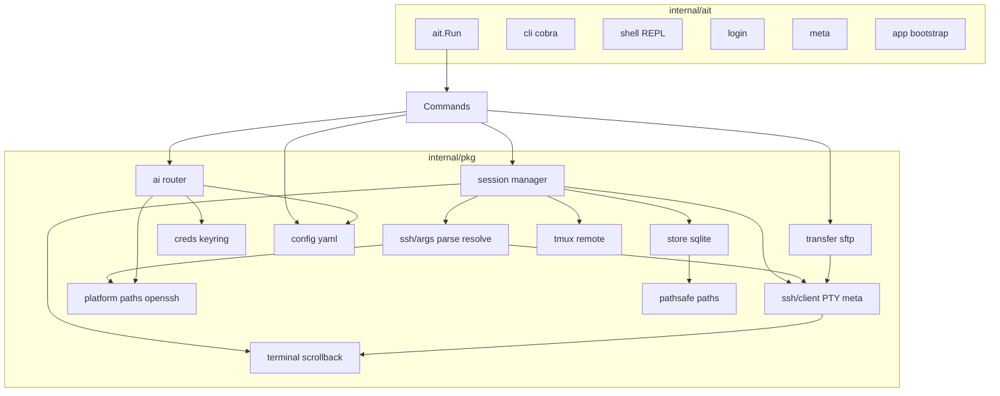
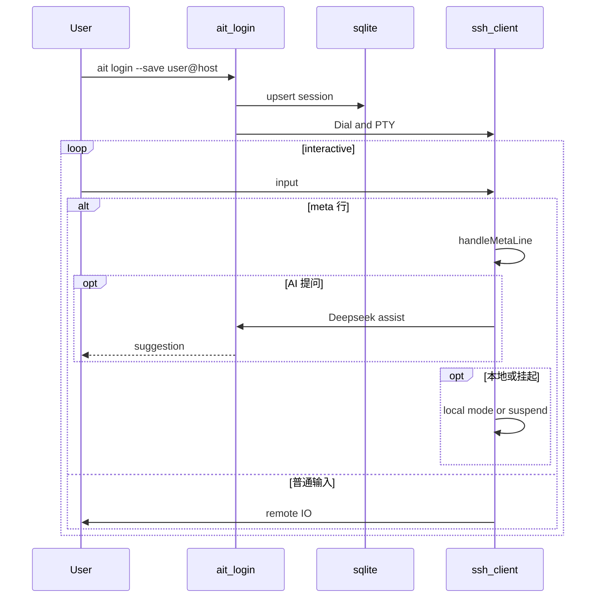
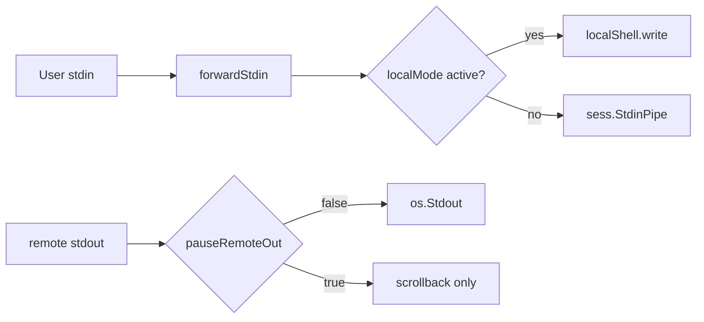
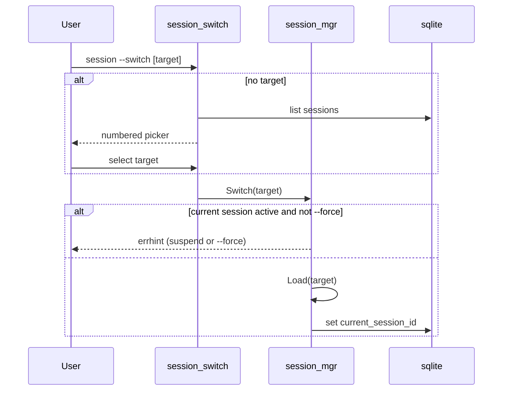
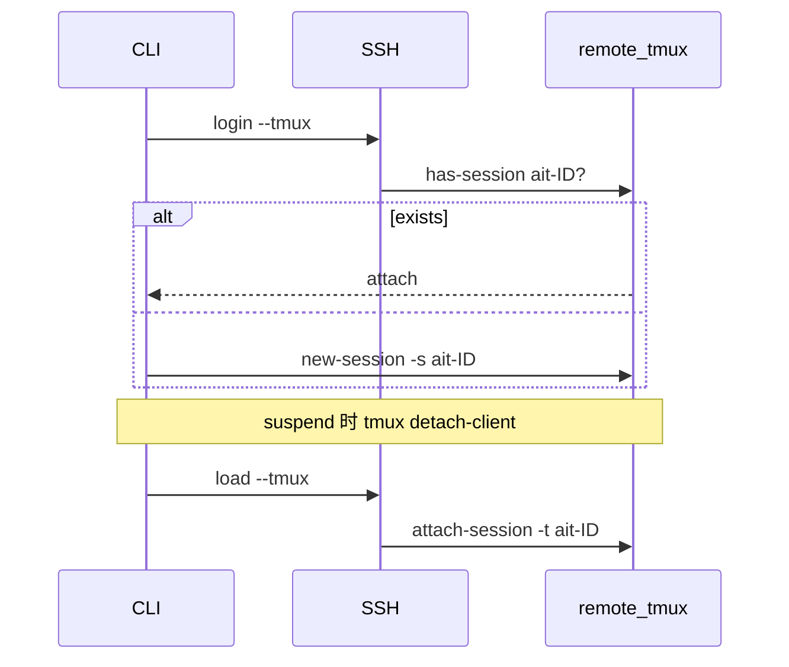
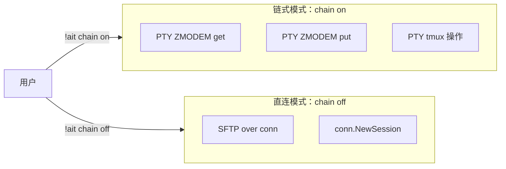

# AiT：架构与行为说明

**语言：** [English](design.md) · 简体中文（本文）

本文档描述**当前主干**已实现的行为与包结构（非待办计划）。用户向导读 [`README.zh-CN.md`](../README.zh-CN.md)、[`docs/user-manual.zh-CN.md`](user-manual.zh-CN.md)；代码结构向导读 [`AGENTS.zh-CN.md`](../AGENTS.zh-CN.md)。

CLI 入口：[`internal/ait/root.go`](../internal/ait/root.go)（`Run` + cobra root）。依赖见 [`go.mod`](../go.mod)。目录：`cmd/ait` 薄入口 → `internal/ait` + `internal/pkg`。

## CLI 形态

```text
ait shell                                    # AiT> REPL（login/list/load 等）
ait ai                                       # 本机 AI 模式（AiT AI>）；ait shell 内也可输入 ai
ait ai model list                            # 列出已配置 AI provider（含 ENABLED 列）
ait ai ask [message...]                      # 单轮提问（无参数读 stdin）；SSH：!ait ai ask / !! ask
ait ai agent [message...]                    # 单轮 agent（工具执行）
ait ai provider enable|disable <provider>    # 启用/禁用某 provider 的路由
ait ai ollama status|setup|start|stop|disable  # 本地 Ollama（setup：models_dir + 安装前 [y/N]）
ait login [ssh-options] destination [command ...] [--save] [--alias NAME] [--password] [--tmux]
        # OpenSSH 兼容：-p -l -i -F -J -o 等；destination 为 [user@]host 或 config Host 别名
        # 需本机 OpenSSH 客户端 (ssh -G) 解析 config；数据面为 Go x/crypto/ssh（Win/macOS/Linux）
        # 新连接须 --save（按 id 书签）或 --alias（命名保存，隐含 --save）才写入 SQLite
        # 若 user@host:port 已在 session 列表中，login 会更新该行并刷新 auth TTL（无需 --save/--alias）
        # 带 command 时为一次性执行；新主机无 --save/--alias 时不持久化
        # 旧写法 --host/--user 仍向后兼容
ait session --list [-v]   # # 列用于按序号选择；-v 输出 FULL_ID（完整 UUID）
ait session --load [<id|alias>] [--tmux] [--password]   # 省略 id 可交互选择；id 须为 alias 或完整 UUID（非列表 ID 列）
ait session --suspend         # 本机 CLI；SSH 内请用 !ait suspend
ait session --switch [id|alias] [--tmux] [--password] [--force]  # 切换会话；省略 id 时交互选择
ait session --delete <id|alias|all> [--force]         # 删除单个或全部会话
ait get [ssh-flags] <paths...>   # OpenSSH 参数；路径/顺序见 get/put 小节
ait put [ssh-flags] <paths...>
ait config init|view|edit|validate|set|get ...   # YAML 配置；edit 用 $VISUAL/$EDITOR（Unix vi / Windows Notepad）
```

**AI 模式**（多 provider：Deepseek + MiniMax + 可选本地 Ollama；云端需密钥环 `ai.<provider>.api_key`，别名 `deepseek.api_key` / `minimax.api_key`）：**`ait ai [--model <云端-provider>]`** 或 **`ait shell` 内 `ai`** 进入本机 AI REPL（`AiT AI>`），`run` / `ait` 经确认后在本机执行。已连接 SSH 时用 **`!ait ai`** / **`!!`** 进入远程 AI（`AiT AI user@host>`），`run` 经确认后写入远程 PTY stdin。**`!ait ai` 作为 meta 子命令被阻断**。未配置云端 Key 且未启用 tiered Ollama 时 `!!` / `!ait ai` 本地 fail-closed。启用 **`ai.tiered.enabled`** 时，短句首轮走本地 Ollama（无需 Key）；长文/复杂题及 `--model` / REPL `model <云端>` 走云端默认与故障转移（`ai.default` / `ai.fallback`）。见 [AI 模式（双作用域）](#ai-模式双作用域) 与 [会话内 meta 协议](#会话内-meta-协议ait--)。

**`!ait local` / `!ait remote`** 切换本地/远程输入；**`!ait suspend`** 挂起会话；**`!ait chain [on|off]`** 切换链式模式（经 PTY 管道注入实现多跳 SSH 的文件传输与 tmux 操作）。

### 两种恢复模式（默认 vs `--tmux`）

| 模式 | 触发 | load 行为 | 远程进程 |
|------|------|-----------|----------|
| **默认（书签）** | 无 `--tmux` | 用已存连接信息重连；可选回放上次 suspend 的本地 scrollback | 不保证保活 |
| **tmux 保活** | `login`/`load` 加 `--tmux` | SSH 后 `tmux attach -t ait-<session_id>`（不存在则 `new -s`） | 断开连接后 shell/进程仍在 |

**新连接须使用 `--save` 或 `--alias` 才持久化**；若同一 user@host:port 已在 `ait session --list` 中，login 会自动更新该行并刷新认证 TTL。普通 `ait login host` 连接未知主机不写 SQLite。scrollback/`remote_cwd` 仅在 suspend 时作为增强项写入，不作为「真正保活」承诺。真正保活必须显式 `--tmux`。

## 架构总览



## 核心设计决策

| 主题 | 方案 | 说明 |
|------|------|------|
| CLI 框架 | [spf13/cobra](https://github.com/spf13/cobra) | 子命令清晰，与 `Run(args)` 对接 |
| SQLite | [modernc.org/sqlite](https://pkg.go.dev/modernc.org/sqlite) | 纯 Go、无 CGO，利于 Windows 交叉编译 |
| SSH | `golang.org/x/crypto/ssh` + `RequestPty` | 标准库生态，跨平台 |
| 本地 PTY | Unix: `github.com/creack/pty`；Windows: ConPTY（`golang.org/x/sys/windows` 或成熟封装） | 分文件 `pty_unix.go` / `pty_windows.go` |
| AI 多 provider | 云端 Deepseek + MiniMax；可选本地 Ollama（OpenAI 兼容）；按 `api_style` 选协议 | `internal/pkg/ai`：tiered 启发式 → Ollama，否则云端默认优先故障转移；Ollama 失败升到云端 |
| 密钥/密码 | 私钥路径入 SQLite；SSH 密码/密钥口令经 keyring 缓存；**认证 TTL 默认 7 天** | 过期后 `load` 必须重新输入 |
| SSH 主机密钥 | 默认 `~/.ssh/known_hosts`；未知主机报错并提示 `ssh-keyscan` | `AIT_SSH_INSECURE=1` 仅开发用 |
| 系统命令 | `exec.LookPath` + `runtime.GOOS` | 缺失时 Deepseek 安装建议 |
| 远程保活 | 仅 `--tmux` 时启用 | 调用系统 `tmux`（远程需已安装，缺失则 AI 建议安装） |

### 会话语义与 7 天认证 TTL

**`login` / `load` 与认证 TTL：**

- **`login` 成功**：写入 `auth_expires_at = now + session.auth_ttl`（默认 **168h / 7 天**）
- **`load` / `switch` 免密重连**：在 TTL 内使用 keyring 缓存，**不刷新** `auth_expires_at`
- **重新输入密码后**（`--password` 或交互提示，且 dial 成功）：刷新 `auth_expires_at`
- **超过 TTL**：`load` / `switch` 前必须重新输入 SSH 密码；验证成功后刷新 TTL

**挂起时持久化：**

- **必有**：连接配置 + `auth_expires_at` + `status`
- **可选（suspend 时）**：本地 `cols`/`rows`、scrollback sidecar、`remote_cwd`（便于默认模式下的体验，非 tmux 保活）
- **`--tmux` 时额外**：`tmux_session_name`（固定 `ait-<session_id>`）、`tmux_enabled` 标志

**默认 `load`（无 `--tmux`）：**

1. 检查 TTL → 过期则要求密码/口令
2. SSH 重连
3. 若有 `session_state`：回放 scrollback、`cd` 到 `remote_cwd`（有则执行）
4. 进入交互

**`load --tmux`：**

1. TTL 检查同上
2. SSH 连接 → 检测远程 `tmux has-session -t ait-<id>` → attach，否则 `tmux new-session -s ait-<id>`
3. 进入 tmux 前台（suspend 时对已存在会话执行 `detach`）

**限制说明：** 未加 `--tmux` 时，挂起仍断开 SSH，**不保证**远程进程继续运行；加 `--tmux` 且远程有 tmux 时，才实现真正会话保持。

### 会话切换（`session --switch`）

在多个已保存会话之间切换。本地无前台 SSH 时，行为等同 `load <target>`。

| 场景 | 行为 |
|------|------|
| 本地无前台 SSH | 等同 `load <target>`（TTL/密码规则相同） |
| DB 中当前会话仍为 `active` | **阻断**并输出 errhint：须先在 SSH 内 `!ait suspend`，或 `session --switch --force`（仅标记当前为 suspended，**不**保存 scrollback/cwd）→ 再 **load 目标** |
| 未指定目标 | `list` 展示编号菜单，用户选择 id/alias（支持 `--tmux` 继承当前连接模式或按目标会话 DB 中 `tmux_enabled`） |

```text
ait session --switch              # 交互式选择
ait session --switch prod         # 按 alias/id 切换
ait session --switch prod --tmux  # 切换并以 tmux 模式 attach 目标
```

**交互 SSH 内：** 会话切换以 CLI `ait session --switch` 为主；挂起使用 `!ait suspend`。

**与 `load` 区别：** `load` 仅连接目标；`switch` 会检查当前会话是否仍为 `active`，须先挂起（或 `--force`）再加载目标，并更新 `app_meta.current_session_id`。

**tmux 模式切换：** 当前会话 `detach` → 目标会话 SSH → `tmux attach -t ait-<target_id>`；两台主机上的 tmux 会话互不影响。

## 数据模型（SQLite）

数据库文件：`<AppRoot>/ait.db`，其中 **`AppRoot`** 为统一运行时目录（[`platform.AppRoot()`](../internal/pkg/platform/paths_appdir.go)）。默认：Linux `~/.local/share/ait`，macOS `~/Library/Application Support/ait`，Windows `%LOCALAPPDATA%\ait`。可用 **`AIT_HOME`** 或 **`AIT_DATA_DIR`** 覆盖。完整目录树见 [运行时文件布局](#运行时文件布局approot)。

```sql
CREATE TABLE sessions (
  id              TEXT PRIMARY KEY,
  alias           TEXT UNIQUE,
  host            TEXT NOT NULL,
  port            INTEGER NOT NULL DEFAULT 22,
  username        TEXT NOT NULL,
  identity_path   TEXT,
  auth_method     TEXT NOT NULL,  -- key | password | agent
  auth_expires_at INTEGER NOT NULL,  -- Unix 秒；load 免密截止
  tmux_enabled    INTEGER NOT NULL DEFAULT 0,
  tmux_session    TEXT,           -- 默认 ait-<id>
  created_at      INTEGER NOT NULL,
  updated_at      INTEGER NOT NULL,
  status          TEXT NOT NULL   -- active | suspended
);

CREATE TABLE session_state (
  session_id        TEXT PRIMARY KEY REFERENCES sessions(id) ON DELETE CASCADE,
  cols              INTEGER,
  rows              INTEGER,
  remote_cwd        TEXT,
  scrollback_path   TEXT,
  suspended_at      INTEGER
);

CREATE TABLE app_meta (
  key   TEXT PRIMARY KEY,
  value TEXT NOT NULL
);
-- 键 current_session_id：当前/上次前台会话 UUID（switch/load/login 后更新）
```

- `login` 且带 `--save`/`--alias`，或目标 **已存在** 于 session 列表 → upsert `sessions`、设置 `auth_expires_at`；若 `--tmux` 则 `tmux_enabled=1` 并初始化远程 tmux；写 `app_meta.current_session_id`。连接新主机且无上述 flag 时不 upsert。
- `suspend` → 写 `session_state`，`status=suspended`；tmux 模式先 `tmux detach` 再断 SSH
- `session --delete <id>` / `session --delete all` → 删 DB 行、scrollback sidecar 及 per-session keyring 条目（**不**杀远程 tmux 会话）

**凭证存储：** SSH 密码不落明文 SQLite；7 天内有期缓存放 **OS keyring**（key: `ait/session/<id>/unlock`），过期自动要求重输。私钥仍只存路径。AI provider API Key 使用 `ai/<provider>/api_key`（CLI：`ait config set ai.deepseek.api_key`；旧键 `deepseek.api_key` 读取时迁移）。桌面环境优先 Secret Service / Keychain / WinCred；无 D-Bus 等 **headless** 场景回退到 `<AppRoot>/keyring` 加密文件目录（`platform.KeyringDir`）。可用 `AIT_KEYRING_DIR` 覆盖路径；headless 建议设置 `AIT_KEYRING_FILE_PASSWORD`（默认开发口令仅适合本机）。`AIT_KEYRING_BACKEND=file` 可强制仅文件后端。

**运行时文件布局（`AppRoot`）：** 所有 AiT 自有运行时文件位于同一目录（`platform.AppRoot()` = `DataDir()` = `ConfigDir()`）。可通过 **`AIT_HOME`**（未设置时可用 **`AIT_DATA_DIR`**）覆盖。默认：Linux `~/.local/share/ait`，macOS `~/Library/Application Support/ait`，Windows `%LOCALAPPDATA%/ait`。Linux 升级时，旧版 `$XDG_CONFIG_HOME/ait/config.yaml`（通常为 `~/.config/ait/config.yaml`）在首次 `config.Load` 时迁入 `AppRoot`。目录结构：

```text
<AppRoot>/
├── config.yaml       # 主配置（ait config init / view / edit / validate / set / get）
├── ait.db            # SQLite 会话
├── repl_history      # REPL 输入历史
├── scrollback/       # suspend 侧车
├── keyring/          # 文件密钥环回退
└── ollama/models/    # 推荐 Ollama models_dir 默认路径
```

首次安装：执行 `ait config init` 创建或补全 `config.yaml`（仅缺失项；API key 仍走 keyring）。**`ait config view`** 打印文件（缺失时自动 init）。**`ait config edit`** 经 `$VISUAL`/`$EDITOR` 编辑（Unix 默认 `vi`，Windows 默认 Notepad），保存后自动校验。**`ait config validate`** 检查 YAML 语法与配置项（session TTL、provider URL、tiered 等）；逐条打印错误原因；失败 exit 1。

## 包布局（当前）

| 路径 | 职责 | 主要文件（示例） |
|------|------|------------------|
| [`internal/ait/`](../internal/ait/) | CLI 入口 | `root.go` |
| [`internal/ait/cli/`](../internal/ait/cli/) | 精简 Cobra 根（`Execute`、`registry.AttachRoot`） | `root.go`、`manager.go` |
| [`internal/ait/registry/`](../internal/ait/registry/) | 顶层命令注册表（OCP）；根 `--help` | `register.go`、`root_help.go`、`all/imports.go` |
| [`internal/pkg/helpdoc/`](../internal/pkg/helpdoc/) | 共用 `--help` 排版 | `body.go`、`bind.go`、`common.go` |
| [`internal/ait/app/`](../internal/ait/app/) | Manager 引导 | `manager.go`, `context.go` |
| [`internal/ait/login/`](../internal/ait/login/) | login 解析与帮助 | `run.go`, `help.go` |
| [`internal/ait/shell/`](../internal/ait/shell/) | `ait shell` REPL | `repl.go`, `exec.go`, `parse.go` |
| [`internal/ait/ai/`](../internal/ait/ai/) | `ait ai` 子树（`ask`、`agent`、`provider`、`ollama`，`subregistry`） | `cmd.go`、`help.go`、`register.go` |
| [`internal/ait/ai/mode/`](../internal/ait/ai/mode/) | `ait ai` / `!ait ai` AI REPL | `repl.go`、`exec.go`、`run_local.go` |
| [`internal/ait/meta/`](../internal/ait/meta/) | 会话内 `!ait` | `exec.go` |
| [`internal/pkg/ssh/args/`](../internal/pkg/ssh/parse/) | OpenSSH argv、`ssh -G`、映射 Options | `parse.go`, `resolve.go`, `*_helpers.go` |
| [`internal/pkg/session/`](../internal/pkg/session/) | 会话生命周期 | `manager.go`, `manager_helpers.go` |
| [`internal/pkg/store/`](../internal/pkg/store/) | SQLite | `store.go`, `store_scan.go`, `session_helpers.go`, `open_helpers.go` |
| [`internal/pkg/ssh/client/`](../internal/pkg/ssh/client/) | 拨号、PTY、`!ait` meta、本地模式、静默注入、远程提示符 emit | `client.go`, `client_dial.go`, `client_init_helpers.go`, `client_init_prompt_emit_helpers.go`, `dialchain.go`, `meta/scanner.go`, `localmode/shell.go`, `hostkeys.go`, `prompt/prompt.go`, `inject.go`, `transfer_zmodem.go` |
| [`internal/pkg/terminal/`](../internal/pkg/terminal/) | scrollback、回放、路径 | `scrollback/delta.go`、`terminal/path.go` |
| [`internal/pkg/tmux/`](../internal/pkg/tmux/) | 远程 tmux | `remote.go`, `remote_pty.go` |
| [`internal/pkg/ai/`](../internal/pkg/ai/) | 多 provider 路由、tiered Ollama、模型列表 | `router.go`, `tiered.go`, `models_list.go`, `router_openai.go`, `router_anthropic.go`, `client.go`, `chat.go` |
| [`internal/pkg/transfer/`](../internal/pkg/transfer/) | SFTP get/put（单文件）、路径默认 | `transfer.go`、`parse.go`、`path_defaults.go` |
| [`internal/pkg/platform/`](../internal/pkg/platform/) | `AppRoot`、数据目录、OpenSSH、编辑器 | `paths_appdir.go`, `editor.go`, `openssh.go`, `exec.go` |
| [`internal/pkg/config/`](../internal/pkg/config/) | YAML 配置、init、validate | `config.go`, `config_load.go`, `config_init.go`, `config_validate.go` |
| [`internal/pkg/creds/`](../internal/pkg/creds/) | OS keyring | `keyring.go` |
| [`internal/pkg/pathsafe/`](../internal/pkg/pathsafe/) | 会话/路径校验 | `path.go` |
| [`configs/ait.example.yaml`](../configs/ait.example.yaml) | 配置模板（密钥走 keyring） | — |

`pkg/` 暂不放公开 API。包级辅助函数放在 `*_helpers.go`；带方法的 struct 单文件（见 [`go-structure.mdc`](../.cursor/rules/go-structure.mdc)）。

## 关键流程

### 提示符（AiT> / AiT Local> / AiT user@host:目录[:分支]>）

| 场景 | 提示符 | 设置方式 |
|------|--------|----------|
| `ait shell`（未连远程） | `AiT> ` | REPL 打印 [`BasePrompt`](../internal/pkg/ssh/client/prompt/prompt.go) |
| SSH 远程 | `AiT user@host:目录[:git分支]> ` | [`RemotePromptInitialCommands`](../internal/pkg/ssh/client/prompt/prompt.go) 在 `load`/`login` 后注入动态 bash `PS1` / zsh `PROMPT`；**`session.remote_prompt.path`**：`short`（默认，末级目录名）或 `absolute`（`$PWD` 家目录显示为 `~`）；Git 仓库时追加 `:分支`。setup 期间 `pauseRemoteOut` 将远程输出缓冲进 scrollback（R1 过滤 setup 泄漏）。[`finishRemoteSetup`](../internal/pkg/ssh/client/client_init_helpers.go) 先 flush `setupFilter.pending`，再经 [`emitBufferedRemotePrompt`](../internal/pkg/ssh/client/client_init_prompt_emit_helpers.go)（raw TTY 前缀 `\r`）或 `\r` refresh 写 stdout；`remotePromptShown` 仅在 emit 成功或首条 prompt 经 [`handleRemoteOutput`](../internal/pkg/ssh/client/client_interactive_helpers.go) 到达 stdout 后置位，避免 refresh 回显被 duplicate 过滤（R2/W4 仍丢弃后续 precmd 重复）。login/load/nested 共用此路径，连接后应**无需按 Enter** 即见远程提示符。 |
| SSH 内层（会话内 `ssh`） | 与 SSH 远程相同，作用于 **active** 跳板 | 在 AiT 会话中执行简单 `ssh user@host` 后，见到 MOTD 且输出安静时自动注入 PS1 并开启 chain 模式；也可用 `ait login -J jump,final` 一次登录到最终主机 |
| SSH 本地模式 | `AiT Local> ` | 静默 rc / env（[`localmode/shell.go`](../internal/pkg/ssh/client/localmode/shell.go)） |

**`ait shell`**：行级 REPL，可直接输入 `login`、`load`、`list`、`help` 等（无需 `!ait` 前缀）。在 shell 内 `login` 结束后回到 `AiT> `；系统 shell 执行 `ait login` 结束后回到 OS shell。

**本地 REPL 输入（UTF-8，macOS / Linux / Windows）：** 交互式 `ait shell` 与本机 `ait ai` 通过 [`terminal.ReadLine`](../internal/pkg/terminal/lineedit.go) 以 **UTF-8** 读取 stdin（Emacs 行编辑、方向键、Up/Down 遍历已加载输入历史）。请使用 UTF-8 终端：Linux/macOS 设置 `LANG=*.UTF-8`；Windows 推荐 **Windows Terminal** 并启用 UTF-8（避免非 UTF-8 代码页）。IME 组字由终端负责，确认后以 UTF-8 字节送入进程（AiT 不绘制预编辑下划线）。管道/重定向 stdin（`echo … | ait shell`）本就支持 UTF-8；SSH 远程 shell 按字节转发，不受此限制。

**TTY 快捷键（本机 REPL）：** Ctrl+A/E（行首/行尾）、Left/Right（光标）、Up/Down（召回已加载输入历史，含跨会话记录）、**Ctrl+R**（输入历史反向增量搜索）、Ctrl+U/K/W（删行/删至行尾/删词）、Backspace、Tab、Ctrl+C（取消当前行）、Ctrl+D（空行 EOF）、Ctrl+L（清屏保留缓冲）。历史仅记录主提示符下 Enter 提交的命令，不含确认 `[y/N]`、选 session 输入或 `!ait local` 的 env/rc 脚本。见 `help` / `ait shell --help` 的 Keys 段。

**输入历史持久化：** 本机 `ait shell` 与 `ait ai` 共用 bash 风格 **`history`** 内置命令（列出、`history n`、`-c`、`-d`、`-s`、`-a`、`-r`、`-w`），与 Up/Down、Ctrl+R 操作同一内存列表。提交命令会追加到 **`<AppRoot>/repl_history`**（权限 `0600`）；REPL 启动时加载。AI 模式下 **`clear`** 仅清对话历史；**`history`** 管理输入行历史。

**清屏（`ait shell` / 本机 TTY）：** 在 `ait shell` 中输入 **`clear`** 通过 [`terminal.ClearScreen`](../internal/pkg/terminal/screen.go) 清空终端（VT100 ANSI）。TTY 下 **Ctrl+L** 清屏并在底部重显当前提示符与未提交行（保留行缓冲，与 bash/readline 一致）。本机 `ait ai` TTY 也支持 **Ctrl+L** 仅清显示；**`ait ai` 的 `clear`** 仍表示清空对话历史，与 shell 的 `clear` 不同。

### 会话内 meta 协议（!ait / !!）

实现位于 [`internal/pkg/ssh/client/meta/scanner.go`](../internal/pkg/ssh/client/meta/scanner.go) 与 [`client.go`](../internal/pkg/ssh/client/client.go) 的 `forwardStdin` / `handleMetaLine`。已弃用 `\ait` 前缀。

| 命令 | 行为 |
|------|------|
| `!ait help` / `!ait` | 打印会话内命令与可本地执行的 CLI 说明 |
| `!ait <子命令> …` | 在本地执行对应 `ait` CLI（如 `!ait list`）；`login`/`load` 请用 `ait shell` |
| `!ait ai [问题]` | 进入**远程** AI REPL；可选首条提问 |
| `!! [问题]` | `!ait ai` 别名（`!!` 后须有空格） |
| `!ait ai`（子命令形式） | **阻断** — 使用行首 `!ait ai`，勿经 CLI runner |
| `!ait local` | 进入本地模式（见下节） |
| `!ait remote` | 退出本地模式，恢复远程 stdin |
| `!ait suspend` | 挂起会话（等同 CLI `suspend`） |
| `!ait get <remote> [<local>]` | 经 SFTP 从当前 SSH 连接下载单个文件（不重新认证）；省略 local 时默认为 `./basename`；相对 remote 路径在 SFTP 前按 **active shell** cwd 解析 |
| `!ait put <local> [<remote>]` | 经 SFTP 向当前 SSH 连接上传单个文件（不重新认证）；省略 remote 时默认为 `./basename`（本地源文件名）；相对 remote 路径在 SFTP 前按 **active shell** cwd 解析 |
| `!ait chain [on\|off]` | 切换链式模式：使用 PTY 管道注入替代 SFTP 进行文件传输和 tmux 操作；当已 SSH 超越直连主机时需要 |

**识别规则：**

- 字节级 `metaScanner`：严格匹配 opener（`!ait ai `、`!ait local`、`!! ` 等）；行内出现 `!` 亦进入 holding，避免远程 zsh 在无换行提示符下吞掉 `!ait`。
- `aiAvailable == false`（未配置 API Key）时 fail-closed：行首 `!!…` / `!ait…` 不进远程；仅**非空** AI 问题才 stderr 提示配置 key；空问题只打印 usage。
- meta 行由本地 echo，不写入远程 PTY；用户可见消息经 `termPrintln` / `aitModeNotice` 使用 `termEOL`（`\r\n`）适配 raw TTY。

### login



- **配置解析**：`internal/pkg/ssh/args` 调用本机 `ssh -G`（`platform.OpenSSHPath`：Linux/macOS PATH；Windows 另试 `System32\OpenSSH\ssh.exe`）
- **拨号**：`client.DialChain` 支持 `ProxyJump` / `ProxyCommand`（Unix `sh -c`，Windows `cmd /c`）
- **一次性命令**：`ait login host cmd` → `RunRemoteCommand`，退出码透传；**新主机**无 `--save`/`--alias` 时不写 SQLite。对已存在的 user@host:port 即使无上述 flag 也会更新该行（刷新 auth TTL、设置 current session）；新主机带 `--save` 或 `--alias` 会 upsert 并设为 **current session**（`app_meta.current_session_id`），便于后续 `session --load` / `--switch`。
- 交互式 login 在 `--save`/`--alias` 或连接已存在时写入/更新会话行；未保存会话时 `!ait suspend` 会提示需保存
- PS1 setup 结束后，本地终端立即显示远程 AiT 提示符（缓冲 emit 或 refresh 回显，非静态占位符）
- 认证顺序：`-i` / config `IdentityFile` → SSH agent → `~/.ssh/id_ed25519` / `id_rsa`

### 本地模式（!ait local / remote）

SSH 连接与子 shell **保持**；stdin 在本地 PTY 与远程 `stdin` 间切换，远程 stdout 在本地模式下暂停显示（仍写入 scrollback）。



| 主题 | 说明 |
|------|------|
| 子进程 | [`localmode/shell.go`](../internal/pkg/ssh/client/localmode/shell.go)：`creack/pty` 启动 `$SHELL`（Windows 为 `ComSpec`） |
| 提示符 | 常量 `AiT Local> `；bash `PS1` 使用 `\[\]…\[\]`；环境变量 `AIT_LOCAL_MODE=1`、`PS1`、`PROMPT`（Windows cmd 另设 `PROMPT`） |
| 静默设置 | **不向终端打印** `export PS1=…` 等 setup 行：bash 用 `--rcfile` 临时 rc；zsh 用 `ZDOTDIR` 最小 `.zshrc`（source 用户 rc 后再次 `export PROMPT`）；临时目录在 `stop()` 时删除 |
| 生命周期 | `enterLocalMode` / `exitLocalMode` / `onLocalShellExit`；`closing` 抑制预期 ptmx 关闭错误 |
| 尺寸 | [`resize.go`](../internal/pkg/ssh/client/resize.go)：SIGWINCH 同步本地 PTY 与远程 `WindowChange` |
| 高级 | 用户可在 `.zshrc` 中检测 `AIT_LOCAL_MODE=1` 自定义主题（可能覆盖 `PROMPT`） |

### suspend / list / load

- **suspend**：`!ait suspend`；tmux 模式先 detach；写 `session_state`（可选 scrollback/cwd）→ 关 SSH
- **list**：表格输出 `#`、`ID`（alias 或 8 位前缀）、`TARGET`（`user@host:port`）、`STATUS`、`TMUX`、`REMAINING`（auth TTL）；`-v` 增加 `FULL_ID`（`--load` / `--switch` 请用 alias 或完整 UUID，勿用 ID 列短码）
- **load**：TTL 校验 →（过期则读密码）→ 重连 → 默认回放+cwd 或 `--tmux` attach → 更新 `current_session_id`
- **switch**：当前会话为 `active` 且未 `--force` 时阻断并 errhint；`--force` 时仅标记当前 suspended、不保存 scrollback/cwd → `Load(target)`；目标与当前相同则 no-op 并提示

### session --switch 流程



### session 清理

```text
ait session --delete all         # 删除全部 sessions + session_state + sidecar + keyring 条目
ait session --delete <id|alias>  # 删除单条；存在则确认提示（--force 跳过）
```

Cobra 结构：`ait session` 的 **`--delete` 为 string flag**（`--delete all` 或 `--delete <id|alias>`），非 `delete` 子命令树。`all` 须二次确认，除非 `--force`。

- `delete all`：事务内清空两表；遍历数据目录删除 scrollback 文件；批量清除 keyring `ait/session/*`
- `delete <id|alias>`：`ON DELETE CASCADE` 清理 `session_state`；删对应 sidecar 与 keyring 项

### tmux 集成（`--tmux`）



- 远程无 `tmux`：`LookPath` 失败 → `ai.SuggestInstall`（apt/brew 等）
- 会话名确定性：`ait-<session_id>`，避免与用户手工 tmux 冲突
- Windows 本地客户端仍可 `load --tmux`，但远程主机通常为 Linux/macOS

### get / put

实现：[`internal/pkg/transfer/`](../internal/pkg/transfer/)（SFTP；路径默认见 [`path_defaults.go`](../internal/pkg/transfer/path_defaults.go)）、[`transfer_route.go`](../internal/pkg/ssh/client/transfer_route.go) + [`internal/pkg/transfer/route/`](../internal/pkg/transfer/route/)（会话内后端选择）、[`transfer_zmodem.go`](../internal/pkg/ssh/client/transfer_zmodem.go) + [`internal/pkg/transfer/zmodem/`](../internal/pkg/transfer/zmodem/)（PTY ZMODEM）、[`internal/pkg/lrzsz/`](../internal/pkg/lrzsz/)（远端探测与可选自动安装）。**仅支持单个普通文件**；目录会返回明确错误。

**TTY 进度**（stderr，raw TTY 下 CRLF 安全）：`get … → …` / `put … → …`，可选 `handshake…`，再 **`copying… N%`**（SFTP 与链式 ZMODEM 均在同一行内刷新）。100% 后：SFTP 显示 **`closing…`**；链式 ZMODEM 显示 **`finishing…`**（get/put 对称，含链式 put 上传完成后收尾）；随后 **`done: get …`** / **`done: put …`**。传输中 Ctrl+C 可在数秒内取消。

会话内 `!ait get`/`put` 使用**统一路由**：**直连**（chain 关闭、与拨号目标同 host）始终 **SFTP**；**链式**（active shell 比拨号目标更深）探测 `sz`/`rz`，有则 **PTY ZMODEM**。直连且无 lrzsz 时**回退 SFTP**；链式且无 lrzsz 时给出安装指引，交互 TTY 下 `[y/N]` 授权后可自动安装（Linux/macOS/Windows 包管理器，可能需要远端 `sudo`）。ZMODEM 使用专用 PTY 注入（无 `stty` 包装）；握手失败约 30s 超时；直连 ZMODEM 失败时可回退 SFTP。

当用户在会话内手动 SSH 超越拨号目标时，SFTP 只能到达拨号目标。**链式模式**（`!ait chain on` 或主机名不匹配时自动启用）必须经 PTY **ZMODEM**。**login ProxyJump** 不等于链式：`DialChain` 到最终主机后，无 lrzsz 时回退 SFTP，与独立 `ait get`/`put` 一致。AiT 客户端本地为纯 Go 协议栈，无需安装 lrzsz。

| 模式 | 命令 | 认证 |
|------|------|------|
| 独立 CLI | `ait get [flags] <paths…>` / `ait put [flags] <paths…>` | [`args.ParseTransfer`](../internal/pkg/ssh/parse/transfer_parse.go) + [`args.Resolve`](../internal/pkg/ssh/resolve/resolve.go) + [`DialChain`](../internal/pkg/ssh/client/dialchain.go)（与 login 相同认证，含密码提示） |
| SSH 会话内 | `!ait get …` / `!ait put …` | 复用 [`handleMetaLine`](../internal/pkg/ssh/client/client.go) / [`client_transfer.go`](../internal/pkg/ssh/client/client_transfer.go) 的**当前连接**，**不二次拨号** |

**独立 CLI 参数与路径**（flag 与路径**顺序无关**；支持粘连如 `-p22`、`-i~/.ssh/id`）：

- OpenSSH 兼容：`-p`、`-l`、`-i`、`-F`、`-J`、`-o`、旧式 `--host`/`--user`/`--port`/`--identity`，以及 `--password`
- AiT：`--session <id|alias>`（已保存会话；远程路径可为该主机上的裸 `/path`）
- **单路径（get）**：`user@host:/remote/file` — 本地默认 `./basename`
- **单路径（put）**：`user@host:/remote/file` — 本地默认 `./basename`；或 `./local/file` 配合 `--session` — 远程默认 `./basename`
- **两个路径**：`user@host:/remote/file` 与本地路径，顺序任意
- **三个路径**：`destination` + 远程文件路径 + 本地路径（顺序任意），例如 `ait get deploy@10.0.0.5 /var/log/app.log ./app.log -F ~/.ssh/config`
- **两个路径 + `--session`**：本地路径与远程服务器路径（顺序无关；通过 `./` 或本地已存在文件识别本地路径）

**会话内**（`!ait get` / `!ait put`）：get 为 remote + 可选 local（默认 remote basename）；put 为 local + 可选 remote（默认 local basename）；相对 remote 在传输前按 active shell cwd 解析；不支持 SSH flag。

### 代理链式模式（!ait chain）

**login 时使用 ProxyJump / `-J`** 经 `DialChain` 到达最终主机；该登录下的会话内 `!ait get`/`put` 默认 **SFTP**，与独立 `ait get`/`put` 一致。**链式模式**适用于**交互 shell 比拨号连接更深**的情况（通常在会话内手动 `ssh` 之后）。

当连接路径为 `本地 → 堡垒机`（login）再手动 `ssh internal` 时，AiT `Client` 仅持有到堡垒机的直连 SSH 会话。SFTP（`conn.NewSession()`）及基于 `conn.NewSession()` 的 tmux 操作只能到达该拨号目标——**无法**直接到达 internal。已通过 PTY 管道工作的功能（AI 模式 `!!`、scrollback 捕获、远程 cwd 检测）不受跳板数量影响，因为 PTY stdin/stdout 穿越所有 SSH 连接。

**链式模式**（`!ait chain on`，嵌套 SSH 时会话内 `ssh` 成功后自动启用，或传输检测到主机名不一致时自动启用）将文件传输和 tmux 操作从 SFTP/直连会话切换为 PTY 管道注入。会话内简单 `ssh user@host` 在见到 MOTD 且输出安静后，还会在内层 shell 注入与 login 相同的 AiT `PS1`/`PROMPT`（`session.remote_prompt.path` 一致）。所有 AiT 注入的命令均为静默（在历史记录和终端中不可见）：

| 层 | 机制 |
|----|------|
| 历史抑制 | 空格前缀（`ignorespace`）+ 登录时注入 `HISTCONTROL=ignorespace:erasedups` / `setopt HIST_IGNORE_SPACE` |
| 回显抑制 | 在注入命令前后使用 `stty -echo` / `stty echo` 包装 |
| 输出捕获 | 纯文本定界符（`AIT_CAPTURE_B_f3e7a1c9` / `AIT_CAPTURE_E_f3e7a1c9`）包裹命令输出，从 scrollback delta 解析（snap 前缀被截断时回退全文搜索） |

**文件传输**（统一路由 + `ZModemTransfer`）：有 lrzsz 时 PTY ZMODEM；直连无 lrzsz 回退 SFTP；链式无 lrzsz 时可 `[y/N]` 授权自动安装。AiT 客户端无需本地 lrzsz。

**tmux 操作**（`tmux/remote_pty.go`）：`HasSessionViaPTY`、`NewSessionViaPTY`、`DetachViaPTY`、`PanePathViaPTY`、`EnsureViaPTY` 通过 PTY 管道注入 tmux 命令，而非新开 SSH 会话。退出码检测使用 `echo "AIT_EXIT_$?"` 模式。

**`RunPTYCapture` 改进**：此前通过原始 `io.WriteString(stdin, cmd+"\n")` 发送命令，会泄露到 bash/zsh 历史记录。现使用 `Client.Inject(stdin, cmd, InjectOpts{SuppressEcho: false})` —— 空格前缀使命令被历史抑制，但终端中仍可见（AI 模式期望用户看到其命令）。



| 功能 | 直连模式（chain off） | 链式模式（chain on） |
|------|----------------------|---------------------|
| `!ait get` / `!ait put` | SFTP（直连） | ZMODEM；否则安装 lrzsz（提示） |
| tmux `--tmux` | `conn.NewSession()` | PTY 注入（`HasSessionViaPTY` 等） |
| AI `!!` / `!ait ai` | PTY 管道（两种模式均可） | PTY 管道（两种模式均可） |
| Scrollback / cwd | PTY 管道（两种模式均可） | PTY 管道（两种模式均可） |
| 远程要求 | 标准 | active shell 上 **lrzsz**（`sz`/`rz`，Unix-like） |

**实现**：[`inject.go`](../internal/pkg/ssh/client/inject.go) + [`inject_helpers.go`](../internal/pkg/ssh/client/inject_helpers.go)（静默 PTY 注入）；[`transfer_zmodem.go`](../internal/pkg/ssh/client/transfer_zmodem.go) + [`internal/pkg/transfer/zmodem/`](../internal/pkg/transfer/zmodem/)（ZMODEM 文件传输）；[`zmodem_session.go`](../internal/pkg/ssh/client/zmodem_session.go)（PTY 独占 tap）；[`tmux/remote_pty.go`](../internal/pkg/tmux/remote_pty.go)（基于 PTY 的 tmux 操作）。

### AI 模式（双作用域）

包：[`internal/ait/ai/mode/`](../internal/ait/ai/mode/)（REPL、授权策略、Runner）；单轮：[`internal/ait/ai/ask/`](../internal/ait/ai/ask/)、[`internal/ait/ai/agent/`](../internal/ait/ai/agent/)；对话 API：[`internal/pkg/ai/chat.go`](../internal/pkg/ai/chat.go)。远程入口经 `InteractiveOpts.OnRemoteAI` 由 [`internal/ait/ai/cmd.go`](../internal/ait/ai/cmd.go) 注入（避免 import 环）。

| 入口 | 作用域 | 提示符 | 命令执行 |
|------|--------|--------|----------|
| `ait ai`、`ait shell` 内 `ai` | 本机 | `AiT AI(Ask)>` / `AiT AI(Agent)>` | `run` → 本机 shell；`ait` → 确认后跑 Cobra |
| SSH 内 `!ait ai`、`!!` | 远程 | `AiT AI(Ask) user@host>` / `AiT AI(Agent) user@host>` | `run` → PTY stdin（`cmd\n`）；不在本机 exec 远程任务 |

**REPL：** `help`、`exit`/`quit`、`clear`、`mode ask|agent`（默认 **agent** 规划并执行；**`mode ask`** 仅问答）、`approve each|session`（默认 **each**；**session** 低危首次同意后免问；`trust` 同 session）、`model`（路由状态）、`model list`、`model <云端-provider>`（`model ollama` 拒绝）、自然语言（Ask→`Chat`；Agent→工具循环）、`run` / 本机 `ait`。已弃用：`policy per-cmd|once` → `approve`（stderr 提示）。

**Agent 执行：** 支持 OpenAI tools 的走 function calling，否则 JSON。**只读命令**（如 `ls`、`git status`）在 Agent 模式下自动执行；写命令与高危及 Ask 模式行为仍须 `[y/N]` 确认。远程 `run_shell` 用 PTY+scrollback 截取；本机 `CombinedOutput`。交互式 TUI（`vim`/`less`/`top` 等）不自动执行。高危命令在 `approve session` 下仍逐条确认。

**多 provider 配置：** YAML `ai` 含 `default`（仅云端：`deepseek` 或 `minimax`）、可选 `fallback`、可选 `tiered`（`enabled`、`local_provider`、`max_prompt_chars`、`max_history_turns`、`complex_keywords`）、各 `providers.<id>`。旧版顶层 `deepseek:` 并入 `ai.providers.deepseek`。MiniMax 支持 `openai` / `anthropic`。Ollama 为 OpenAI 兼容 `http://127.0.0.1:11434/v1`（允许 localhost HTTP，无需 API key）。tiered 开启时 `ClassifyPrompt` 将简单首轮发往 Ollama；否则 Chat/Assist 按云端顺序（`--model` / REPL `model`，否则 `ai.default`，再 fallback）。Ollama 失败升到云端。`SuggestInstall` 始终走云端。系统提示注入事实字段 `ai_provider`、`ai_model`、`ai_mode`（`local_first` | `cloud_only`），避免模型编造后端。`AIT_AI_FAILOVER_LOG=1` 可在 stderr 打印切换。

**模型列表：** `ait ai model list` 与 REPL `model list` 输出已配置 provider（密钥、**ENABLED**、角色、可达性）及可选 Ollama tags。禁用的 provider 不会收到任何 Chat/Assist 请求。

**启用/禁用：** `ai.providers.<id>.enabled`（YAML 省略视为 true）。`ait ai provider disable minimax` 停止走 MiniMax；`ait ai provider enable ollama` 重新启用路由；完整本地安装用 `ait ai ollama setup`（缺失时 [y/N] 安装确认；拒绝则打印手动安装说明）。

**Ollama CLI（`ait ai ollama`）：** `setup` 交互选择 `models_dir`（`OLLAMA_MODELS`；备选 AiT 数据目录、`~/.ollama/models`、自定义；`--models-dir`）；写入 tiered 与 ollama 并探测/安装/拉模型；`status` 查配置与服务；`start`/`stop` 控制 `ollama serve`；`disable` 禁用 provider（可选 `--stop`）。见 [`internal/pkg/ollama/`](../internal/pkg/ollama/)。

**授权：** 每次执行前多行确认：`y` 仅本次，`c` 信任首词模式，`s` 信任本会话低危，`n` 跳过（高危仅 y/n）。`approve each`/`approve session` 命令不变；`exit`/`quit` 清除信任。

**单轮 ask：** `ait ai ask` 与 `!ait ai ask <msg>` / `!! ask <msg>` 走 [`ai/mode/chat`](../internal/ait/ai/mode/chat/) 的 `RunOnce`（单次对话，不进 REPL）；空 `ask` 返回 `ask requires a message`。

**SSH：** `handleAIMetaLine` 同步 `RunREPL` 并 `pauseRemoteOut`；不再异步单次 `Assist`。`!ait ai` / `!!` 后可跟首条问题，或 `ask <msg>` / `agent <msg>` 单轮。

**安装建议**（不变）：`platform.LookPath` 失败时由 `SuggestInstall` 提示安装方式。

## 跨平台要点

| 平台 | PTY / 终端 | 数据目录 | 常见缺失命令 |
|------|------------|----------|----------------|
| Linux | creack/pty + raw mode | XDG data home | 远程 `--tmux` 需 `tmux` |
| macOS | 同上 | Application Support | 远程 `brew install tmux` |
| Windows | ConPTY；OpenSSH 内置 | LocalAppData | `winget` / OpenSSH 功能 |

构建标签：`//go:build linux || darwin` 与 `windows` 分离 PTY 实现；`make test` 在 Linux CI 全量，Windows 目标至少 `go build` 通过。

## 依赖（当前 go.mod）

直接依赖：

- `github.com/spf13/cobra` — CLI
- `modernc.org/sqlite` — 会话库（纯 Go）
- `golang.org/x/crypto/ssh`、`golang.org/x/term` — SSH 与终端
- `github.com/99designs/keyring` — 密钥/密码缓存
- `github.com/google/uuid` — 会话 ID
- `github.com/pkg/sftp` — 文件传输（get/put）
- `github.com/sashabaranov/go-openai` — Deepseek（OpenAI 兼容）
- `gopkg.in/yaml.v3` — 配置

间接：`github.com/creack/pty`（Unix 本地模式 `!ait local`）。

新增依赖时优先 stdlib + `x/` 扩展，见项目规则。

## 测试策略（当前）

| 包 | 测试重点 |
|----|----------|
| `store` | CRUD、`:memory:` SQLite |
| `ssh/client` | meta 行、hostkeys、prompt、localmode、auth |
| `ssh/args` | parse/resolve、`ssh -G`（需本机 `ssh` 时 skip） |
| `session` | TTL/密码提示逻辑 |
| `ait` | REPL、shell 行解析、login help |
| `terminal`, `ai`, `config`, `transfer`, `platform`, `pathsafe` | 单元测试 |

门禁：`make test`、`make vet`；`make test-cross` 对 windows/darwin `go build`。

## 实现状态

以下能力已在当前代码库中实现：

- [x] Cobra CLI、`ait shell` REPL、config/keyring、`session.auth_ttl`
- [x] `login` / 交互 SSH、`ssh/args` + `ssh/client`（含 ProxyJump/Command）
- [x] `suspend` / `list` / `load` / `session --switch` / `session --delete`
- [x] `--tmux` 远程保活
- [x] `get` / `put`（SFTP，单文件）与双作用域 AI 模式（`ait ai`、`!ait ai` / `!!`）
- [x] 代理链式模式（`!ait chain on/off`）——经 PTY 管道注入实现多跳 SSH 的文件传输与 tmux
- [x] 跨平台构建（含 Windows OpenSSH 探测、分文件 proxy/resize）

## 风险与缓解

- **Windows PTY 复杂度高**：第一期可先保证「连接 + 非全屏交互」可用，再完善 ConPTY 尺寸/信号；`go build` Windows 为门禁
- **scrollback 过大**：超过阈值（如 512KB）写入 sidecar 文件，DB 只存 path
- **安全**：不在日志打印 API Key/密码；`!!` 上下文脱敏；keyring 条目随 `delete`/`delete all` 清除
- **TTL 边界**：时钟回拨用单调比较 + 文档说明；`auth_expires_at` 可在 `config` 中覆盖（最小 1h，最大 30d 防误配）
- **链式模式文件传输**：经 PTY 跑 lrzsz 兼容 ZMODEM，分块 CRC。active shell 须 **lrzsz**；v1 不支持 Windows OpenSSH 远端。多跳高延迟链路上大文件可能慢于直连 SFTP。

## 交付物

- 可执行 `bin/ait`（`make build`）
- [`configs/ait.example.yaml`](../configs/ait.example.yaml) 配置模板
- 用户说明：[`README.zh-CN.md`](../README.zh-CN.md)、[`docs/user-manual.zh-CN.md`](user-manual.zh-CN.md)；代码结构：[`AGENTS.zh-CN.md`](../AGENTS.zh-CN.md)
- `make test` / `make vet` / `make test-cross` 通过
