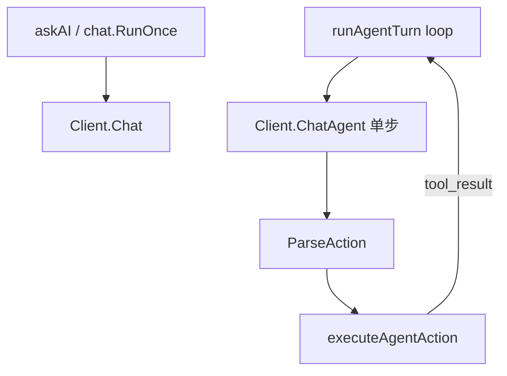

# 基于 Eino 的 AiT AI 模块重构计划

> **v8**（2026-06-18）：在 v7 基础上经仓库代码全盘 review 修正——`apitypes` 解循环、`Assist` 与 `Chat` 分流、`PromptMeta` 对齐现有类型、P4 `endpoint` 删除范围、`mode_test` 测试策略。路径 B；策略 A。验收 **E1–E12**。工期 **7–8 周**（Phase 1 含 apitypes 约 +2–3 天）。

归档自 Cursor 实施方案（v7 定稿）。

## 1. 目标与范围

### 1.1 目标

- 用 **Eino ChatModel**（`eino` + `eino-ext`）替换 `internal/pkg/ai/client` 自研 HTTP（`endpoint` + `router_*`）。
- 保留 `internal/pkg/ai/agent` 的 **FC/XML 适配**（`ToolCallToJSON`、`XMLToolCallToJSON`）直至专用路径废弃。
- **Agent 多步循环**留在 [`internal/ait/ai/mode/agent.go`](../../internal/ait/ai/mode/agent.go) 的 `runAgentTurn`（`maxSteps`、`tool_result:\n`、risk/approve）；每步仅 **一次** `ChatAgent` 等价调用。
- **不采用** Eino ADK 多步 Agent 或 ADK HITL（与 approve 冲突）。

### 1.2 当前实现基线（2026-06-18 实施后）

| 区域 | 路径 | 职责 |
|------|------|------|
| Eino ChatModel | `internal/pkg/ai/eino/` | 单步 Generate、prompt、FC/XML 后处理、legacy 策略 |
| 共享 DTO | `internal/pkg/ai/apitypes/` | `ChatMessage`、`AssistEnv`、`Scope`、`PromptMeta` |
| HTTP 编排 | `internal/pkg/ai/client/` | `Chat`/`ChatAgent`、`completion*`、Eino + specialized 双 backend |
| FC/XML | `internal/pkg/ai/agent/` | `FCCall`、`ToolCallToJSON`、`XMLToolCallToJSON` |
| 路由启发式 | `internal/pkg/ai/router/` | `ClassifyPrompt`、`ResolveTryOrder` |
| REPL/执行 | `internal/ait/ai/mode/` | `runAgentTurn`、`executeAgentAction` |

`go-openai` 已移除；Anthropic / tiered Ollama Agent 走 `specialized_agent_completion.go`。

### 1.3 生产调用链



| 方法 | 调用方 | 备注 |
|------|--------|------|
| `Chat` | `askAI`、`chat.RunOnce` | Ask；`AssistEnv`；tiered 走 `ClassifyPrompt` |
| `ChatAgent` | `runAgentTurn` | Agent；同 `buildChatMessages` + `AgentMode` |
| `Assist` | **无** | 跳过 tiered，直 `chatWithFailover` |
| `ListModels` / `StatusLine` | `setModel` | `models_list.go` / `promptMetaForStatus` → `endpoints` |

**`ait ai agent`**：已通过 `runner.LocalAIModeOptions` 补齐 `Capture`/`CLI`/`MaxSteps`/`d.Exec`。

### 1.4 分层

`internal/pkg/ai/eino` **不得** import `internal/ait`。Tool **执行**仅在 `mode`；eino 只做 Generate + schema + XML/FC 适配。

---

## 2. 目标架构

### 2.1 包布局（v8：解 import 循环）

**Phase 1.0 前置** — 新建 [`internal/pkg/ai/apitypes/`](../../internal/pkg/ai/apitypes/)（无 `client`/`eino`/`ait` 依赖）：

| 类型 | 来源（现位于 `client`） |
|------|-------------------------|
| `ChatMessage`、`AssistEnv`、`Scope`、`PromptMeta` | [`chat.go`](../../internal/pkg/ai/client/chat.go)、[`client_router.go`](../../internal/pkg/ai/client/client_router.go) |

[`internal/pkg/ai/client`](../../internal/pkg/ai/client/) 与 [`internal/pkg/ai`](../../internal/pkg/ai/client_wrap.go) facade **type alias** 到 `apitypes`（语义不变）。**禁止** `eino` import `client`（`client` 将 import `eino` → 循环）。

**Phase 1.1** — [`internal/pkg/ai/eino/`](../../internal/pkg/ai/eino/)：

| 文件 | 职责 |
|------|------|
| `provider_factory.go` | config + creds → ChatModel；MiniMax/DeepSeek/Ollama 默认走 eino-ext `openai` + `base_url` |
| `router_model.go` | 单 provider Generate（failover/tiered **编排留在 `client.completion*`**） |
| `prompt_builder.go` | 迁 [`chat_helpers.go`](../../internal/pkg/ai/client/chat_helpers.go) 系统提示与 `prependEnvContext`（用 `apitypes`） |
| `reply_extract.go` | 迁 [`reply_helpers.go`](../../internal/pkg/ai/client/reply_helpers.go)；根包 [`ai.ExtractReply`](../../internal/pkg/ai/client_wrap.go) 委托此实现 |
| `message_convert.go` | `apitypes.ChatMessage` ↔ Eino schema messages；P2–P3 边界可暂接受 `[]openai.ChatCompletionMessage` → Eino 转换 |
| `client_bridge.go` | Ask 单步 `Generate` |
| `agent_completion.go` | 单步 Agent Generate + tools；**不执行** tool |
| `tool_schema.go` | Eino tool schema（P4 前仍可与 `agent.Tools()` 并存） |
| `legacy_policy.go` | `ShouldLegacyChat` / `ShouldLegacyAgent`（入参 **`apitypes.PromptMeta` + api_style + useLocal**，非 `*endpoint`） |
| `mock_chatmodel.go` | **client/eino 层**单测 |
| `minimax_adapter.go` | 按需：Anthropic Messages / XML 后处理 |

[`internal/pkg/ai/client/eino_bridge.go`](../../internal/pkg/ai/client/eino_bridge.go)（P2 起）：`Client` 侧双 backend 编排、`AIT_AI_EINO` 开关；**不**把 bridge 放进 `eino` 包。

**不新增** `mode/agent/eino_*.go`、`adk_runner.go`、`exec.go`。

### 2.2 路由位置

仍在 [`Client.completion`](../../internal/pkg/ai/client/client_router.go) / `completionAgent`：按 `legacy_policy` 选 **eino** 或 **endpoint**（P2–P3 双 backend）。

`runAgentTurn` **不改** for 循环。

### 2.3 Legacy 策略（Chat / Agent 分离）

| 函数 | 为 true 时走 endpoint（P2–P3） | 原因 |
|------|-------------------------------|------|
| `ShouldLegacyChat(meta)` | `api_style == anthropic` | Chat 无 tools，但 Messages API 与 OpenAI 不同；P2 先迁 openai 风格 |
| `ShouldLegacyAgent(meta, useLocal)` | `useLocal && localID == ollama` | 策略 A：tiered 小模型 Agent tool 质量风险 |
| | `api_style == anthropic` | 无 native tools；`XMLToolCallToJSON` |

**非 legacy（走 eino）**：

- Chat：openai 风格（含 DeepSeek、默认 MiniMax、Ollama tiered **Chat**）— tiered **不**触发 Chat legacy。
- Agent：openai 风格云端；`agent_completion` 后处理顺序与现 `router_openai.go` 一致：  
  `tool_calls` → `ToolCallToJSON`；否则 content → `XMLToolCallToJSON`；否则 `ExtractReply`（M4/M6）。

**策略 B**（P0 可选）：取消 `useLocal + ollama` Agent legacy，tiered Agent 也走 eino。

**Provider 事实**：Deepseek/Ollama **仅** openai；Anthropic 仅 MiniMax 等可配置。

### 2.4 分阶段与 backend

| 阶段 | Chat | ChatAgent |
|------|------|-----------|
| P2 | eino（openai 风格）；anthropic Chat **仍 endpoint** | endpoint |
| P3 | Chat：anthropic 仍 legacy 直至 P0 证明 eino 可行；Agent：`agent_completion` + §2.3 legacy | `agent_completion` + §2.3 legacy |
| P4 | 单路径 eino + `specialized_*` 窄 legacy | legacy 面迁入 `specialized_agent_completion.go` 后删 `endpoint`/`router_*` |

**Assist 例外（v8）：** [`Assist`](../../internal/pkg/ai/client/client_router.go) / [`SuggestInstall`](../../internal/pkg/ai/client/client_router.go) **永不**走 `completion()` / tiered / `ClassifyPrompt`；仅 `chatWithFailover` 云端顺序。P2 在 **`chatWithFailover` 内**接 eino（`ShouldLegacyChat` 仅 anthropic），**不得**改为调用 `completion()`。

P2–P3 回滚：`AIT_AI_EINO=0` 恢复全 endpoint（P4 删后仅能 revert）。

### 2.5 Tiered 不对称（刻意）

| 路径 | Ollama tiered 行为 |
|------|-------------------|
| **Chat** | P2 起走 eino（无 tools，风险低） |
| **Agent** | 策略 A：P3 legacy endpoint；P4 迁入 eino 单步 |

---

## 3. 依赖

```go
github.com/cloudwego/eino v0.9.x
github.com/cloudwego/eino-ext/components/model/openai v0.x.x
github.com/cloudwego/eino-ext/components/model/deepseek v0.x.x // 若 openai 包装不足
github.com/cloudwego/eino-ext/components/model/ollama v0.x.x
// Anthropic Messages：按 P0 POC 增加组件或 minimax_adapter
```

- **不引入** `eino/adk` 作为生产依赖。
- P4：移除 `sashabaranov/go-openai`。

---

## 4. 分阶段实施

### Phase 0：Spike（3–5 天）

- `go get` + M1（`TestBuild_FreshModCache`）
- 单步 FC：`tool_calls` → JSON
- OpenAI 风格 content XML（M4）与 Anthropic XML（M6）
- Ollama tiered 短 prompt Agent（评估策略 B）
- Anthropic Messages Chat（评估 P2 是否可跳过 Chat legacy）
- 书面：策略 A/B、是否 `minimax_adapter`

产出：`internal/pkg/ai/eino/spike_test.go`。

### Phase 1：apitypes + eino 包（6–8 天）

**1.0 apitypes（2–3 天）**

- 提取 §2.1 表内 DTO 到 `internal/pkg/ai/apitypes`；`client` / `ai` facade type alias；`make test` 全绿、无行为变更。

**1.1 eino 包（4–5 天）**

- §2.1 eino 文件；**不接** `Client`
- `agent_completion` 对齐 `ChatAgent` 语义（E9 thinking 不入 history）
- `legacy_policy` 用 **`apitypes.PromptMeta`** + `config.ProviderConfig.APIStyle`（**非**新造 `ProviderRouteMeta`、**非** `*endpoint`）

### Phase 2：Chat（5–7 天）

| 任务 | 说明 |
|------|------|
| 双 backend | `client/eino_bridge.go`：`einoBackend` + 现有 `endpoints`；`AIT_AI_EINO=0` 全 endpoint |
| `Chat` | `completion()` 内：非 `ShouldLegacyChat` → eino；anthropic → endpoint |
| `Assist` / `SuggestInstall` | **仅** `chatWithFailover` 内接 eino；**禁止** tiered / `ClassifyPrompt` |
| `StatusLine` / `promptMetaForStatus` | E11；eino/endpoint 两侧 `PromptMeta` 字段一致；模型名可读 `cfg` + `endpoints`（P4 再纯 cfg） |
| 测试 | 现有 `mockOpenAIServer` + httptest **可复用**（eino-ext openai 仍打 `/v1/chat/completions`） |
| **不动** `ChatAgent` | |

### Phase 3：ChatAgent（10–14 天）

| 任务 | 说明 |
|------|------|
| `completionAgent` | `useLocal` 分支：**策略 A** 下 `useLocal && localID==ollama` **始终** `completeAgent(endpoint)`；云端非 legacy → `agent_completion` |
| `ChatAgent` | 历史/thinking 语义不变（[`agent_chat.go`](../../internal/pkg/ai/client/agent_chat.go)） |
| `agent/cmd.go` | `runner.LocalAIModeOptions(aiClient, mgr.Config.AgentMaxSteps(), d.Exec)`（补 `Capture`/`CLI`/`MaxSteps`） |
| 测试 | §5.2；**新增** `TestTiered_AgentLegacy`（E1b）、`TestRunAgentOnce_StepLimit`（E12）；`mode_test` **保留** httptest + `*ai.Client`（`Options.AI` 为具体类型，**不**强改 mock_chatmodel） |

### Phase 4：清理（4–6 天，有序）

0. **`agent/tools.go`**：引入与 `go-openai` 无关的 FC 中间类型；`ToolCallToJSON` 接受该类型（`xml_action.go` 不动）。
1. **`specialized_agent_completion.go`**：承接 Anthropic Agent XML + tiered Ollama Agent（自 `router_*` 迁入，非 ADK）。
2. **`NewClient` / 路由面**：`cloudKeyedSet` / `providerReachable` / `promptMetaForStatus` 改为 **config + creds + ollama.FetchTags**（[`models_list.go`](../../internal/pkg/ai/client/models_list.go) 已 mostly cfg）；**再**删 `endpoint.go`、`router_openai.go`、`router_anthropic.go`。
3. 精简 `tools.go` 中 OpenAI 类型；**保留** `xml_action.go`。
4. 删 `go-openai`、`AIT_AI_EINO`。
5. **`ListModels` 输出格式不变**（行为不变；实现不再依赖 `*endpoint`）。

### Phase 5：文档

- `docs/architecture.md`、`docs/tools/aissh.md`、`CHANGELOG [Unreleased]`、`AGENTS.md`
- `.cursor/rules/change-acceptance.mdc` 登记 **E1–E12**

---

## 5. 文件与测试

```
+ internal/pkg/ai/apitypes/*           # Phase 1.0
+ internal/pkg/ai/eino/*
+ internal/pkg/ai/client/eino_bridge.go  # P2
+ internal/pkg/ai/client/specialized_agent_completion.go  # P4
− endpoint.go / router_openai.go / router_anthropic.go    # P4 末（须先完成 NewClient/ListModels 去 endpoint 依赖）
= internal/pkg/ai/agent/xml_action.go
```

| 测试文件 | Phase | 备注 |
|----------|-------|------|
| `eino/*_test.go`、`client/router_test.go` M4/M6 | P1–P3 | FC/XML；`mock_chatmodel` 在此层 |
| `tiered_router_test.go` | P2 Chat / P3 Agent legacy | E1 vs E1b；mock HTTP 可继续用 |
| `mode/mode_test.go` | P3+ | **保留** httptest `*ai.Client`；E12 新增 |
| E12 | P3 | **新增** `TestRunAgentOnce_StepLimit` |

---

## 6. 验收 E1–E12

| ID | 行为 | 依据 |
|----|------|------|
| E1 | Chat tiered → Ollama（eino） | `TestTiered_SimpleUsesOllamaT1` 等 |
| E1b | Agent tiered → legacy 单步（策略 A） | 新增 `TestTiered_AgentLegacy` |
| E2 | Ollama 失败 → 云端 failover | `TestTiered_OllamaFailoverT3` |
| E3 | FC + OpenAI content XML + Anthropic XML | M4/M6 测试 |
| E4 | Read 自动放行 | A22 测试 |
| E5 | prompt 含 provider/model/mode | `TestPromptBuilder_InjectsMeta` |
| E6 | 无 go-openai；`test-cross` | |
| E7 | `len(history)==0` 时 prepend scrollback/cwd | `TestBuildChatMessages_FirstTurnPrependsEnv`、`TestPrependEnvContext_RemoteHost` |
| E8 | 非 JSON 纯文本输出 | `agent.go:47-50` |
| E9 | thinking 不入 history | `Chat`/`ChatAgent` |
| E10 | 多步 history + `tool_result` | Agent 多步测试 |
| E11 | `StatusLine` 正确 | `TestClient_StatusLine` |
| E12 | maxSteps 超限文案 | **新增** `TestRunAgentOnce_StepLimit` |

### 手动烟雾

```bash
timeout 5 ./bin/ait ai ask ping
timeout 5 ./bin/ait ai agent ping
timeout 5 ./bin/ait ai model list
./bin/ait ai
# REPL: ait list（A20n）；SSH !! / !! agent msg
```

---

## 7. 风险

| 风险 | 缓解 |
|------|------|
| P4 删 router 后 Anthropic Agent 断档 | 先 `specialized_agent_completion` 再删文件 |
| Chat anthropic 与 Agent legacy 混为一谈 | §2.3 分函数 |
| **`client` ↔ `eino` import 循环** | Phase 1.0 `apitypes`；`eino` 禁止 import `client` |
| **Assist 误接 tiered** | Assist 仅 `chatWithFailover`；与 `Chat`/`completion()` 分流 |
| OpenAI 路径 XML-in-content（M4） | `agent_completion` 统一适配 |
| `tools.go` 依赖 go-openai | P4 **先** FC 中间类型再删依赖 |
| P4 删 `endpoint` 破坏 ListModels/StatusLine | P4 步 2 先改 `cloudKeyedSet`/`providerReachable`/`promptMetaForStatus` |
| tiered Chat/Agent 不对称 | §2.5 文档化；E1/E1b 分测 |

---

## 8. 工期

| Phase | 工期 |
|-------|------|
| 0 | 3–5 天 |
| 1（含 1.0 apitypes） | 6–8 天 |
| 2 | 5–7 天 |
| 3 | 10–14 天 |
| 4 | 4–6 天 |
| 5 | 2–3 天 |

**合计 7–9 周**（较 v7 +约 3–5 天 apitypes/P4 细化）。

---

## 9. 决策记录

| 决策 | 选择 |
|------|------|
| 路径 B | Eino ChatModel 单步；**非** ADK 多步 |
| Legacy 判定 | Chat anthropic ≠ Agent ollama-tiered；分函数 |
| Tiered | Chat 立即 eino；Agent ollama 策略 A 延迟 |
| XML 回退 | OpenAI + Anthropic 均需（M4/M6） |
| P4 顺序 | specialized 迁移 **先于** 删 router |
| meta 类型 | **`apitypes.PromptMeta`**（与现 `client.PromptMeta` 同形 alias），非 `*endpoint` |
| Assist | **永不 tiered**；仅 `chatWithFailover` + eino/legacy |
| 测试 mock | `mock_chatmodel` 在 client/eino；`mode_test` 保留 httptest |

---

## 10. Review 历史

| 版本 | 要点 |
|------|------|
| v5 | 代码对齐；Anthropic；`agent/cmd` |
| v6 | 去 ADK 多步；`agent_completion`；路由在 Client |
| v7 | Chat/Agent legacy 分离；P4 顺序；M4 OpenAI XML；E7/E12 精度；tiered 不对称 |
| **v8** | 代码 review：`apitypes` 解循环；Assist≠Chat 路由；`PromptMeta` 对齐；P4 endpoint 删除范围；mode 测试策略 |

### v8 代码 review 发现的冲突与修正

| # | 原设计（v7） | 仓库事实 / 冲突 | v8 修正 |
|---|-------------|----------------|---------|
| C1 | `eino/prompt_builder` 直接迁 `chat_helpers` | `client` 将 import `eino`；`eino` 若 import `client` 取类型 → **import 循环** | Phase **1.0** 提取 `internal/pkg/ai/apitypes`；bridge 在 `client/eino_bridge.go` |
| C2 | `ProviderRouteMeta` 新类型 | 现网已用 [`PromptMeta`](../../internal/pkg/ai/client/client_router.go) 且 facade 导出 | 复用 `apitypes.PromptMeta`，不新造类型名 |
| C3 | Phase 2「Assist 同 Chat backend」 | [`Assist`](../../internal/pkg/ai/client/client_router.go) 走 `chatWithFailover`，**不**走 `completion()`/tiered；[aissh guide](../../tools/aissh.md) 明确 cloud-only | Assist **仅**在 failover 路径接 eino；禁止接 `ClassifyPrompt` |
| C4 | P3 `mode_test` 改用 `mock_chatmodel` | [`mode.Options.AI`](../../internal/ait/ai/mode/scope.go) 为 `*ai.Client`  concrete；现有 [`testAIClientHandler`](../../internal/ait/ai/mode/mode_test.go) 已够用 | mode 层保留 httptest；mock_chatmodel 限 client/eino 单测 |
| C5 | P4「ListModels 不动」 | [`providerReachable`](../../internal/pkg/ai/client/client_helpers.go) / `NewClient` / `promptMetaForStatus` **依赖** `c.endpoints` | P4 先 refactor  keyed 检测（cfg+creds），再删 `endpoint` |
| C6 | P4 直接删 `tools.go` 中 go-openai | [`ToolCallToJSON(openai.ToolCall)`](../../internal/pkg/ai/agent/tools.go) 签名绑死 | P4 **步 0** 引入 FC 中间 struct，再删 go-openai |
| C7 | P3「全 eino Chat 含 anthropic」 | Anthropic 为自研 HTTP（[`router_anthropic.go`](../../internal/pkg/ai/client/router_anthropic.go)）；P0 前未定 | anthropic Chat legacy **延续至 P0 结论**；默认 P2–P3 仍 endpoint |
| C8 | `router_model` 含 tiered+failover | 现 [`completion`](../../internal/pkg/ai/client/client_router.go) / `ClassifyPrompt` 在 client | tiered/failover **留在 client**；eino 包只做单步 Generate |

**结论**：v8 与当前仓库一致；可按 Phase 0 开工（Phase 1 须先完成 apitypes）。
