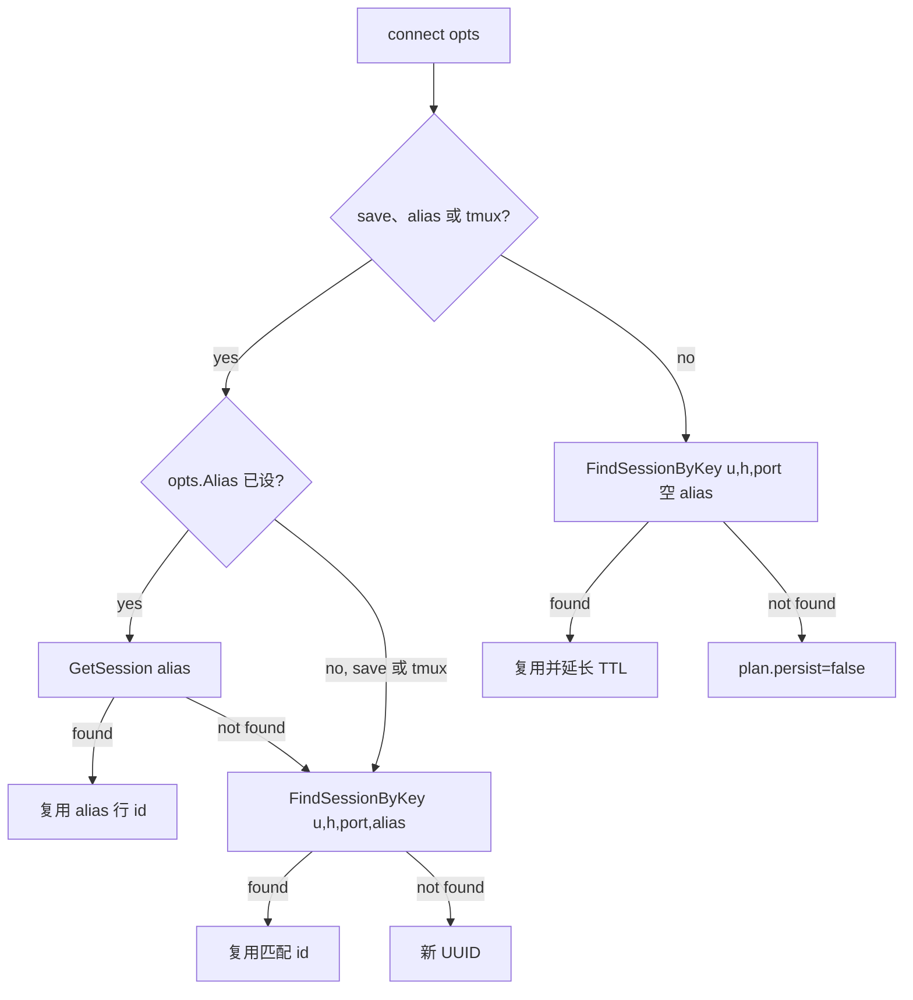

# aissh

> AiT SSH 工具指南：连接、会话持久化与文件传输。
>
> **命名：** 二进制 `aitssh`，插件命令 `ssh`（`ait ssh …`），Go 包名 `aissh`，文档标题 aissh。

## 目录

- [概述](#概述)
- [CLI 表面](#cli-表面)
- [快速开始](#快速开始)
- [命令参考](#命令参考)
- [本地 REPL 输入（UTF-8）](#本地-repl-输入utf-8)
- [提示符](#提示符)
- [安全与 SSH](#安全与-ssh)
- [AI 配置说明](#ai-配置说明)
- [会话内命令](#会话内命令)
- [数据目录](#数据目录)
- [错误提示](#错误提示)
- [限制](#限制)
- [代理链模式](#代理链模式)
- [相关文档](#相关文档)

---

## 概述

SSH：OpenSSH 风格连接（`-p`、`-i`、`-J`、`-o`）、会话持久化、可选 `--tmux`、会话内 `!ait`（无 AI）、`get`/`put`、本机 shell REPL（UTF-8 行编辑）。

AI 用 [`ait.md`](ait.md)（`ait agent`）。结构见 [`../architecture/overview.md`](../architecture/overview.md)；实现见 [`../architecture/aissh.md`](../architecture/aissh.md)。

---

## CLI 表面

```text
aitssh shell                                    # AiT> REPL（OpenSSH 风格连接、list/load 等）
aitssh                                          # 无参：根帮助（不是 SSH 连接）
aitssh [ssh-options] destination [command ...] [--save] [--alias NAME] [--password] [--tmux]
        # 兼容 OpenSSH：-p -l -i -F -J -o 等；destination 为 [user@]host 或配置 Host 别名
        # 需本机 OpenSSH 客户端（ssh -G）解析配置；数据面为 Go x/crypto/ssh
        # --save、--alias（命名保存，隐含 --save）或 --tmux（隐含 --save）会写入 SQLite
        # 连接键匹配时，也会更新已有空 alias 行（刷新 auth TTL）
        # 带 command：一次性执行（类似 ssh host cmd）；新主机需 --save 或 --alias 才会持久化
        # 遗留 --host/--user 仍支持，以保持兼容
aitssh session --list [-v]   # # 列为按序号选择；-v 增加 FULL_ID（完整 UUID）
aitssh session --load [<id|alias>] [--tmux] [--password]   # 省略 id 时在 TTY 上挑选；id 须为 alias 或完整 UUID（不是列表短 ID）
aitssh session --suspend         # 仅本机 CLI；SSH 内用 !ait suspend
aitssh session --switch [id|alias] [--tmux] [--password] [--force]  # 切换会话；省略 id 时在 TTY 上挑选
aitssh session --delete <id|alias|all> [--force]                     # 删除一条或全部已保存会话
aitssh get [ssh-flags] <paths...> [--session NAME] [--password P]
aitssh put [ssh-flags] <paths...> [--session NAME] [--password P]
        # --session 用已保存会话（路径可省略 user@host）；--password 写入 keyring
aitssh config init|view|edit|validate|set|get ...   # YAML 配置；edit 使用 $VISUAL/$EDITOR
aitssh version / aitssh -V                          # 版本
```

**连接解析**

- 首词 `login` 不当作 SSH 连接。
- `aitssh login ...` 与 shell 内 `login ...` 均为未知命令。

### 两种恢复模式（默认与 `--tmux`）

| 模式 | 触发 | `load` 行为 | 远程进程 |
|------|------|-------------|----------|
| 默认（书签） | 无 `--tmux` | 用已存连接信息重连；可选将已存 scrollback 载入内存（不重绘到终端） | 不保证保活 |
| tmux 保活 | connect/load 带 `--tmux` | SSH 之后：`tmux attach -t ait-<session_id>`（不存在则 `new -s`） | 断开后 shell/进程仍存活 |

### 连接持久化决策（连接键含 alias）



**持久化模型摘要**

- 会话身份键为 `username + host + port + alias`。
- 空 alias 与命名 alias 是不同记录。
- `--alias` 与 `--tmux` 各自隐含保存行为。
- `login_destination` 保存原始 destination 形式（例如 ssh config 的 Host 别名）。
- 纯 `aitssh user@host` 仅在匹配到已有**空 alias** 行时更新该行；否则为临时会话。

---

## 快速开始

```bash
# AI API 密钥（OS keyring；无头 Linux 上可为 <AppRoot>/keyring 下的加密文件）
# 首次 AI 配置（不是 aissh config）：
./bin/ait agent config init
# 无 D-Bus 的服务器上设置主密码：
export AIT_KEYRING_FILE_PASSWORD='your-secret'
./bin/ait agent config set ai.deepseek.api_key <your-key>
./bin/ait agent config set ai.minimax.api_key <your-key>   # 可选第二提供商
# 别名仍可用：deepseek.api_key、minimax.api_key

# 连接：完整旗标见帮助
./bin/aitssh --help

# 交互连接并持久化会话
./bin/aitssh deploy@example.com --alias prod
./bin/aitssh -p 22 -i ~/.ssh/id_ed25519 deploy@10.0.0.5
./bin/aitssh -J bastion app.internal

# 一次性远程命令（类似 ssh host cmd；新主机默认不持久化）
./bin/aitssh deploy@example.com uptime

# 列出、恢复、切换会话
./bin/aitssh session --list
./bin/aitssh session --list -v
./bin/aitssh session --load
./bin/aitssh session --load prod
./bin/aitssh session --switch staging

# 文件传输（OpenSSH 旗标；路径与旗标顺序任意）
./bin/aitssh get -p22 -i~/.ssh/id ./app.log user@deploy:/var/log/app.log
./bin/aitssh get deploy@10.0.0.5 /var/log/app.log ./app.log
./bin/aitssh get ./app.log /var/log/app.log --session prod
./bin/aitssh put -l root ./bin/app user@host:/usr/local/bin/app
```

可选模板引导：

```bash
./bin/aitssh config init
# 或从仓库根目录复制示例：
mkdir -p ~/.local/share/ait
cp configs/ait.example.yaml ~/.local/share/ait/config.yaml
```

---

## 命令参考

| 命令 | 说明 |
|------|------|
| `aitssh shell` | 本机交互 REPL（`AiT>`）：先内置命令，再 `<AppRoot>/bin`，再 `aitssh` CLI，再 PATH，最后窄范围连接路由。会话处于 active 时，连接与 load 会被阻断 |
| `aitssh [flags] destination` | OpenSSH 风格连接（`aitssh user@host`、`aitssh -J jump final`）；`--save`、`--alias` 或 `--tmux` 会持久化 |
| `aitssh session --list` | 列出已保存会话（`#` 显示列；`-v` 输出 `FULL_ID`） |
| `aitssh session --load [<id\|alias>]` | 恢复会话；省略 id 时在 TTY 上挑选（脚本须传 alias 或完整 UUID）；使用 alias 或完整 UUID，不要用列表短 ID |
| `aitssh session --suspend` | 本机 CLI 挂起；会话内用 `!ait suspend` |
| `aitssh session --switch [id\|alias]` | 切换会话；省略 id 时在 TTY 上挑选；当前仍为 active 时会被阻断，除非 `--force` |
| `aitssh session --delete <id\|alias>` | 删除一条会话 |
| `aitssh session --delete all` | 删除全部会话（除非 `--force`，否则需确认） |
| `aitssh get [flags] <paths...>` | 下载单个文件；可用 `--session` |
| `aitssh put [flags] <paths...>` | 上传单个文件；可用 `--session` |
| `aitssh config init [--dry-run]` | 创建或合并 `config.yaml` 中缺失的键（补齐缺失的 `session.*`） |
| `aitssh config view` | 打印配置 YAML（缺失时会创建） |
| `aitssh config edit` | 打开编辑器（`$VISUAL`/`$EDITOR`）并校验 |
| `aitssh config validate` | 校验 YAML 与 session/SSH 取值；出错时非零退出。`ai.*` 语义校验用 `ait agent config validate` |
| `aitssh config set/get <key>` | 读写 session 配置值；拒绝 `ai.*` |
| `aitssh version` / `-V` | 打印版本 |

常用旗标：

- `--tmux` 远程保活模式（隐含 `--save`）
- `--port`、`--identity`、`--password`、`--alias`
- `get`/`put`：`--session NAME`（已保存会话）、`--password P`
- `session --switch --force` 用于当前会话仍为 active 时强制切换

---

## 本地 REPL 输入（UTF-8）

本地 REPL 行为适用于 `aitssh shell`。

### 平台支持

- macOS/Linux：设置 UTF-8 locale，例如 `LANG=en_US.UTF-8`
- Windows：优先 Windows Terminal；设置 UTF-8（遗留控制台可用 `chcp 65001`）
- IME 组字由终端处理；提交后的文本以 UTF-8 字节到达

### 编辑与按键

- Ctrl+A / Ctrl+E：移到行首/行尾
- Left/Right：移动光标
- Up/Down：历史召回
- Ctrl+R：反向增量历史搜索
- Ctrl+U/Ctrl+K/Ctrl+W：删除整行/到行尾/一词
- Backspace、Tab 插入
- Ctrl+C：取消当前行
- Ctrl+D：空行时退出
- Ctrl+L：清屏并在 TTY 上重绘提示符与缓冲

### 历史

- 历史记录的是命令输入历史。
- 确认提示（`[y/N]`）、选择器输入与内部 setup 行不会污染命令历史。
- 历史跨会话保存在 `<AppRoot>/repl_history`（权限 `0600`）。
- `history` 命令支持类 bash 子集：列表、`history n`、`-c`、`-d`、`-s`、`-a`、`-r`、`-w`。

### 清屏行为

- `aitssh shell`：`clear` 命令与 Ctrl+L 会清除终端显示。

### 范围边界

- SSH 会话编辑（顶层 connect/load）使用远程 shell 编辑。
- `!ait local` 在远程会话隧道内使用本地 shell 编辑。

---

## 提示符

| 上下文 | 提示符 |
|--------|--------|
| `aitssh shell` | `AiT> ` |
| SSH 远程 | `AiT user@host:dir[:git-branch]> ` |
| SSH 嵌套 | 在当前活动嵌套主机上使用相同格式 |
| `!ait local` | `AiT Local> ` |

路径显示由 `session.remote_prompt.path` 控制：

- `short`（默认）：末级路径段
- `absolute`：完整路径，并用 `~` 替换家目录

连接/加载后的预期体验：

- `aitssh user@host` 或 `aitssh session --load` 之后，应立即出现远程 `AiT user@host:...>` 提示符。
- 不必再按一次 Enter 才能看到首条提示符。
- 默认由 AiT 管理远程提示符。设置 `AIT_REMOTE_SYSTEM_PROMPT=1` 可保留远程 shell 原生提示符（meta/`!ait` 仍可用；嵌套 `ssh` 仍会自动开启 chain 模式）。

---

## 安全与 SSH

- 默认启用 known-host 校验（`~/.ssh/known_hosts`）。
- 新主机请先添加密钥再连接（例如 `ssh-keyscan -H host >> ~/.ssh/known_hosts`）。
- `AIT_SSH_INSECURE=1` 仅开发用，勿用于生产。
- `--password` 可能出现在进程列表中；优先使用 keyring 与交互式密钥输入。

凭据存储模型：

- SSH 密钥与 AI API 密钥（供 `ait` / `ait agent`）：由 keyring 承载
- SQLite 存元数据与密钥路径，不存明文 SSH 密码
- 无头环境下可回退到 `<AppRoot>/keyring` 下的加密文件 keyring

---

## AI 配置说明

`aitssh` 不跑 AI。Agent Loop / 远程会话 / `ai.*` 配置走 `ait` / `ait agent` / `ait agent connect` / `ait agent config`（见快速开始与 [`ait.md`](ait.md)）。AI 默认开；关：`ait agent config set ai.experimental.enabled false` 或 `AIT_AI_EXPERIMENTAL=0`。`aitssh config set`/`get` 拒绝 `ai.*`。

`aitssh config init` 补齐缺失的 `session.*`。文件尚不存在时，Save 前 `normalizeAI` 可能写出默认 `ai:` 段；语义校验用 `ait agent config validate`。

---

## 会话内命令

SSH 内的元命令前缀是 `!ait`（不是 `!aitssh`）。`!!` 不是 AI 入口（适用场景下会转发到远程 PTY）。

| 输入 | 行为 |
|------|------|
| `!ait` / `!ait help` | 打印会话内帮助 |
| `!ait <subcmd> ...` | 运行支持的本机 `aitssh` 子命令（如 `config get …`） |
| `!ait [flags] dest` | 必要时自动持久化，挂起当前，再连接目标 |
| `!ait load [id\|alias]` | 必要时自动持久化，挂起当前，再加载目标 |
| `!ait session --switch [id\|alias]` | 必要时自动持久化，挂起当前，再切换 |
| `!ait session --delete …` | 删除已保存会话（同 CLI） |
| `!ait local` | 进入本机模式 |
| `!ait remote` | 离开本机模式 |
| `!ait suspend` | 挂起当前会话 |
| `!ait get <remote> [local]` | 经当前 SSH 连接下载 |
| `!ait put <local> [remote]` | 经当前 SSH 连接上传 |
| `!ait chain` | 打印当前 chain 状态 |
| `!ait chain on\|off` | 开关 chain 模式 |
| `!ait ai …` | 未知命令 + Try（指向 `ait agent`）；会话内无 AI |

检测与路由说明：

- meta 行在字节级扫描，不会进入远程 shell stdin
- `!ait list` 会改写为 `session --list`
- `!!` 不是 AI 入口；适用时转发到远程 PTY

---

## 数据目录

全部运行时文件位于同一 `AppRoot` 目录。

| 平台 | 默认 `AppRoot` |
|------|----------------|
| Linux | `~/.local/share/ait/` |
| macOS | `~/Library/Application Support/ait/` |
| Windows | `%LOCALAPPDATA%\ait\` |

覆盖顺序：

- 优先非空 `AIT_HOME`
- 否则非空 `AIT_DATA_DIR`
- 空字符串忽略，回退到上述 OS 默认

运行时布局：

```text
<AppRoot>/
├── config.yaml       # 主 YAML 配置
├── ait.db            # SQLite 会话库
├── repl_history      # aitssh shell 输入历史
├── ait_repl_history  # ait shell（工具箱）输入历史（文件名不同）
├── scrollback/       # 每会话 scrollback 侧车文件
├── keyring/          # 加密文件 keyring 回退
└── bin/              # 用户 shell 扩展二进制
```

可选：`ai.providers.ollama.models_dir` 可指向如 `<AppRoot>/ollama/models` 的本地模型目录；未配置则不要求该路径存在。

操作说明：

- `aitssh config init` 创建或合并缺失的配置键（补齐 `session.*`；新建文件时经 `normalizeAI` 仍可能写出默认 `ai:`）。
- `aitssh config view` 打印当前配置（缺失时会创建）。
- `aitssh config edit` 打开编辑器，保存时校验。
- `aitssh config validate` 检查文件能否反序列化，以及 session/SSH 取值是否合法。文件中任意处的类型错误（例如 `ai.experimental.enabled: "not-a-bool"`）会使该命令失败。`ai.*` 的语义检查（提供商 URL、agent 超时等）由 `ait agent config validate` 执行。错误的 `session.remote_prompt.path` 会使 `aitssh config validate` 失败，且会被 `ait agent config validate` 忽略。`set`/`get` 拒绝 `ai.*`。

---

## 错误提示

多数校验与路由错误带多行 `Try:` 块。

| 情形 | 典型提示 |
|------|----------|
| `session --load` 使用列表短显示 ID | 显示 ID 不是加载目标；用 alias 或完整 UUID（`-v`） |
| `session --switch` 时当前会话仍附着 | 在会话内挂起（`!ait suspend`）或使用 `--force` |
| 未知配置键 | 提示合法键路径与 config get/set 示例 |
| `config validate` 失败 | 含字段路径与原因 |
| validate 时缺少配置文件 | 先运行 `aitssh config init` |
| `config edit` 找不到编辑器 | 设置 `EDITOR` / `VISUAL` |

排版行为：

- CLI stderr 保留结构化消息与 `Try:` 示例
- 在 TTY 上，多行格式经 CRLF 安全输出路径保留

---

## 限制

- 无 `--tmux` 时，不保证远程进程在挂起/断开后仍存活。
- `aitssh get` 与 `aitssh put` 为单文件传输（不递归目录）。
- 会话内 `!ait put` 的本地路径在 AiT 客户端机器上，不是远程 cwd。
- 进度在 TTY 上行内刷新；非 TTY 仍分阶段，无行内刷新。
- chain ZMODEM 依赖远程 `lrzsz`（`sz`、`rz`）在 chain 模式下可用。
- `get`/`put` 不支持 `-L`/`-R`/`-D` 等转发类 OpenSSH 旗标（见各命令 `--help`）。
- 极大的 scrollback 捕获会增加内存与侧车 I/O 开销。
- Windows 的 PTY 与 shell 组合可能存在环境相关边界情况。
- `aitssh shell` 内置 `ll`（类 `ls -la`）；顶层 `aitssh ll` 与会话内 `!ait` 无此内置。

风险关注项：

- chain 模式传输可靠性依赖活动 shell 与远程工具行为
- 超大 scrollback 会话会影响回放与清理成本
- 跨 shell 提示符行为（尤其定制 zsh 主题）仍可能需要环境调优

---

## 代理链模式

连接时的 `ProxyJump` 与会话内 chain 模式不是同一概念。

### 直连路径

- `aitssh -J jump final` 经跳板链拨号到终跳（兼容 OpenSSH：每个 `-J` hop 经 `ssh -G` 解析，包括如 `devhost` 的 Host 别名）。
- jump SSH 客户端在终跳连接存活期间保持打开（直连 tcpip 转发需要）。
- 对这一直接拨号目标，会话内传输优先走直连路径行为。

### chain 模式触发

chain 模式：会话内再嵌套 `ssh` 之后的更深一跳。

- 嵌套 `ssh` 稳定后（MOTD/提示符安静，包括空闲 shell），AiT 会更新活动主机并自动打开 chain
- 若活动 shell 主机与拨号目标不同，`!ait get`/`!ait put` 可自动开启 chain 模式
- 手动控制：`!ait chain on` / `!ait chain off`；无参 `!ait chain` 打印状态

### chain 模式效果

- 传输后端切换为 PTY 管道注入路径
- tmux 远程操作也经 PTY 注入路由
- scrollback 在直连与 chain 两种状态下均可工作

### 要求

- chain 模式下活动 shell 需要 `lrzsz`（`sz`、`rz`）才能做 ZMODEM 传输
- 若缺失，AiT 可提供安装提示与交互式 `[y/N]` 安装流程

传输路由摘要（与实现一致）：

- 直连（非 chain）：默认走 SFTP
- 链式：优先 ZMODEM（需 `lrzsz`）；失败不回退 SFTP
- 链式缺 `lrzsz` 时可提示安装；非 TTY 仅给手动指引

---

## 相关文档

| 文档 | 说明 |
|------|------|
| [`../architecture/overview.md`](../architecture/overview.md) | AiT 工具箱项目结构 |
| [`../architecture/aissh.md`](../architecture/aissh.md) | 包分层、工作流与源码地图 |
| [`ait.md`](ait.md) | Agent Loop / `ait agent` |
| [`../../AGENTS.md`](../../AGENTS.md) | 代码库导向与包职责 |
| [`../../CONTRIBUTING.md`](../../CONTRIBUTING.md) | 开发流程与编码规范 |
| [`../../README.md`](../../README.md) | 项目概览与安装 |
