# aitssh internals

> Code layout, package rules, and implementation workflows for contributors.

## Table of contents

- [Overview](#overview)
- [Layer diagram](#layer-diagram)
- [Call chain and argv routing](#call-chain-and-argv-routing)
- [Technology stack](#technology-stack)
- [Package layering](#package-layering)
- [Runtime AppRoot layout](#runtime-approot-layout)
- [Workflows](#workflows)
- [Data model (SQLite)](#data-model-sqlite)
- [Package layout](#package-layout)
- [Module interaction matrix](#module-interaction-matrix)
- [Where to start reading](#where-to-start-reading)
- [Further reading](#further-reading)

---

## Overview

This document is the implementation reference for `aitssh`: where code lives, how argv routes, package boundaries, and end-to-end workflows with source pointers.

| Document | Audience |
|----------|----------|
| [`../architecture.md`](../architecture.md) | AiT toolbox structure (no tool-specific implementation) |
| [`aitssh.md`](aitssh.md) | End-user CLI guide (commands, prompts, behavior) |
| [`../../AGENTS.md`](../../AGENTS.md) | Agent-oriented build/test orientation |
| [`.cursor/rules/package-layering.mdc`](../../.cursor/rules/package-layering.mdc) | Cursor rule summary (keep in sync with [Package layering](#package-layering)) |

---

## Layer diagram

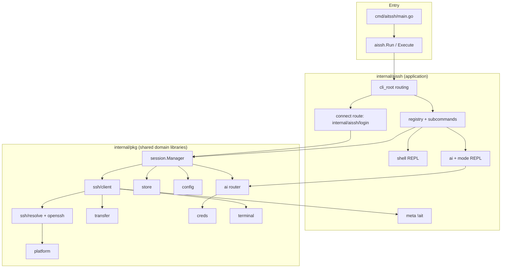

---

## Call chain and argv routing

Top-level argv flow:

```text
cmd/aitssh/main.go      -> minimal main; delegates to aissh.Run
internal/aissh          -> package aissh: Run, Execute, NewManager, root wiring
internal/aissh/<cmd>    -> one package per top-level command (closed loop)
internal/pkg/*          -> shared module-private libraries
pkg/*                   -> external import libraries only
```

Routing surfaces:

| Input | Handler | Notes |
|-------|---------|-------|
| `aitssh` with no args | Root help via `ExecuteWriters` | Not an implicit SSH connect |
| `aitssh [flags] destination` | `internal/aissh/login` connect route | Not a registered Cobra subcommand |
| `aitssh <registered-cmd> …` | Cobra tree via `registry` | Subcommands register in `init()` |
| `aitssh shell` REPL line | `shell` dispatch chain | Builtins → `AppRoot/bin` → Cobra → PATH → connect route |

Directory/package note:

- Root app lives at `internal/aissh/` with Go package `aissh`.
- Registered command packages should match Cobra command names (`shell`, `session`, `ai`, `config`, …).
- `internal/aissh/login/` is the SSH connect route package (not a registered Cobra top-level command).

Key files: [`../../internal/aissh/cli_root.go`](../../internal/aissh/cli_root.go), [`../../internal/aissh/root.go`](../../internal/aissh/root.go), [`../../internal/pkg/cliroute/route.go`](../../internal/pkg/cliroute/route.go).

---

## Technology stack

Source of truth for versions and upgrades: [`go.mod`](../../go.mod).

| Topic | Choice | Why |
|---|---|---|
| CLI framework | `spf13/cobra` | Predictable command tree and help integration |
| SQLite driver | `modernc.org/sqlite` | Pure Go (no CGO), easier cross-platform builds |
| SSH stack | `golang.org/x/crypto/ssh` | Standard Go SSH implementation |
| Local PTY | Unix `creack/pty`, Windows ConPTY path | OS-native interactive behavior |
| AI providers | Deepseek + MiniMax + optional Ollama | Cloud routing with optional local-first tier |
| Secret storage | OS keyring + fallback keyring dir | Avoid plaintext credentials in SQLite |
| Host key policy | `known_hosts` by default | Align with OpenSSH trust model |

---

<a id="package-layering"></a>
## Package layering

This section defines where `aitssh` code belongs and how to keep extension points open without breaking dependency flow.

### Call chain (summary)

See [Call chain and argv routing](#call-chain-and-argv-routing) above.

### Subcommand closure

Each registered top-level subcommand should be self-contained under `internal/aissh/<cmd>/`.

| Concern | Typical file |
|---|---|
| Command name constants | `name.go` or `cmd.go` |
| Flags | `flags.go` |
| Parsing | `parse.go` |
| Cobra wiring | `cmd.go` |
| Help body | `help.go` |
| Runtime execution | `run.go` |
| Registration | `register.go` |

Do not create names-only helper packages for command constants under `internal/pkg`.

### `internal/aissh` responsibilities

`internal/aissh` owns application composition:

- root command creation and execution entrypoints
- manager bootstrap (`NewManager`)
- registry attachment (`AttachRoot`)
- init hooks for shell/meta/AI integration
- top-level route decisions (default SSH connect vs Cobra command tree)

### `internal/pkg` responsibilities

`internal/pkg/*` is for reusable logic shared across command packages:

- storage (`store`), lifecycle manager (`session`), transport (`ssh/client`)
- config, credentials, terminal, transfer, AI router
- shared parsing/mechanics that are not owned by a single command package

Import rule:

- `internal/pkg` must not import `internal/aissh`.

### `pkg` responsibilities

`pkg/*` is for external consumers and should stay generic.  
AiT product behavior should remain in `internal/*`.

### `helpdoc` split

- Shared help builders live in `internal/pkg/helpdoc`.
- Command-specific help text/flags remain in each command package `help.go`.
- Root and nested help lists should come from registry/subregistry entry collections.

### Package naming rules

- Use command-name package names where possible (`shell`, `ai`, `session`, `config`).
- Keep the root package exception: directory `internal/aissh`, package `aissh`.
- Keep the connect-route exception: `internal/aissh/login` for default SSH route.
- Avoid `*cmd` package suffixes.
- Keep AI REPL implementation under `internal/aissh/ai/mode`.

### Nested subcommands

Nested command trees follow the same closure pattern:

- `aitssh ai` -> `ask`, `agent`, `provider`, `ollama`
- `aitssh ai provider` -> `enable`, `disable`
- `aitssh ai ollama` -> `status`, `setup`, `start`, `stop`, `disable`
- `aitssh config` -> `set`, `get`, `init`, `view`, `edit`, `validate`

Children register via parent subregistry packages, not by hand-appending long `AddCommand` lists.

### Shared extraction guidelines

Extract to shared packages when behavior is truly cross-command:

- OpenSSH argv mechanics
- transfer parsing reused by both `get` and `put`
- common terminal/error/help primitives

Keep command-specific flags and user-facing semantics inside the owning command package.

### Command entry surfaces

`aitssh` has three distinct entry surfaces:

| Surface | Mechanism | Extension point |
|---|---|---|
| Cobra command tree | `registry` and nested `subregistry` | add command package + register + blank import |
| Shell builtins (`aitssh shell`) | shell builtin registry | add builtin constant + handler |
| SSH meta / AI mode | meta and AI mode executors | add meta verb handling in the relevant executor |

Special case:

- `aitssh ai model list` is a supported positional path and must keep behavior documented at [`aitssh.md#ai-mode`](aitssh.md#ai-mode) (R15 expectation).

### `clihints` as shared try-lines source

Try-line examples for reusable hints should stay centralized in `internal/pkg/clihints` so command packages and shared packages do not drift.

### Extending commands (open-closed)

When adding top-level commands:

1. Create `internal/aissh/<cmd>/` with closure files and `register.go`.
2. Register via `registry.Register` in `init()`.
3. Wire blank imports in registry import aggregator.
4. Avoid touching unrelated command packages.

Nested commands follow the same pattern under the parent command tree.

### Package layering checklist

- [ ] New/updated command package is self-contained (`flags`, `parse`, `help`, `run`, `register`)
- [ ] Registration uses registry/subregistry, not ad-hoc root command edits
- [ ] `internal/pkg` contains only shared logic and does not import `internal/aissh`
- [ ] `cmd/aitssh/main.go` remains thin
- [ ] Help content split remains `helpdoc` shared + per-command `help.go`
- [ ] `clihints` try lines remain single-source
- [ ] Behavior/regression gates remain aligned with [`change-acceptance.mdc`](../../.cursor/rules/change-acceptance.mdc)

---

## Runtime AppRoot layout

All runtime files live under `AppRoot` (`platform.AppRoot()`), overridable by `AIT_HOME`.

```text
<AppRoot>/
├── config.yaml       # YAML config
├── ait.db            # SQLite data store
├── repl_history      # REPL input history (0600)
├── scrollback/       # Session scrollback sidecars
├── keyring/          # File keyring fallback
├── bin/              # User shell extensions
└── ollama/models/    # Default local model directory hint
```

Defaults:

- Linux: `~/.local/share/ait`
- macOS: `~/Library/Application Support/ait`
- Windows: `%LOCALAPPDATA%\ait`

---

## Workflows

This section captures end-to-end behavior used most often in production usage.

### 1) SSH connect sequence

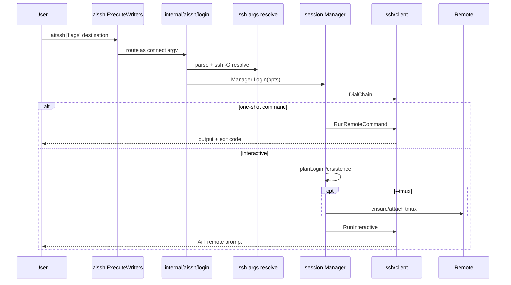

### 2) Connect persistence flow

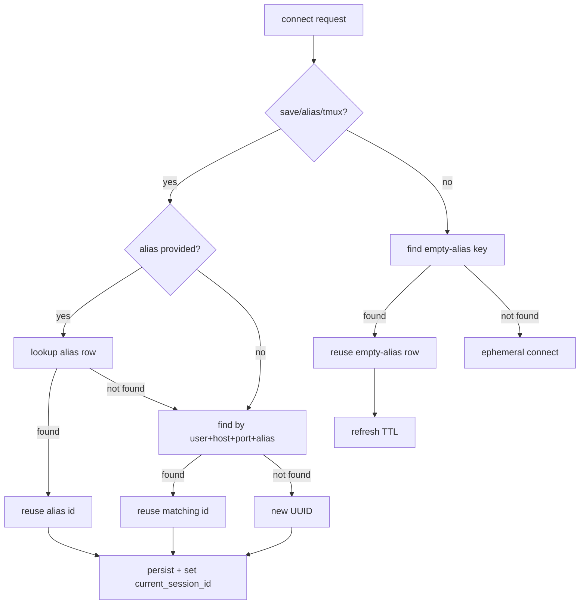

### 3) Shell REPL dispatch (text + flow)

Dispatch order in `aitssh shell`:

1. builtin commands
2. `<AppRoot>/bin/<name>`
3. `aitssh` CLI subcommands
4. system PATH fallback
5. narrow SSH connect route
6. not-found hint

`login` is never treated as connect route first token.

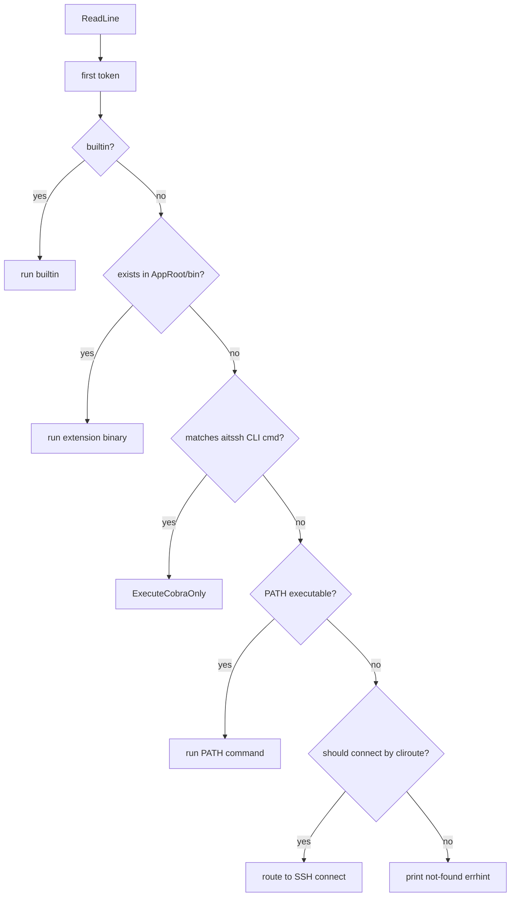

### 4) Session lifecycle, TTL, and switch

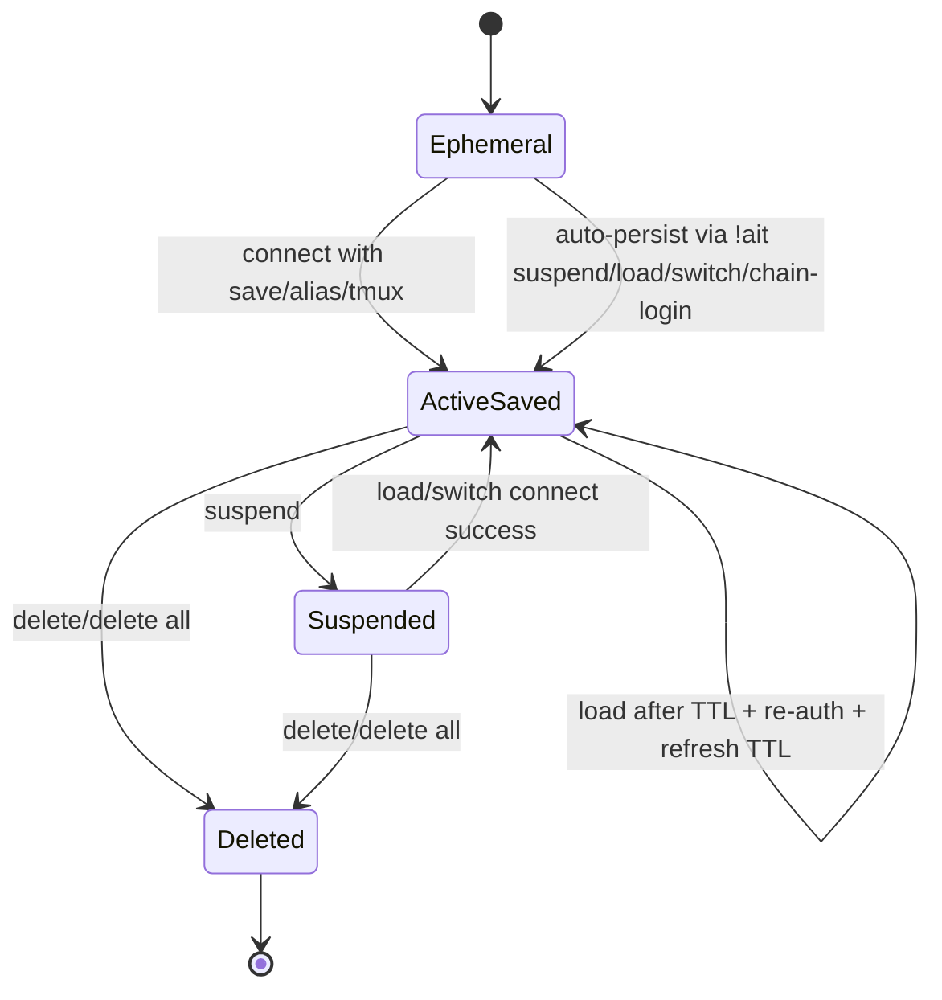

Switch behavior:

- standalone local `session --switch` blocks when current session is active, unless `--force`
- in-session `!ait session --switch` auto-persists/suspends current session before switching
- no-target switch/load uses interactive picker

### 5) Local mode flow (`!ait local` / `!ait remote`)

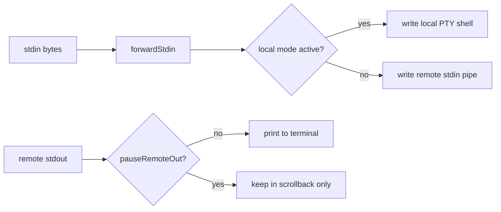

Notes:

- SSH tunnel remains active during local mode
- prompt changes to `AiT Local>`
- remote output is paused from display while local mode active

### 6) In-session meta protocol (`!ait`, `!!`)

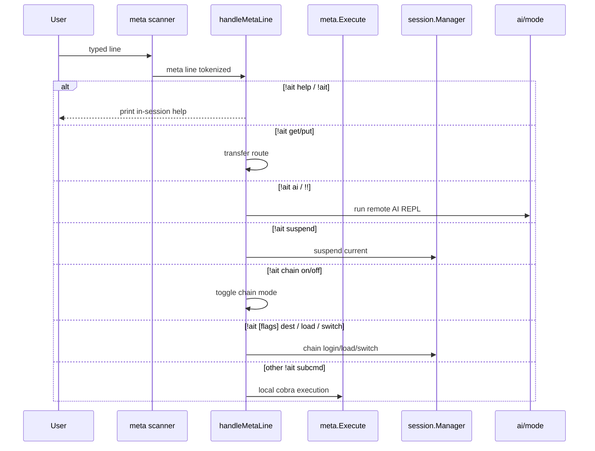

### 7) AI dual scope workflow

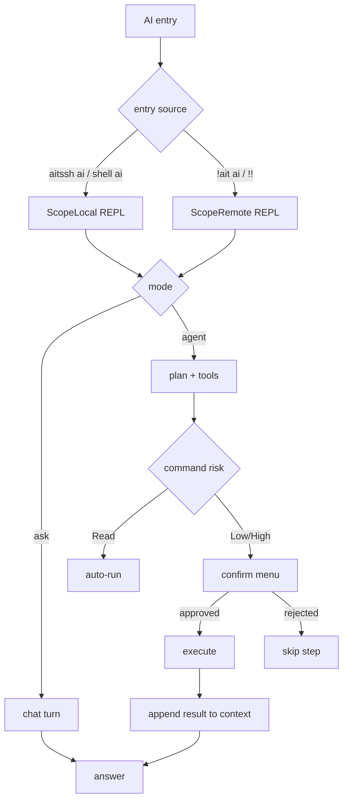

### 8) Get/put transfer workflow

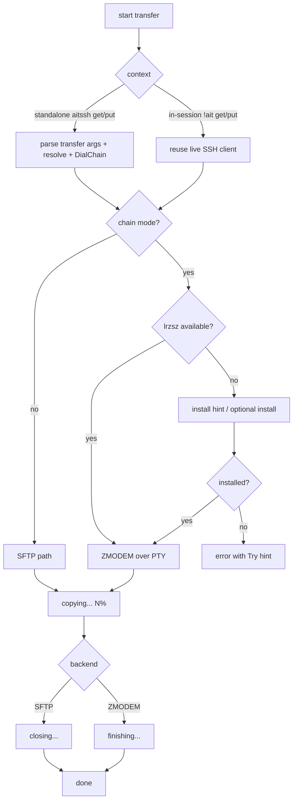

### 9) Remote prompt pipeline

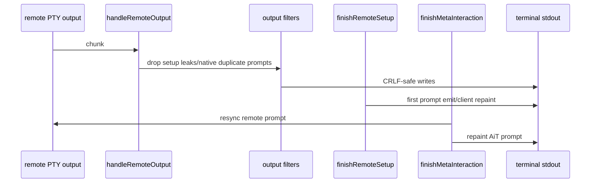

Key behavior:

- setup output filtering prevents PS1 injection leaks
- first prompt is shown without requiring Enter
- meta completion repaint path prevents fallback to native shell prompt when AiT prompt is managed

### 10) tmux keep-alive flow (`--tmux`)

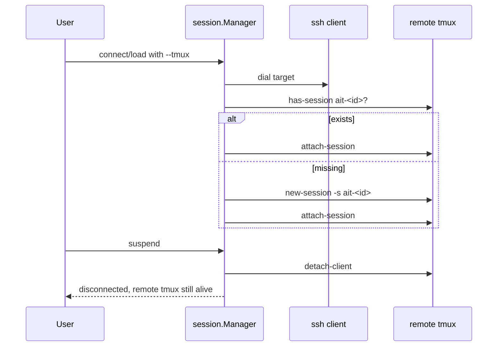

### 11) Proxy chain mode workflow

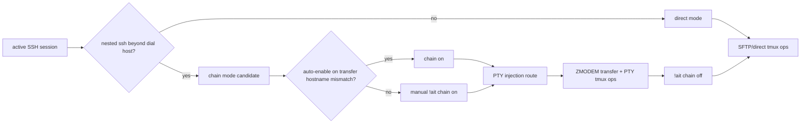

---

## Data model (SQLite)

Database file: `<AppRoot>/ait.db`.

```sql
CREATE TABLE sessions (
  id              TEXT PRIMARY KEY,
  alias           TEXT UNIQUE,
  host            TEXT NOT NULL,
  port            INTEGER NOT NULL DEFAULT 22,
  username        TEXT NOT NULL,
  identity_path   TEXT,
  auth_method     TEXT NOT NULL,       -- key | password | agent
  auth_expires_at INTEGER NOT NULL,    -- unix seconds
  tmux_enabled    INTEGER NOT NULL DEFAULT 0,
  tmux_session    TEXT,
  created_at      INTEGER NOT NULL,
  updated_at      INTEGER NOT NULL,
  status          TEXT NOT NULL        -- active | suspended
);

CREATE TABLE session_state (
  session_id      TEXT PRIMARY KEY REFERENCES sessions(id) ON DELETE CASCADE,
  cols            INTEGER,
  rows            INTEGER,
  remote_cwd      TEXT,
  scrollback_path TEXT,
  suspended_at    INTEGER
);

CREATE TABLE app_meta (
  key   TEXT PRIMARY KEY,
  value TEXT NOT NULL
);
```

Core fields and meanings:

- `login_destination`: persisted in session metadata for reconnect resolution parity
- `auth_expires_at`: credential-free reconnect window cutoff
- `tmux_enabled` + `tmux_session`: remote keep-alive configuration
- `status`: `active` / `suspended`
- `app_meta.current_session_id`: currently active foreground session

---

## Package layout

| Path | Responsibility | Representative files |
|------|----------------|----------------------|
| [`../../internal/aissh/`](../../internal/aissh/) | CLI entry and root routing | `root.go`, `cli_root.go`, `manager.go`, `init_hooks.go` |
| [`../../internal/aissh/registry/`](../../internal/aissh/registry/) | top-level command registry | `registry.go`, `root_help.go`, `all/imports.go` |
| [`../../internal/pkg/helpdoc/`](../../internal/pkg/helpdoc/) | shared CLI help layout | `body.go`, `bind.go`, `common.go` |
| [`../../internal/aissh/login/`](../../internal/aissh/login/) | default connect route adapter | `run.go`, `help.go` |
| [`../../internal/aissh/shell/`](../../internal/aissh/shell/) | `aitssh shell` REPL and dispatch | `repl.go`, `exec.go`, `exec_dispatch.go` |
| [`../../internal/aissh/session/`](../../internal/aissh/session/) | session command surface | `cmd.go`, `flags.go`, `run.go` |
| [`../../internal/aissh/meta/`](../../internal/aissh/meta/) | in-session local CLI execution | `exec.go` |
| [`../../internal/aissh/ai/`](../../internal/aissh/ai/) | AI command tree | `cmd.go`, `help.go`, `register.go` |
| [`../../internal/aissh/ai/mode/`](../../internal/aissh/ai/mode/) | AI REPL runtime | `repl.go`, `exec.go`, `run_local.go` |
| [`../../internal/pkg/session/`](../../internal/pkg/session/) | connect/load/switch/suspend orchestration | `manager.go`, `manager_login.go`, `manager_helpers.go` |
| [`../../internal/pkg/store/`](../../internal/pkg/store/) | SQLite storage + migrations | `store.go`, `store_sessions.go`, `store_meta.go`, `open_helpers.go` |
| [`../../internal/pkg/ssh/args/`](../../internal/pkg/ssh/args/) | SSH argv parsing and `ssh -G` resolve | `parse.go`, `resolve.go` |
| [`../../internal/pkg/ssh/client/`](../../internal/pkg/ssh/client/) | dial, interactive PTY, meta, prompt, transfer, injection | `client.go`, `client_dial.go`, `dialchain.go`, `transfer_zmodem.go` |
| [`../../internal/pkg/ssh/client/meta/`](../../internal/pkg/ssh/client/meta/) | byte-level meta scanner | `scanner.go` |
| [`../../internal/pkg/ssh/client/localmode/`](../../internal/pkg/ssh/client/localmode/) | local shell in SSH session | `shell.go` |
| [`../../internal/pkg/ssh/client/prompt/`](../../internal/pkg/ssh/client/prompt/) | prompt format and setup scripts | `prompt.go` |
| [`../../internal/pkg/terminal/`](../../internal/pkg/terminal/) | line edit, history, CRLF, screen helpers | `lineedit`, `history`, `crlf`, `screen`, `scrollback` |
| [`../../internal/pkg/tmux/`](../../internal/pkg/tmux/) | remote tmux operations | `remote.go`, `remote_pty.go` |
| [`../../internal/pkg/transfer/`](../../internal/pkg/transfer/) | standalone SFTP transfer | `transfer.go`, `parse.go`, `path_defaults.go` |
| [`../../internal/pkg/transfer/route/`](../../internal/pkg/transfer/route/) | in-session transfer backend routing | route helpers |
| [`../../internal/pkg/transfer/zmodem/`](../../internal/pkg/transfer/zmodem/) | zmodem protocol engine | receive/send/session files |
| [`../../internal/pkg/lrzsz/`](../../internal/pkg/lrzsz/) | remote lrzsz probe/install helpers | probe/install files |
| [`../../internal/pkg/ai/`](../../internal/pkg/ai/) | provider routing and chat facade | `chat.go`, `router`, `models`, provider clients |
| [`../../internal/pkg/config/`](../../internal/pkg/config/) | config load/save/validate/init | `config.go`, `config_load.go`, `config_validate.go` |
| [`../../internal/pkg/platform/`](../../internal/pkg/platform/) | app-root paths, editor and OpenSSH helpers | `paths_appdir.go`, `editor.go`, `openssh.go` |
| [`../../internal/pkg/creds/`](../../internal/pkg/creds/) | keyring abstraction | `keyring.go` |
| [`../../configs/ait.example.yaml`](../../configs/ait.example.yaml) | example config template | YAML sample |

---

## Module interaction matrix

| Caller | Callee | Why |
|--------|--------|-----|
| `internal/aissh/login` | `internal/pkg/session` | connect route delegates orchestration |
| `internal/pkg/session` | `internal/pkg/ssh/args` | parse/resolve OpenSSH-compatible options |
| `internal/pkg/session` | `internal/pkg/store` | persist session lifecycle state |
| `internal/pkg/session` | `internal/pkg/ssh/client` | dial and interactive execution |
| `internal/pkg/ssh/client` | `internal/aissh/meta` | in-session local CLI execution |
| `internal/pkg/ssh/client` | `internal/aissh/ai/mode` | remote AI REPL runtime |
| `internal/aissh/shell` | `internal/aissh` root/cobra runner | dispatch to local CLI subcommands |
| `internal/pkg/ssh/client` | `internal/pkg/transfer` / transfer route | transfer path selection and execution |
| `internal/pkg/ai` | `internal/pkg/config` + `internal/pkg/creds` | provider config + key retrieval |
| `internal/pkg/ssh/client` | `internal/pkg/tmux` | keep-alive tmux integration |

---

## Where to start reading

| Task | Start here |
|------|------------|
| Add a top-level command | `../../internal/aissh/<cmd>/register.go` and `../../internal/aissh/registry/all/imports.go` |
| Change connect flag behavior | `../../internal/pkg/ssh/openssh/login_parse.go` and `../../internal/aissh/login/help.go` |
| Adjust persistence logic | `../../internal/pkg/session/manager_login_persist_helpers.go` |
| Understand interactive SSH loop | `../../internal/pkg/ssh/client/client.go` (`RunInteractive`) |
| Trace in-session meta handling | `../../internal/pkg/ssh/client/client_interactive_helpers.go` |
| Modify shell dispatch precedence | `../../internal/aissh/shell/exec_dispatch.go` |
| Modify AI REPL verbs and policy | `../../internal/aissh/ai/mode/exec.go` and `../../internal/aissh/ai/mode/repl.go` |
| Adjust root argv routing | `../../internal/aissh/cli_root.go` and `../../internal/pkg/cliroute/route.go` |
| Understand transfer backend decisions | `../../internal/pkg/ssh/client/transfer_route.go` |
| Understand prompt setup and repaint | `../../internal/pkg/ssh/client/client_init_helpers.go` and prompt helpers |

---

## Further reading

| Document | Description |
|----------|-------------|
| [`../architecture.md`](../architecture.md) | AiT toolbox project structure |
| [`aitssh.md`](aitssh.md) | Operator-facing CLI guide |
| [`../../AGENTS.md`](../../AGENTS.md) | Codebase orientation and package responsibilities |
| [`../../CONTRIBUTING.md`](../../CONTRIBUTING.md) | Development workflow and coding standards |
| [`../../README.md`](../../README.md) | Project overview and setup |
| [`../../go.mod`](../../go.mod) | Dependency and module version source |
